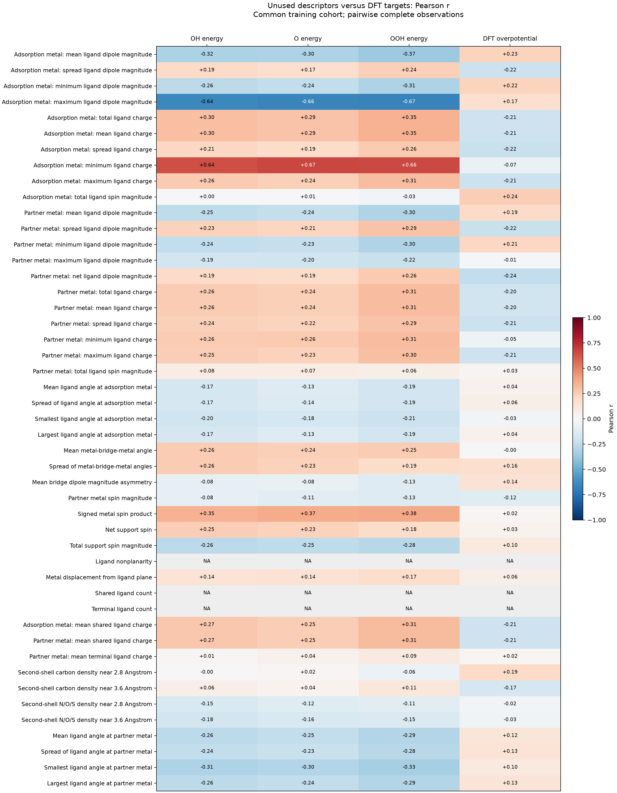
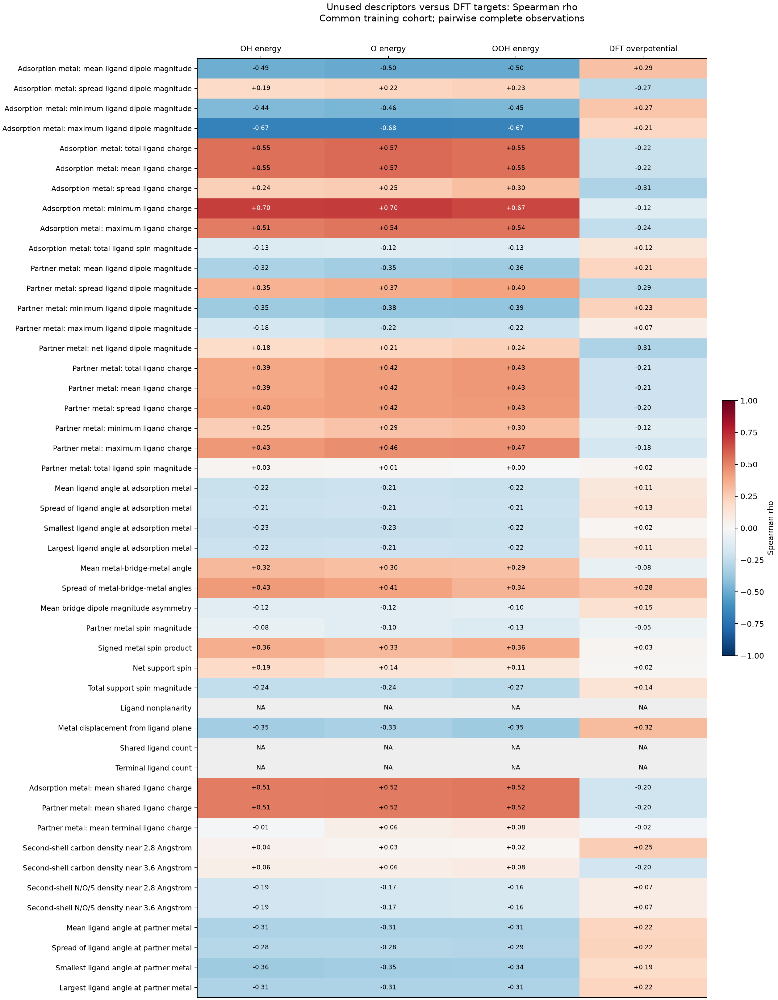

# Available descriptor correlations with DFT targets

This analysis covers **47 unused candidate descriptors** and the **8 current inputs**. It reports associations with OH, O and OOH energies and same-site DFT-based ORR overpotential. The model fits and descriptor selection are unchanged.

The main tables use the same **70 training sites in 50 structures** for every target. Validation sites are excluded from the main tables. Only finite, raw-verified target values and finite raw descriptor values enter each correlation. There is no median imputation; counts may vary by descriptor.

Pearson r measures linear association. Spearman rho measures monotonic association using average ranks for ties. Values range from -1 to +1; the sign indicates direction. A correlation does not measure the independent contribution of a descriptor in a multiple-input model, and does not establish a physical mechanism.

$$
r_{xy}=\frac{\sum_i(x_i-\overline x)(y_i-\overline y)}{\sqrt{\sum_i(x_i-\overline x)^2\sum_i(y_i-\overline y)^2}},\qquad \rho_{xy}=r_{\operatorname{rank}(x),\operatorname{rank}(y)}.
$$

`NA` means fewer than three pairs or a constant/numerically constant descriptor or target. Numerical constancy is a range no larger than $10^{-12}\max(1,\max|x|)$. The CSV includes a 95% structure-bootstrap interval for Pearson r, using 2,000 resamples with both sites from a structure resampled together. These intervals describe exploratory sampling variation; they do not correct for inspecting many descriptor-target pairs.

## Pearson correlations: unused descriptors



| Descriptor | OH r | O r | OOH r | Overpotential r | Pairs | Structures |
|---|---:|---:|---:|---:|---:|---:|
| Adsorption metal: mean ligand dipole magnitude | -0.320 | -0.305 | -0.366 | +0.226 | 70 | 50 |
| Adsorption metal: spread ligand dipole magnitude | +0.191 | +0.168 | +0.238 | -0.218 | 70 | 50 |
| Adsorption metal: minimum ligand dipole magnitude | -0.262 | -0.244 | -0.310 | +0.224 | 70 | 50 |
| Adsorption metal: maximum ligand dipole magnitude | -0.642 | -0.657 | -0.666 | +0.170 | 70 | 50 |
| Adsorption metal: total ligand charge | +0.302 | +0.287 | +0.351 | -0.206 | 70 | 50 |
| Adsorption metal: mean ligand charge | +0.302 | +0.287 | +0.351 | -0.206 | 70 | 50 |
| Adsorption metal: spread ligand charge | +0.208 | +0.186 | +0.260 | -0.219 | 70 | 50 |
| Adsorption metal: minimum ligand charge | +0.644 | +0.667 | +0.662 | -0.070 | 70 | 50 |
| Adsorption metal: maximum ligand charge | +0.259 | +0.241 | +0.310 | -0.213 | 70 | 50 |
| Adsorption metal: total ligand spin magnitude | +0.004 | +0.007 | -0.031 | +0.243 | 70 | 50 |
| Partner metal: mean ligand dipole magnitude | -0.250 | -0.236 | -0.303 | +0.192 | 70 | 50 |
| Partner metal: spread ligand dipole magnitude | +0.233 | +0.214 | +0.285 | -0.225 | 70 | 50 |
| Partner metal: minimum ligand dipole magnitude | -0.244 | -0.227 | -0.297 | +0.209 | 70 | 50 |
| Partner metal: maximum ligand dipole magnitude | -0.193 | -0.200 | -0.223 | -0.010 | 70 | 50 |
| Partner metal: net ligand dipole magnitude | +0.195 | +0.186 | +0.264 | -0.244 | 70 | 50 |
| Partner metal: total ligand charge | +0.257 | +0.241 | +0.310 | -0.197 | 70 | 50 |
| Partner metal: mean ligand charge | +0.257 | +0.241 | +0.310 | -0.197 | 70 | 50 |
| Partner metal: spread ligand charge | +0.239 | +0.219 | +0.288 | -0.212 | 70 | 50 |
| Partner metal: minimum ligand charge | +0.257 | +0.265 | +0.306 | -0.047 | 70 | 50 |
| Partner metal: maximum ligand charge | +0.249 | +0.232 | +0.301 | -0.205 | 70 | 50 |
| Partner metal: total ligand spin magnitude | +0.076 | +0.075 | +0.058 | +0.028 | 70 | 50 |
| Mean ligand angle at adsorption metal | -0.172 | -0.132 | -0.190 | +0.041 | 70 | 50 |
| Spread of ligand angle at adsorption metal | -0.171 | -0.135 | -0.194 | +0.057 | 70 | 50 |
| Smallest ligand angle at adsorption metal | -0.201 | -0.177 | -0.213 | -0.030 | 70 | 50 |
| Largest ligand angle at adsorption metal | -0.171 | -0.131 | -0.190 | +0.041 | 70 | 50 |
| Mean metal-bridge-metal angle | +0.256 | +0.236 | +0.254 | -0.002 | 70 | 50 |
| Spread of metal-bridge-metal angles | +0.257 | +0.233 | +0.186 | +0.158 | 70 | 50 |
| Mean bridge dipole magnitude asymmetry | -0.081 | -0.077 | -0.132 | +0.142 | 70 | 50 |
| Partner metal spin magnitude | -0.082 | -0.107 | -0.125 | -0.122 | 70 | 50 |
| Signed metal spin product | +0.347 | +0.369 | +0.380 | +0.020 | 70 | 50 |
| Net support spin | +0.246 | +0.227 | +0.180 | +0.032 | 70 | 50 |
| Total support spin magnitude | -0.265 | -0.252 | -0.276 | +0.095 | 70 | 50 |
| Ligand nonplanarity | NA | NA | NA | NA | 70 | 50 |
| Metal displacement from ligand plane | +0.138 | +0.144 | +0.173 | +0.059 | 70 | 50 |
| Shared ligand count | NA | NA | NA | NA | 70 | 50 |
| Terminal ligand count | NA | NA | NA | NA | 70 | 50 |
| Adsorption metal: mean shared ligand charge | +0.266 | +0.247 | +0.314 | -0.206 | 70 | 50 |
| Partner metal: mean shared ligand charge | +0.266 | +0.247 | +0.314 | -0.206 | 70 | 50 |
| Partner metal: mean terminal ligand charge | +0.008 | +0.041 | +0.092 | +0.017 | 70 | 50 |
| Second-shell carbon density near 2.8 Angstrom | -0.002 | +0.018 | -0.056 | +0.188 | 70 | 50 |
| Second-shell carbon density near 3.6 Angstrom | +0.062 | +0.036 | +0.114 | -0.170 | 70 | 50 |
| Second-shell N/O/S density near 2.8 Angstrom | -0.151 | -0.120 | -0.105 | -0.025 | 70 | 50 |
| Second-shell N/O/S density near 3.6 Angstrom | -0.182 | -0.156 | -0.147 | -0.034 | 70 | 50 |
| Mean ligand angle at partner metal | -0.263 | -0.246 | -0.293 | +0.125 | 70 | 50 |
| Spread of ligand angle at partner metal | -0.243 | -0.226 | -0.280 | +0.135 | 70 | 50 |
| Smallest ligand angle at partner metal | -0.308 | -0.296 | -0.330 | +0.098 | 70 | 50 |
| Largest ligand angle at partner metal | -0.262 | -0.244 | -0.292 | +0.126 | 70 | 50 |

## Spearman correlations: unused descriptors



| Descriptor | OH rho | O rho | OOH rho | Overpotential rho |
|---|---:|---:|---:|---:|
| Adsorption metal: mean ligand dipole magnitude | -0.492 | -0.505 | -0.503 | +0.293 |
| Adsorption metal: spread ligand dipole magnitude | +0.194 | +0.216 | +0.227 | -0.269 |
| Adsorption metal: minimum ligand dipole magnitude | -0.438 | -0.457 | -0.446 | +0.273 |
| Adsorption metal: maximum ligand dipole magnitude | -0.674 | -0.677 | -0.671 | +0.210 |
| Adsorption metal: total ligand charge | +0.549 | +0.568 | +0.554 | -0.223 |
| Adsorption metal: mean ligand charge | +0.549 | +0.568 | +0.554 | -0.223 |
| Adsorption metal: spread ligand charge | +0.236 | +0.253 | +0.299 | -0.309 |
| Adsorption metal: minimum ligand charge | +0.695 | +0.700 | +0.668 | -0.121 |
| Adsorption metal: maximum ligand charge | +0.515 | +0.538 | +0.538 | -0.244 |
| Adsorption metal: total ligand spin magnitude | -0.134 | -0.117 | -0.132 | +0.118 |
| Partner metal: mean ligand dipole magnitude | -0.317 | -0.351 | -0.356 | +0.213 |
| Partner metal: spread ligand dipole magnitude | +0.350 | +0.370 | +0.400 | -0.287 |
| Partner metal: minimum ligand dipole magnitude | -0.354 | -0.384 | -0.392 | +0.232 |
| Partner metal: maximum ligand dipole magnitude | -0.177 | -0.219 | -0.216 | +0.068 |
| Partner metal: net ligand dipole magnitude | +0.182 | +0.212 | +0.240 | -0.306 |
| Partner metal: total ligand charge | +0.388 | +0.418 | +0.431 | -0.205 |
| Partner metal: mean ligand charge | +0.388 | +0.418 | +0.431 | -0.205 |
| Partner metal: spread ligand charge | +0.399 | +0.417 | +0.427 | -0.204 |
| Partner metal: minimum ligand charge | +0.247 | +0.287 | +0.300 | -0.120 |
| Partner metal: maximum ligand charge | +0.430 | +0.463 | +0.470 | -0.178 |
| Partner metal: total ligand spin magnitude | +0.026 | +0.009 | +0.002 | +0.025 |
| Mean ligand angle at adsorption metal | -0.220 | -0.212 | -0.219 | +0.111 |
| Spread of ligand angle at adsorption metal | -0.214 | -0.210 | -0.213 | +0.127 |
| Smallest ligand angle at adsorption metal | -0.230 | -0.228 | -0.220 | +0.019 |
| Largest ligand angle at adsorption metal | -0.218 | -0.210 | -0.216 | +0.112 |
| Mean metal-bridge-metal angle | +0.323 | +0.303 | +0.294 | -0.075 |
| Spread of metal-bridge-metal angles | +0.428 | +0.406 | +0.339 | +0.285 |
| Mean bridge dipole magnitude asymmetry | -0.117 | -0.116 | -0.100 | +0.151 |
| Partner metal spin magnitude | -0.077 | -0.104 | -0.133 | -0.053 |
| Signed metal spin product | +0.364 | +0.326 | +0.361 | +0.031 |
| Net support spin | +0.191 | +0.136 | +0.115 | +0.015 |
| Total support spin magnitude | -0.242 | -0.243 | -0.266 | +0.139 |
| Ligand nonplanarity | NA | NA | NA | NA |
| Metal displacement from ligand plane | -0.350 | -0.326 | -0.353 | +0.317 |
| Shared ligand count | NA | NA | NA | NA |
| Terminal ligand count | NA | NA | NA | NA |
| Adsorption metal: mean shared ligand charge | +0.509 | +0.523 | +0.524 | -0.202 |
| Partner metal: mean shared ligand charge | +0.509 | +0.523 | +0.524 | -0.202 |
| Partner metal: mean terminal ligand charge | -0.009 | +0.057 | +0.080 | -0.024 |
| Second-shell carbon density near 2.8 Angstrom | +0.042 | +0.025 | +0.021 | +0.246 |
| Second-shell carbon density near 3.6 Angstrom | +0.055 | +0.064 | +0.080 | -0.195 |
| Second-shell N/O/S density near 2.8 Angstrom | -0.193 | -0.175 | -0.161 | +0.072 |
| Second-shell N/O/S density near 3.6 Angstrom | -0.193 | -0.175 | -0.161 | +0.072 |
| Mean ligand angle at partner metal | -0.309 | -0.310 | -0.310 | +0.216 |
| Spread of ligand angle at partner metal | -0.283 | -0.285 | -0.289 | +0.222 |
| Smallest ligand angle at partner metal | -0.359 | -0.349 | -0.343 | +0.186 |
| Largest ligand angle at partner metal | -0.308 | -0.308 | -0.309 | +0.217 |

## Current model inputs: Pearson correlations

| Descriptor | OH r | O r | OOH r | Overpotential r |
|---|---:|---:|---:|---:|
| Adsorption metal charge | -0.794 | -0.828 | -0.793 | -0.061 |
| Partner metal charge | -0.122 | -0.127 | -0.172 | +0.001 |
| Metal separation | +0.209 | +0.178 | +0.204 | -0.027 |
| Adsorption metal: net ligand dipole magnitude | +0.202 | +0.192 | +0.254 | -0.216 |
| Adsorption metal: mean ligand spin magnitude | +0.004 | +0.007 | -0.031 | +0.243 |
| Partner metal: mean ligand spin magnitude | +0.076 | +0.075 | +0.058 | +0.028 |
| Adsorption metal spin magnitude | -0.862 | -0.904 | -0.834 | -0.205 |
| Adsorption metal: mean terminal ligand charge | +0.614 | +0.646 | +0.649 | -0.139 |

## Constant and redundant descriptors

Correlation is undefined in the common training cohort for: Ligand nonplanarity; Shared ligand count; Terminal ligand count.

Every adsorption site in this cohort has two shared and two terminal ligands. The ligand-count descriptors therefore provide no variation within this cohort.

The stored ligand nonplanarity is zero at every common-training site.

- Adsorption metal: total ligand charge equals four times its mean in this cohort. The total and mean have identical correlations and do not supply independent linear inputs.
- Adsorption metal: total absolute ligand magnetic moment equals four times its mean in this cohort. The total and mean have identical correlations and do not supply independent linear inputs.
- Partner metal: total ligand charge equals four times its mean in this cohort. The total and mean have identical correlations and do not supply independent linear inputs.
- Partner metal: total absolute ligand magnetic moment equals four times its mean in this cohort. The total and mean have identical correlations and do not supply independent linear inputs.

Mean shared-ligand charge is identical for the two metals, because both summaries use the same bridging atoms.

## Additional cohorts and reproducibility

The CSV also includes `target_training` correlations on each target's complete training cohort (70 OH sites, 70 O sites, 70 OOH sites; overpotential uses the common training cohort), and `all_verified_available` correlations on all available verified data, which include validation and other sites. The latter are descriptive summaries and should not guide selection using validation data.

All ligand summaries use pooled N/O/S neighbors within 2.30 Angstrom of the corresponding metal. The dipole entries are metal-centered Bader point-charge moments. Plane descriptors use the smallest-singular-value normal of the centered ligand coordinates. The partner-metal angle summaries were calculated from the clean coordinates for this analysis. All descriptors use clean-structure information.

- [All correlations, counts, missing-value coverage and Pearson intervals](descriptor_target_correlations.csv)
- [Descriptor names, definitions and units](descriptor_definitions.csv)
- [Raw descriptor values](descriptor_values.csv)
- [Cohort sizes](correlation_cohorts.csv)

Current heatmap exports: [pearson_r PNG](unused_descriptors_pearson_r.png); [pearson_r SVG](unused_descriptors_pearson_r.svg); [pearson_r PDF](unused_descriptors_pearson_r_66811482.pdf); [spearman_rho PNG](unused_descriptors_spearman_rho.png); [spearman_rho SVG](unused_descriptors_spearman_rho.svg); [spearman_rho PDF](unused_descriptors_spearman_rho.pdf).

Reproduce from the repository root:

```powershell
python article/KongiCats/calculations/models_20261011_dipole_ridge/analyze_descriptor_correlations.py
```
