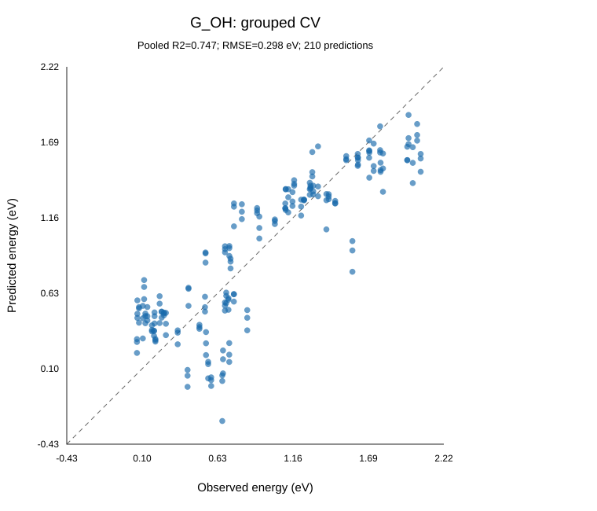
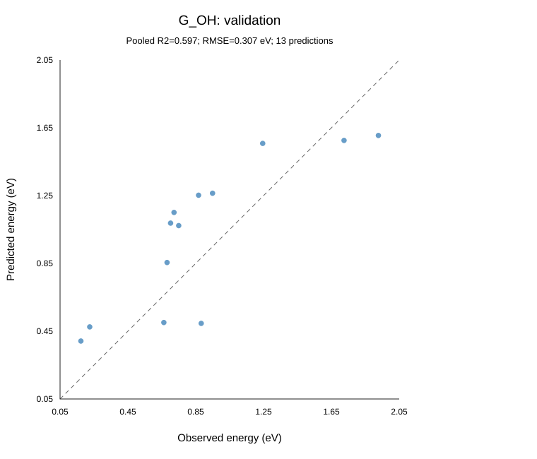
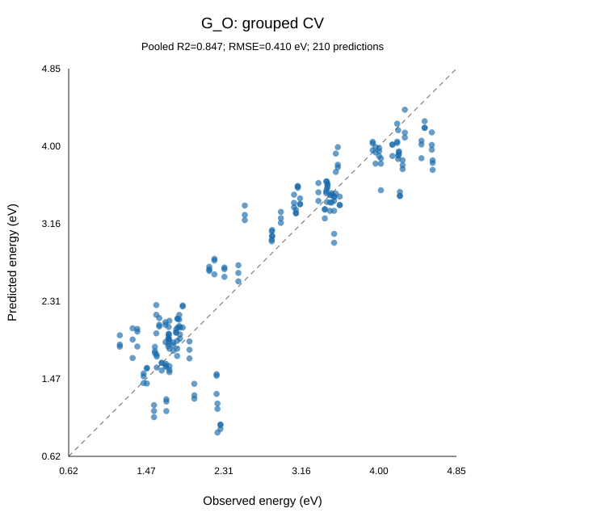
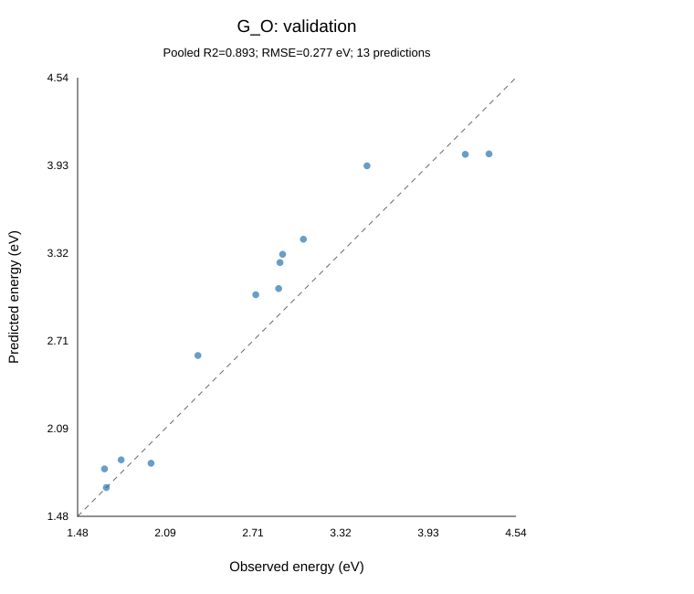
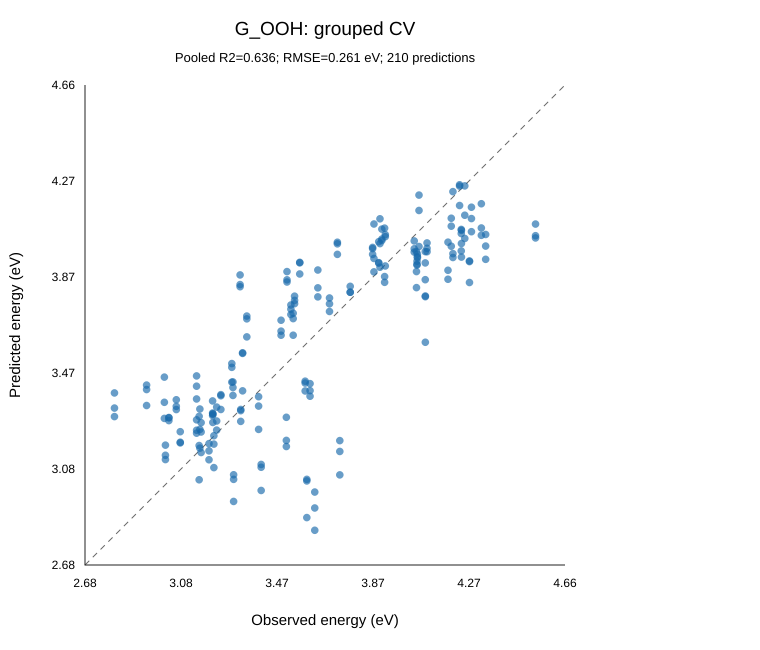
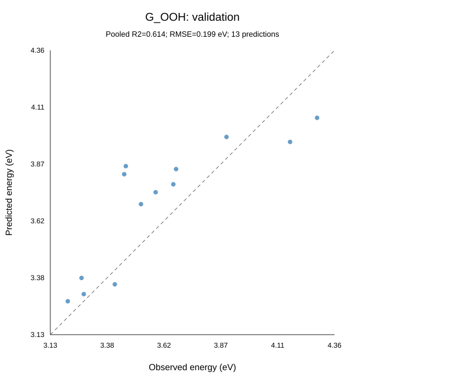
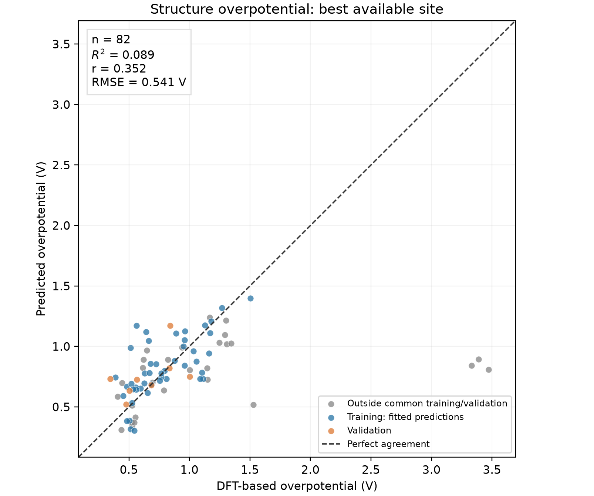
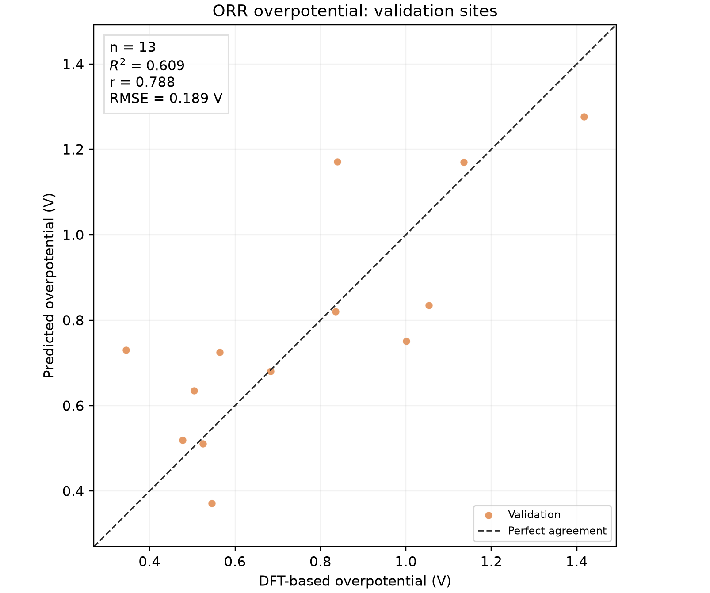
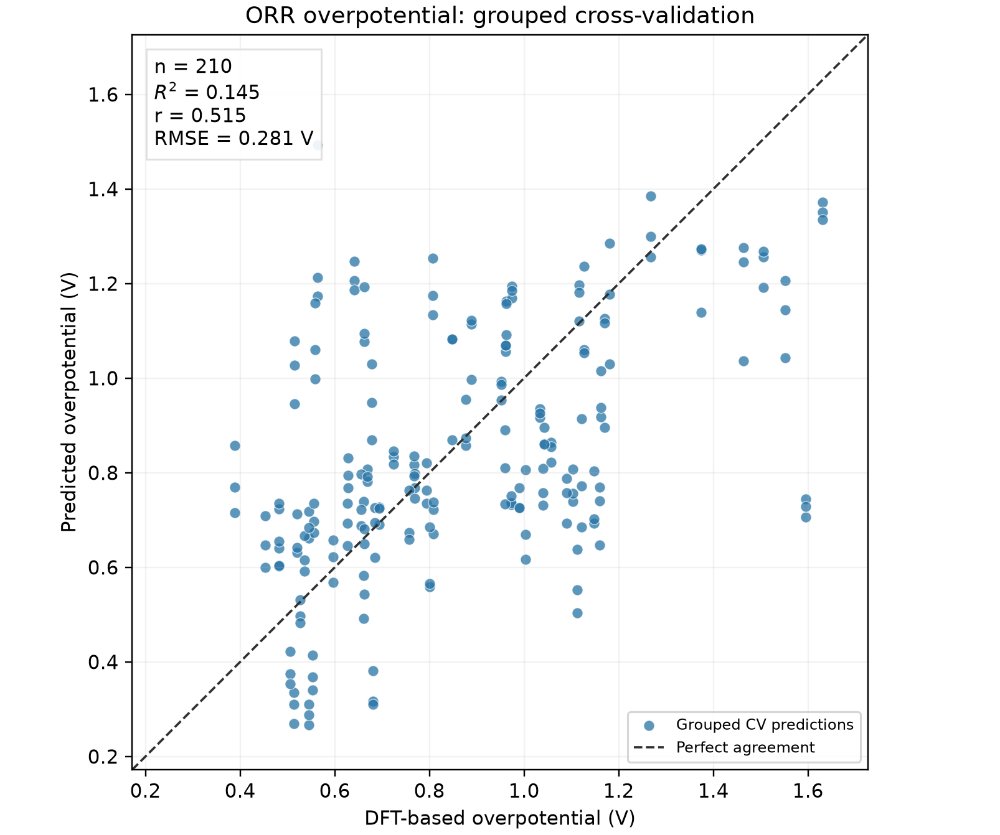

# Current adsorption-energy models

OH, O and OOH use the same **8 descriptors** and **linear ridge regression**. Inputs are calculated from optimized clean structures. Coefficients and ridge strengths are fitted separately for each target.

**Inputs:** Adsorption metal charge; Partner metal charge; Adsorption metal spin magnitude; Adsorption metal: mean ligand spin magnitude; Partner metal: mean ligand spin magnitude; Metal separation; Adsorption metal: mean terminal ligand charge; Adsorption metal: net ligand dipole magnitude.

Each equation contains 8 linear terms and an intercept.

## Descriptors used by all three models

### Symbols and atomic selection

Let $s$ denote the adsorption metal and $p$ the partner metal. Their Cartesian positions $\mathbf r_s$ and $\mathbf r_p$ are in Angstrom. Inputs are the optimized clean-structure coordinates, Bader charges and post-optimization RPBE-D4 atomic magnetic moments.

The signed Bader charge of atom $i$ is $q_i=Z_i-N_i^{\mathrm{Bader}}$, where $Z_i$ is its atomic number and $N_i^{\mathrm{Bader}}$ its Bader electron population. Positive charge means electron deficiency. The signed atomic magnetic moment $m_i$ is in Bohr magnetons.

### Exact meaning of the spin values

The spin values are calculated local atomic magnetic moments, stored as one signed value per atom in `data.post_opt_rpbe_d4_magmoms`. They are the post-optimization RPBE-D4 values of the clean catalyst. Their unit is the Bohr magneton, $\mu_B$. A local magnetic moment measures spin polarization, and can be fractional. The sign gives its orientation along the calculation's spin axis.

Conceptually, the local moment reflects the imbalance between spin-up and spin-down electron populations assigned to that atom:

$$
m_i\approx(N_{i,\uparrow}-N_{i,\downarrow})\mu_B.
$$

Atomic moment assignment depends on the electronic-structure method's partitioning; this population expression explains the physical meaning. The model reads the stored atomic moments directly and does not recompute them from Bader charges. The available array does not establish that the moment assignment uses Bader basins. See the [local magnetic moment definition](https://gpaw.readthedocs.io/tutorialsexercises/magnetic/sites/sites.html).

The current spin inputs are defined exactly as:

$$
x_{3}=|m_s|,\qquad
x_{4}=\frac{1}{n_s}\sum_{i\in H_s}|m_i|,\qquad
x_{5}=\frac{1}{n_p}\sum_{i\in H_p}|m_i|.
$$

Absolute values discard orientation; each ligand's absolute moment is taken before averaging. Individual moments and mean magnitudes are in $\mu_B$.

### Ligand selection and geometry

For each metal $M\in\{s,p\}$:

$$
H_M=\{i:Z_i\in\{7,8,16\},\ i\notin\{s,p\},\ \lVert\mathbf r_i-\mathbf r_M\rVert_2\leq2.30\ \mathrm{Angstrom}\},\qquad n_M=\#H_M.
$$

N/O/S neighbors are pooled and an atom may belong to both neighborhoods. Distances are Cartesian for nonperiodic structures. Metal separation is:

$$
d_{sp}=\sqrt{(r_{s,x}-r_{p,x})^2+(r_{s,y}-r_{p,y})^2+(r_{s,z}-r_{p,z})^2}.
$$

### Shared and terminal ligand charge

$$
B=H_s\cap H_p,\qquad T_M=H_M\setminus B,\qquad
\operatorname{Mean}_A(q)=\frac{1}{\#A}\sum_{i\in A}q_i.
$$

Shared ligands neighbor both metals; terminal ligands neighbor only the specified metal. Charge means retain the sign of each Bader charge and have units of $e$.

### Local ligand dipole definition

$$
\boldsymbol\mu_M=\sum_{i\in H_M}q_i(\mathbf r_i-\mathbf r_M),\qquad p_M=\lVert\boldsymbol\mu_M\rVert_2.
$$

The net magnitude sums signed vectors first and includes directional cancellation. It has units of $e\,\mathrm{Angstrom}$. The metal defines the origin of this local Bader point-charge approximation.

### Summary operations in use

$$
\operatorname{Mean}_A(v)=\frac{1}{\#A}\sum_{i\in A}v_i.
$$

An empty ligand or pair set produces a missing summary, replaced by the target's training median. Genuine zero charges, moments and net dipole cancellation are retained as zero.


Each row is one input to every model, in the equation order shown.

| Symbol | Descriptor name | Description | Formula | Units | Data column |
|---|---|---|---|---|---|
| $x_{1}$ | Adsorption metal charge | Signed Bader charge on the adsorption metal; positive means electron deficiency. | $q_s=Z_s-N_s^{\mathrm{Bader}}$ | e | `q_site` |
| $x_{2}$ | Partner metal charge | Signed Bader charge on the other metal. | $q_p=Z_p-N_p^{\mathrm{Bader}}$ | e | `q_partner` |
| $x_{3}$ | Adsorption metal spin magnitude | Absolute calculated atomic magnetic moment of the adsorption metal. | $\lvert m_s\rvert$ | Bohr magneton | `spin_site_abs` |
| $x_{4}$ | Adsorption metal: mean ligand spin magnitude | Mean of absolute atomic magnetic moments on the selected N/O/S neighbors. | $\operatorname{Mean}_{H_s}(\lvert m_i\rvert)$ | Bohr magneton | `site_heteroatom_spin_abs_mean_muB` |
| $x_{5}$ | Partner metal: mean ligand spin magnitude | Mean of absolute atomic magnetic moments on the selected N/O/S neighbors. | $\operatorname{Mean}_{H_p}(\lvert m_i\rvert)$ | Bohr magneton | `partner_heteroatom_spin_abs_mean_muB` |
| $x_{6}$ | Metal separation | Cartesian separation between the two metals. | $\lVert\mathbf r_s-\mathbf r_p\rVert_2$ | Angstrom | `metal_metal_distance_A` |
| $x_{7}$ | Adsorption metal: mean terminal ligand charge | Mean signed Bader charge of terminal ligands in this metal's shell. | $\operatorname{Mean}_{H_s\setminus B}(q_i)$ | e | `site_terminal_ligand_charge_mean_e` |
| $x_{8}$ | Adsorption metal: net ligand dipole magnitude | Magnitude of the signed vector sum of ligand charge moments around this metal; includes directional cancellation. | $\left\lVert\sum_{i\in H_s}q_i(\mathbf r_i-\mathbf r_s)\right\rVert_2$ | e Angstrom | `site_heteroatom_charge_dipole_proxy_norm_eA` |

## Prediction equations

The equations below use **raw input units** from the descriptor table. Replace missing inputs with the target's training medians listed below. The coefficients already incorporate fitted scaling; evaluate these equations directly without standardizing the inputs. Energies are in eV. Displayed coefficients have ten significant digits; CSV and JSON files retain full precision.

### G_OH

Ridge strength $\alpha$: **1**.

$$
\begin{aligned}
\widehat G_{\mathrm{OH}}={}& -1.162722959 -0.7463544955\,x_{1} -0.2343435964\,x_{2} -0.35989395\,x_{3}
\\ & +3.911233855\,x_{4} -1.487062123\,x_{5} +0.4250962889\,x_{6} -2.28300043\,x_{7}
\\ & -0.1603021748\,x_{8}
\end{aligned}
$$

```text
G_OH_predicted = -1.162722959
    -0.7463544955 * x1 -0.2343435964 * x2 -0.35989395 * x3
    +3.911233855 * x4 -1.487062123 * x5 +0.4250962889 * x6
    -2.28300043 * x7 -0.1603021748 * x8
```

### G_O

Ridge strength $\alpha$: **1**.

$$
\begin{aligned}
\widehat G_{\mathrm{O}}={}& +2.258317586 -1.984545203\,x_{1} -0.4940124967\,x_{2} -0.5383819179\,x_{3}
\\ & +10.11288613\,x_{4} -5.833638251\,x_{5} +0.5568456263\,x_{6} -2.425655941\,x_{7}
\\ & -0.3595490261\,x_{8}
\end{aligned}
$$

```text
G_O_predicted = +2.258317586
    -1.984545203 * x1 -0.4940124967 * x2 -0.5383819179 * x3
    +10.11288613 * x4 -5.833638251 * x5 +0.5568456263 * x6
    -2.425655941 * x7 -0.3595490261 * x8
```

### G_OOH

Ridge strength $\alpha$: **10**.

$$
\begin{aligned}
\widehat G_{\mathrm{OOH}}={}& +5.306471494 -0.5789300466\,x_{1} -0.2278080999\,x_{2} -0.1584201022\,x_{3}
\\ & +0.5890668055\,x_{4} -0.5649143491\,x_{5} +0.10000421\,x_{6} +0.6398747737\,x_{7}
\\ & -0.0723435545\,x_{8}
\end{aligned}
$$

```text
G_OOH_predicted = +5.306471494
    -0.5789300466 * x1 -0.2278080999 * x2 -0.1584201022 * x3
    +0.5890668055 * x4 -0.5649143491 * x5 +0.10000421 * x6
    +0.6398747737 * x7 -0.0723435545 * x8
```

The displayed equations reproduce the saved validation predictions with a maximum difference of 3.9e-10 eV.

## Model performance

| Target | Training structures / sites | Grouped CV R² | Grouped CV RMSE (eV) | Validation R² | Validation RMSE (eV) |
|---|---:|---:|---:|---:|---:|
| G_OH | 50 / 70 | 0.747 | 0.298 | 0.597 | 0.307 |
| G_O | 50 / 70 | 0.847 | 0.410 | 0.893 | 0.277 |
| G_OOH | 50 / 70 | 0.636 | 0.261 | 0.614 | 0.199 |

CV scores are the mean of three repeated five-fold structure-grouped evaluations. Both sites from a structure stay together in each split. The 8 descriptors and linear form are fixed in every fold; ridge strength is chosen using four-fold grouped CV within each outer training partition.

The 8 inputs are fixed for the current split. CV evaluates fitting and ridge-strength selection conditional on these inputs. It does not independently evaluate the exploratory process used to choose the descriptors.

Final ridge strengths are chosen using three repeated four-fold grouped CV runs on training data, then each model is fitted to all its training sites. The ridge grid is 0.0001, 0.001, 0.01, 0.1, 1, 10, 100, 1000 and 10000. Validation energies are not used to choose the current ridge strengths.

## Training and validation selection

All three targets use the same 50 training structures / 70 sites and 10 validation structures / 13 sites. Eligible sites require all three finite, raw-DFT-matched energy labels and pass the recorded endpoint/data-quality filters. Training sites are retained regardless of their model prediction errors.

Invalid endpoint geometries remain excluded from training and validation. Each selected OH/O/OOH endpoint must have a verified mapping and atomic arrays, nearest adsorbate O within 3.0 Angstrom of the intended metal and support, and OOH O-O separation at most 2.0 Angstrom. Any failed endpoint excludes that site from all three targets. The checks use the OOH orientation selected for the energy label. [Endpoint geometry checks](representative_split/selected_endpoint_geometry_checks.csv) and [data-quality exclusion ledger](representative_split/data_quality_exclusion_ledger.csv) record the evidence.

The 14 structures in the [distance exclusion record](representative_split/relative_distance_exclusions.json) are excluded in full from all three targets, including both adsorption sites. Their selected O, OH or OOH distance is at least 5% above the fixed mean for the same adsorption metal and adsorbate. The reference means and structure list are fixed; rebuilding the split does not repeatedly recalculate exclusions. [Reference means](representative_split/relative_distance_reference_means.csv) and [flagged endpoints](representative_split/relative_distance_flagged_endpoints.csv) give the numerical evidence.

Validation membership is selected using clean-structure chemistry and descriptor ranges. Both sites of each structure stay together.

The validation set covers 6 metals (Co, Cr, Cu, Fe, Mn, Ni), 3 ligand environments (N-only, N/O and N/S), and 10 of the 19 available metal pairs. Each validation pair and ligand environment is also represented in training; singleton pairs stay in training.

All 8 validation inputs lie within the training minima and maxima. Metal charge and spin magnitudes also lie within training ranges for that same metal and adsorption/partner role. These are coordinatewise bounds, not a guarantee of inclusion in the multivariate training convex hull. See the [split report and structure list](representative_split/report.md), [chemistry coverage](representative_split/chemistry_coverage.csv) and [descriptor range checks](representative_split/descriptor_range_checks.csv).

These results measure interpolation among represented chemistries. They are conditional on the chosen inputs and eligibility filters. Validation labels have already been examined during model development; this is not an untouched external test or an estimate of extrapolation to unseen chemistries.

## Missing values and fitting

| Symbol | Descriptor | OH median | O median | OOH median |
|---|---|---:|---:|---:|
| $x_{1}$ | Adsorption metal charge | 1.0556035 | 1.0556035 | 1.0556035 |
| $x_{2}$ | Partner metal charge | 1.062473 | 1.062473 | 1.062473 |
| $x_{3}$ | Adsorption metal spin magnitude | 1.514683289 | 1.514683289 | 1.514683289 |
| $x_{4}$ | Adsorption metal: mean ligand spin magnitude | 0.02031276357 | 0.02031276357 | 0.02031276357 |
| $x_{5}$ | Partner metal: mean ligand spin magnitude | 0.01958182524 | 0.01958182524 | 0.01958182524 |
| $x_{6}$ | Metal separation | 3.270440488 | 3.270440488 | 3.270440488 |
| $x_{7}$ | Adsorption metal: mean terminal ligand charge | -1.14177775 | -1.14177775 | -1.14177775 |
| $x_{8}$ | Adsorption metal: net ligand dipole magnitude | 0.9846035333 | 0.9846035333 | 0.9846035333 |

For fitting, median-imputed inputs $\widetilde x_j$ are standardized as $z_j=(\widetilde x_j-\overline x_j)/s_j$. All medians, means and population standard deviations come from the applicable training partition. An entirely missing training column has median zero; standard deviations at most $10^{-12}$ are replaced by one.

The fitting objective is:

$$
\min_{b,\boldsymbol\beta}\left[\sum_{i\in T}\left(G_i-b-\sum_{j=1}^{8}\beta_j z_{ij}\right)^2+\alpha\sum_{j=1}^{8}\beta_j^2\right].
$$

The ridge penalty acts on fitted coefficients and controls their magnitude. The intercept is unpenalized. The fitted scaling is incorporated into the raw-input equations above.

## Prediction graphs

CV graphs pool predictions across the three repeats; their pooled R² differs from the mean repeat R² in the table.

| Target | Grouped CV | Validation |
|---|---|---|
| G_OH |  |  |
| G_O |  |  |
| G_OOH |  |  |

## ORR limiting potential and overpotential

The calculation follows `add_che_results()` in [ML-article_2026_DAC_ORR_analysis.ipynb](../../archive/ML-article_2026_DAC_ORR_analysis.ipynb). For each adsorption site, all three intermediate energies belong to that same site. The four one-electron step potentials are:

$$
U_1=(4.92-G_{\mathrm{OOH}})/e,\quad U_2=(G_{\mathrm{OOH}}-G_{\mathrm O})/e,\quad
U_3=(G_{\mathrm O}-G_{\mathrm{OH}})/e,\quad U_4=G_{\mathrm{OH}}/e.
$$

$$
U_L=\min(U_1,U_2,U_3,U_4),\qquad \eta_{\mathrm{ORR}}=1.23\ \mathrm V-U_L.
$$

Here $e$ is the elementary charge. With energies in eV and one electron transferred per step, the numerical step values are in V. The potential-determining step is the step with the smallest potential; ties use the first step. DFT-based overpotential uses the stored DFT-derived adsorption energies. Predicted overpotential uses the three current regression predictions. No extra energy corrections are introduced; the thermodynamic interpretation follows the supplied energy convention.

The calculation covers **88 structures / 176 possible metal sites**. Complete, raw-verified DFT pathways exist for **123 sites in 82 structures**. Predictions are supplied for both metal sites, including structures whose DFT pathway is incomplete. Incomplete DFT overpotentials remain blank; available predicted energies never fill missing DFT energies.

DFT verification requires source total energies for OH, O and the lowest-energy available OOH x/z orientation to match the corresponding raw same-site calculations within $10^{-8}$ eV. The notebook's energy filter ($G_{OH}\geq0$, $G_O\leq4.92$ eV) retains 118 sites. Its pass/fail flag is included in the site CSV; the complete-pathway table includes every verified site.

### Predicted versus DFT-based overpotential

For a structure, the reported overpotential is the minimum site overpotential. The correlation graph compares minima over the **same DFT-complete site set** for each structure. The table also lists the best predicted value over both metal sites, which can include a site without a complete DFT pathway.



| Evaluation | Points | R² | Pearson r | RMSE (V) | MAE (V) |
|---|---:|---:|---:|---:|---:|
| All complete sites: final fitted models | 123 | 0.110 | 0.404 | 0.521 | 0.268 |
| Notebook energy-filtered sites: final fitted models | 118 | 0.515 | 0.728 | 0.231 | 0.184 |
| Structures: same available site sets | 82 | 0.089 | 0.352 | 0.541 | 0.263 |
| Validation sites | 13 | 0.609 | 0.788 | 0.189 | 0.146 |
| Grouped CV sites: pooled repeats | 210 | 0.145 | 0.515 | 0.281 | 0.217 |

All-site and structure correlations include training predictions and are descriptive fit summaries. The validation graph uses sites held out from all three fits. The grouped CV graph combines three same-fold held-out energy predictions before calculating each site's overpotential, and pools the three repeats. Its 210 plotted predictions represent 70 distinct sites in 50 structures. These scores remain exploratory and conditional on the curated cohorts and chosen descriptor set.

Overpotential is evaluated directly because it depends on differences between intermediate energies and selection of the smallest step potential. Accurate intermediate-energy regressions can still produce a less accurate overpotential or change the predicted determining step.

| Validation sites | Grouped CV sites |
|---|---|
|  |  |

[All-site correlation graph](shared_descriptor_search/graphs/overpotential_all_sites.png); [notebook energy-filtered correlation graph](shared_descriptor_search/graphs/overpotential_notebook_filtered.png). Every overpotential graph is also saved as SVG and PDF in `shared_descriptor_search/graphs/`.

### Overpotential for every structure

`DFT η` and `Predicted η (matched sites)` use the same available DFT-complete site set. `Predicted η (both sites)` uses both metal sites. All values are in V; a dash indicates an incomplete DFT pathway.

| ID | Structure | DFT sites | DFT best site | DFT η | Predicted best matched site | Predicted η (matched sites) | Predicted best site | Predicted η (both sites) |
|---:|---|---:|---|---:|---|---:|---|---:|
| 1 | KMC_Cr_Co_A2_B2_NNNNOO_q2 | 1 | metal1 | 1.1036 | metal1 | 0.7844 | metal2 | 0.5785 |
| 2 | KMC_Cr_Mn_A2_B1_NNNNNN_q2 | 2 | metal2 | 1.1468 | metal1 | 0.8219 | metal1 | 0.8219 |
| 3 | KMC_Ni_Cu_A2_B1_NNNNOO_q2 | 2 | metal1 | 1.1813 | metal1 | 1.2090 | metal1 | 1.2090 |
| 4 | KMC_Fe_Co_A2_B1_NNNNSS_q2 | 2 | metal1 | 0.5057 | metal1 | 0.3878 | metal1 | 0.3878 |
| 5 | KMC_Cr_Co_A2_B1_NNNNOO_q2 | 2 | metal2 | 0.6685 | metal1 | 0.7808 | metal1 | 0.7808 |
| 6 | KMC_Fe_Co_A2_B2_NNNNSS_q2 | 1 | metal2 | 0.5264 | metal2 | 0.5321 | metal2 | 0.5321 |
| 7 | KMC_Mn_Co_A2_B1_NNNNNN_q2 | 2 | metal1 | 0.5587 | metal2 | 0.6432 | metal2 | 0.6432 |
| 8 | KMC_Cr_Co_A2_B2_NNNNNN_q2 | 2 | metal2 | 0.5250 | metal2 | 0.5108 | metal2 | 0.5108 |
| 9 | KMC_Mn_Co_A2_B2_NNNNNN_q2 | 2 | metal2 | 0.4365 | metal2 | 0.3094 | metal2 | 0.3094 |
| 10 | KMC_Co_Cu_A2_B1_NNNNSS_q2 | 2 | metal1 | 0.5963 | metal1 | 0.6525 | metal1 | 0.6525 |
| 11 | KMC_Ni_Cu_A2_B2_NNNNOO_q2 | 2 | metal1 | 0.8887 | metal1 | 1.1066 | metal1 | 1.1066 |
| 12 | KMC_Fe_Cu_A2_B2_NNNNSS_q2 | 2 | metal1 | 0.4060 | metal1 | 0.5839 | metal1 | 0.5839 |
| 30 | KMC_Ni_Cu_A2_B1_NNNNSS_q2 | 1 | metal1 | 1.2476 | metal1 | 1.0300 | metal1 | 1.0300 |
| 31 | KMC_Cu_Cu_A2_B1_NNNNOO_q2 | 1 | metal1 | 1.5051 | metal1 | 1.3986 | metal1 | 1.3986 |
| 32 | KMC_Fe_Cu_A2_B1_NNNNSS_q2 | 2 | metal1 | 0.5240 | metal1 | 0.3715 | metal1 | 0.3715 |
| 33 | KMC_Cu_Cu_A2_B2_NNNNOO_q2 | 0 | — | — | — | — | metal2 | 1.3475 |
| 34 | KMC_Co_Cu_A2_B1_NNNNOO_q2 | 2 | metal1 | 0.6160 | metal1 | 0.8222 | metal1 | 0.8222 |
| 35 | KMC_Ni_Ni_A2_B1_NNNNOO_q2 | 1 | metal1 | 1.1684 | metal1 | 1.2380 | metal2 | 1.2245 |
| 36 | KMC_Co_Co_A2_B2_NNNNSS_q2 | 1 | metal1 | 0.7684 | metal1 | 0.7458 | metal1 | 0.7458 |
| 37 | KMC_Co_Ni_A2_B1_NNNNSS_q2 | 2 | metal1 | 0.6937 | metal1 | 0.7017 | metal1 | 0.7017 |
| 38 | KMC_Mn_Co_A2_B2_NNNNSS_q2 | 2 | metal1 | 0.5363 | metal1 | 0.6455 | metal1 | 0.6455 |
| 39 | KMC_Cr_Cr_A2_B1_NNNNNN_q2 | 1 | metal1 | 0.9595 | metal1 | 0.8427 | metal2 | 0.8326 |
| 40 | KMC_Ni_Ni_A2_B2_NNNNOO_q2 | 1 | metal1 | 0.8395 | metal1 | 1.1716 | metal2 | 1.1222 |
| 41 | KMC_Mn_Cu_A2_B2_NNNNSS_q2 | 1 | metal2 | 1.2680 | metal2 | 1.3201 | metal1 | 0.9520 |
| 42 | KMC_Fe_Ni_A2_B2_NNNNSS_q2 | 1 | metal2 | 0.9629 | metal2 | 1.1267 | metal1 | 0.5755 |
| 43 | KMC_Mn_Co_A2_B1_NNNNOO_q2 | 1 | metal2 | 0.8354 | metal2 | 0.8202 | metal2 | 0.8202 |
| 44 | KMC_Co_Co_A2_B1_NNNNNN_q2 | 1 | metal1 | 0.7941 | metal1 | 0.7993 | metal2 | 0.7966 |
| 45 | KMC_Co_Ni_A2_B1_NNNNOO_q2 | 2 | metal1 | 0.8231 | metal1 | 0.8896 | metal1 | 0.8896 |
| 46 | KMC_Ni_Ni_A2_B1_NNNNSS_q2 | 1 | metal1 | 1.3451 | metal1 | 1.0252 | metal2 | 0.9758 |
| 47 | KMC_Cu_Cu_A2_B1_NNNNSS_q2 | 1 | metal1 | 1.3077 | metal1 | 1.0201 | metal1 | 1.0201 |
| 48 | KMC_Mn_Fe_A2_B2_NNNNSS_q2 | 2 | metal2 | 0.5447 | metal2 | 0.3048 | metal2 | 0.3048 |
| 49 | KMC_Cr_Co_A2_B2_NNNNSS_q2 | 1 | metal2 | 0.7670 | metal2 | 0.7779 | metal1 | 0.7265 |
| 50 | KMC_Cr_Cu_A2_B1_NNNNSS_q2 | 0 | — | — | — | — | metal1 | 0.7929 |
| 51 | KMC_Cr_Co_A2_B1_NNNNNN_q2 | 2 | metal2 | 0.5554 | metal2 | 0.6625 | metal2 | 0.6625 |
| 52 | KMC_Cr_Co_A2_B1_NNNNSS_q2 | 2 | metal2 | 0.7566 | metal2 | 0.7165 | metal2 | 0.7165 |
| 53 | KMC_Co_Co_A2_B1_NNNNSS_q2 | 1 | metal1 | 0.6262 | metal1 | 0.6966 | metal2 | 0.6963 |
| 54 | KMC_Fe_Ni_A2_B1_NNNNSS_q2 | 2 | metal1 | 0.5457 | metal1 | 0.3716 | metal1 | 0.3716 |
| 55 | KMC_Mn_Ni_A2_B1_NNNNSS_q2 | 2 | metal1 | 0.4448 | metal1 | 0.6988 | metal1 | 0.6988 |
| 56 | KMC_Co_Ni_A2_B2_NNNNSS_q2 | 2 | metal1 | 0.5536 | metal1 | 0.4134 | metal1 | 0.4134 |
| 57 | KMC_Mn_Co_A2_B1_NNNNSS_q2 | 2 | metal2 | 0.6551 | metal1 | 0.6152 | metal1 | 0.6152 |
| 58 | KMC_Co_Ni_A2_B2_NNNNOO_q2 | 0 | — | — | — | — | metal1 | 0.8749 |
| 59 | KMC_Mn_Ni_A2_B2_NNNNSS_q2 | 2 | metal1 | 0.5149 | metal1 | 0.9884 | metal1 | 0.9884 |
| 60 | KMC_Cr_Ni_A2_B2_NNNNSS_q2 | 1 | metal2 | 0.9516 | metal2 | 1.0021 | metal1 | 0.7347 |
| 61 | KMC_Co_Co_A2_B2_NNNNOO_q2 | 0 | — | — | — | — | metal2 | 0.7438 |
| 62 | KMC_Co_Co_A2_B1_NNNNOO_q2 | 1 | metal1 | 0.8090 | metal1 | 0.7307 | metal1 | 0.7307 |
| 63 | KMC_Mn_Ni_A2_B1_NNNNOO_q2 | 1 | metal1 | 0.6851 | metal1 | 0.6871 | metal1 | 0.6871 |
| 64 | KMC_Ni_Cu_A2_B2_NNNNSS_q2 | 1 | metal1 | 0.9605 | metal1 | 1.0521 | metal1 | 1.0521 |
| 65 | KMC_Cr_Fe_A2_B2_NNNNSS_q2 | 2 | metal2 | 0.5142 | metal2 | 0.3156 | metal2 | 0.3156 |
| 66 | KMC_Ni_Ni_A2_B2_NNNNSS_q2 | 1 | metal1 | 0.9387 | metal1 | 0.9907 | metal1 | 0.9907 |
| 67 | KMC_Cr_Fe_A2_B1_NNNNSS_q2 | 2 | metal2 | 0.5260 | metal2 | 0.3368 | metal2 | 0.3368 |
| 68 | KMC_Co_Co_A2_B2_NNNNNN_q2 | 1 | metal1 | 0.4772 | metal1 | 0.5195 | metal1 | 0.5195 |
| 69 | KMC_Cr_Ni_A2_B1_NNNNSS_q2 | 1 | metal1 | 3.3310 | metal1 | 0.8424 | metal1 | 0.8424 |
| 70 | KMC_Mn_Fe_A2_B1_NNNNSS_q2 | 2 | metal1 | 0.4824 | metal2 | 0.3839 | metal2 | 0.3839 |
| 71 | KMC_Mn_Mn_A2_B1_NNNNNN_q2 | 1 | metal1 | 0.5638 | metal1 | 1.1712 | metal2 | 1.1692 |
| 72 | KMC_Mn_Cu_A2_B1_NNNNSS_q2 | 2 | metal1 | 0.7883 | metal1 | 0.6369 | metal1 | 0.6369 |
| 73 | KMC_Mn_Co_A2_B2_NNNNOO_q2 | 2 | metal2 | 0.4537 | metal2 | 0.5906 | metal2 | 0.5906 |
| 74 | KMC_Mn_Mn_A2_B2_NNNNSS_q2 | 1 | metal1 | 0.5647 | metal1 | 0.7253 | metal2 | 0.6929 |
| 75 | KMC_Cu_Cu_A2_B2_NNNNSS_q2 | 1 | metal1 | 1.2940 | metal1 | 1.0942 | metal1 | 1.0942 |
| 76 | KMC_Cr_Ni_A2_B1_NNNNOO_q2 | 2 | metal1 | 1.1491 | metal1 | 0.7267 | metal1 | 0.7267 |
| 77 | KMC_Cr_Mn_A2_B2_NNNNSS_q2 | 2 | metal2 | 0.5205 | metal2 | 0.6908 | metal2 | 0.6908 |
| 78 | KMC_Cr_Mn_A2_B1_NNNNSS_q2 | 2 | metal2 | 0.3446 | metal2 | 0.7304 | metal2 | 0.7304 |
| 79 | KMC_Co_Cu_A2_B2_NNNNSS_q2 | 2 | metal1 | 0.6287 | metal1 | 0.7783 | metal1 | 0.7783 |
| 80 | KMC_Cr_Cr_A2_B1_NNNNSS_q2 | 1 | metal1 | 1.0574 | metal1 | 0.8748 | metal2 | 0.8662 |
| 81 | KMC_Cr_Cr_A2_B2_NNNNSS_q2 | 1 | metal1 | 1.0012 | metal1 | 0.7511 | metal2 | 0.7369 |
| 82 | KMC_Mn_Ni_A2_B1_NNNNNN_q2 | 2 | metal1 | 0.6479 | metal1 | 0.9678 | metal1 | 0.9678 |
| 83 | KMC_Mn_Mn_A2_B1_NNNNSS_q2 | 1 | metal1 | 0.3886 | metal1 | 0.7451 | metal1 | 0.7451 |
| 84 | KMC_Mn_Mn_A2_B2_NNNNNN_q2 | 0 | — | — | — | — | metal1 | 1.1432 |
| 85 | KMC_Co_Ni_A2_B1_NNNNNN_q2 | 2 | metal1 | 0.4819 | metal1 | 0.6672 | metal1 | 0.6672 |
| 86 | KMC_Co_Ni_A2_B2_NNNNNN_q2 | 2 | metal1 | 0.5047 | metal1 | 0.6355 | metal1 | 0.6355 |
| 87 | KMC_Cr_Mn_A2_B2_NNNNNN_q2 | 1 | metal2 | 0.6417 | metal2 | 1.1203 | metal1 | 0.9615 |
| 88 | KMC_Cr_Ni_A2_B1_NNNNNN_q2 | 2 | metal1 | 1.0035 | metal1 | 0.8055 | metal1 | 0.8055 |
| 89 | KMC_Ni_Ni_A2_B1_NNNNNN_q2 | 1 | metal1 | 1.3008 | metal1 | 1.2133 | metal2 | 1.1854 |
| 90 | KMC_Ni_Ni_A2_B2_NNNNNN_q2 | 1 | metal1 | 1.1265 | metal1 | 1.1752 | metal1 | 1.1752 |
| 91 | KMC_Mn_Ni_A2_B2_NNNNNN_q2 | 2 | metal1 | 0.6206 | metal1 | 0.8899 | metal1 | 0.8899 |
| 92 | KMC_Cr_Cr_A2_B2_NNNNNN_q2 | 1 | metal1 | 1.1625 | metal1 | 0.9435 | metal1 | 0.9435 |
| 94 | KMC_Cr_Ni_A2_B2_NNNNOO_q2 | 1 | metal1 | 1.0896 | metal1 | 0.7317 | metal1 | 0.7317 |
| 95 | KMC_Mn_Mn_A2_B2_NNNNOO_q2 | 0 | — | — | — | — | metal1 | 0.8993 |
| 96 | KMC_Cr_Mn_A2_B2_NNNNOO_q2 | 2 | metal2 | 0.8767 | metal2 | 0.8808 | metal2 | 0.8808 |
| 97 | KMC_Cr_Cu_A2_B1_NNNNOO_q2 | 1 | metal1 | 1.1123 | metal1 | 0.7325 | metal1 | 0.7325 |
| 98 | KMC_Cr_Cr_A2_B1_NNNNOO_q2 | 1 | metal1 | 3.3890 | metal1 | 0.8942 | metal1 | 0.8942 |
| 99 | KMC_Cr_Ni_A2_B2_NNNNNN_q2 | 1 | metal1 | 3.4728 | metal1 | 0.8079 | metal1 | 0.8079 |
| 100 | KMC_Cr_Cr_A2_B2_NNNNOO_q2 | 1 | metal1 | 1.0332 | metal1 | 0.9600 | metal2 | 0.9164 |
| 101 | KMC_Cr_Mn_A2_B1_NNNNOO_q2 | 1 | metal2 | 0.6780 | metal2 | 0.8583 | metal2 | 0.8583 |
| 102 | KMC_Mn_Mn_A2_B1_NNNNOO_q2 | 1 | metal1 | 0.7241 | metal1 | 0.8546 | metal2 | 0.8408 |
| 103 | KMC_Co_Cu_A2_B2_NNNNOO_q2 | 2 | metal1 | 0.6837 | metal1 | 0.6801 | metal1 | 0.6801 |
| 104 | KMC_Mn_Cu_A2_B2_NNNNOO_q2 | 1 | metal2 | 1.1702 | metal2 | 1.1106 | metal1 | 0.8050 |
| 105 | KMC_Mn_Cu_A2_B1_NNNNOO_q2 | 2 | metal2 | 1.5269 | metal1 | 0.5184 | metal1 | 0.5184 |
| 106 | KMC_Mn_Ni_A2_B2_NNNNOO_q2 | 2 | metal1 | 0.6628 | metal2 | 1.0461 | metal2 | 1.0461 |

### Detailed calculations

- [All site calculations](shared_descriptor_search/overpotential_site_calculations.csv): raw descriptors, DFT and predicted intermediate energies, four step potentials, limiting potential, overpotential, determining step, source verification, notebook energy-filter flag and training/validation membership.
- [All structure calculations](shared_descriptor_search/overpotential_structure_calculations.csv)
- [Grouped CV overpotential calculations](shared_descriptor_search/overpotential_grouped_cv_predictions.csv)
- [Overpotential metrics](shared_descriptor_search/overpotential_metrics.csv)


## Model files and reproduction

The current model files are in `shared_descriptor_search/`:

- [Descriptor names, formulas and units](shared_descriptor_search/selected_descriptors.csv)
- [Full-precision equations and model parameters](shared_descriptor_search/model_parameters.json)
- [Model coefficients](shared_descriptor_search/model_coefficients.csv)
- [Training medians and scaling](shared_descriptor_search/model_preprocessing.csv)
- [Model metrics](shared_descriptor_search/model_metrics.csv)
- [Grouped CV predictions](shared_descriptor_search/nested_cv_predictions.csv)
- [Validation predictions](shared_descriptor_search/validation_predictions.csv)
- [Training and validation membership](shared_descriptor_search/cohort_membership.csv)

Reproduce the fit and reports from the repository root:

```powershell
python article/KongiCats/calculations/models_20261011_dipole_ridge/run_shared_descriptor_search.py
```

Fitting uses NumPy; overpotential graphs use Matplotlib. Matplotlib can be installed locally with `python -m pip install --target article/KongiCats/calculations/models_20261011_dipole_ridge/.plot_dependencies matplotlib`. To rebuild reports from the fitted model files, run `python article/KongiCats/calculations/models_20261011_dipole_ridge/build_current_report.py`.
