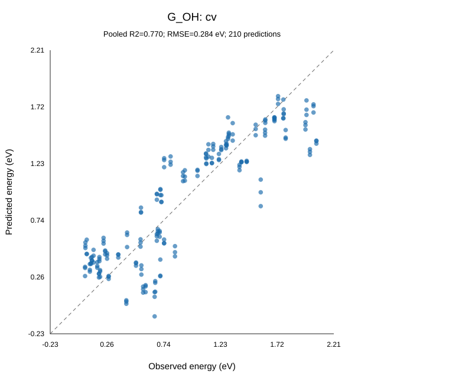
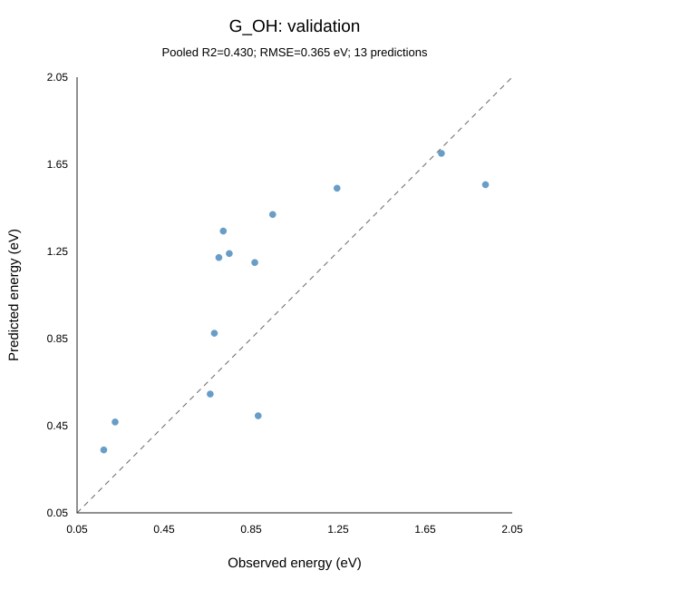
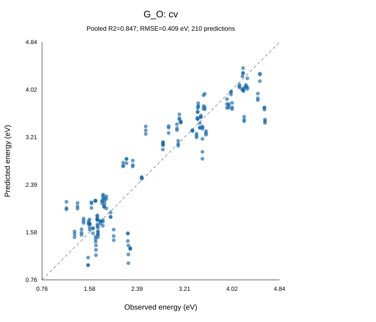
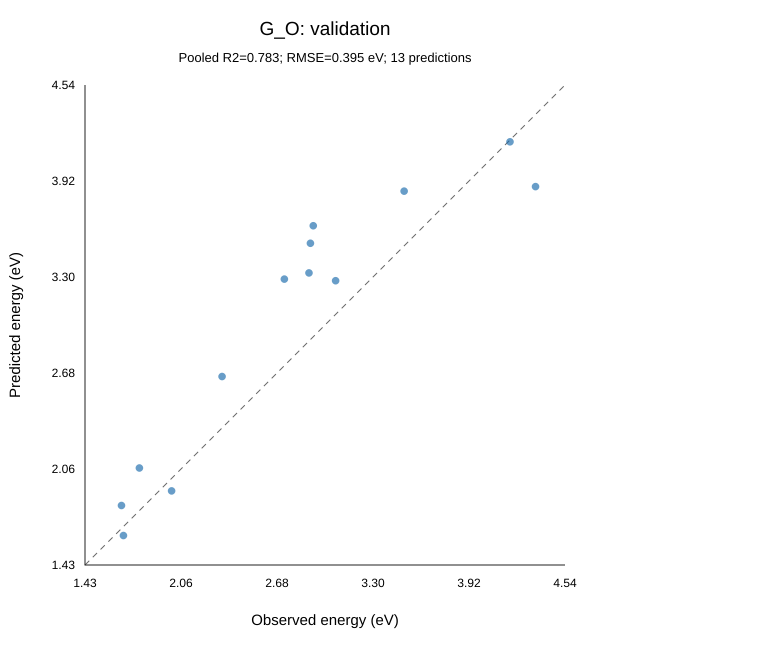
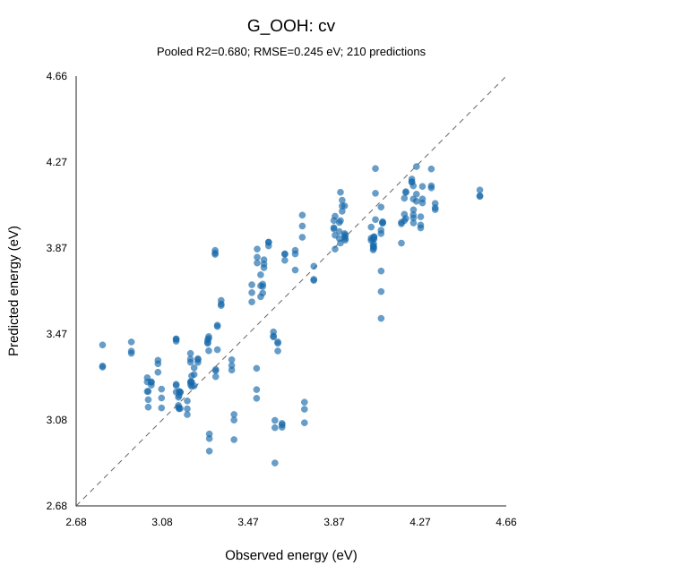
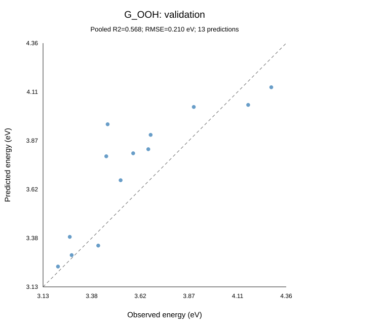

# Selected experimental adsorption-energy candidate

All three targets share 4 descriptors and use linear ridge. The fixed cohort contains 50 training structures / 70 sites and 10 validation structures / 13 sites. The descriptors are selected using training data; validation is evaluated after the choice.

## Descriptor definitions

### Symbols and atomic selection

Let $s$ denote the adsorption metal and $p$ the partner metal. Their Cartesian positions $\mathbf r_s$ and $\mathbf r_p$ are in Angstrom. Inputs are the optimized clean-structure coordinates, Bader charges and post-optimization RPBE-D4 atomic magnetic moments.

The signed Bader charge of atom $i$ is $q_i=Z_i-N_i^{\mathrm{Bader}}$, where $Z_i$ is its atomic number and $N_i^{\mathrm{Bader}}$ its Bader electron population. Positive charge means electron deficiency. The signed atomic magnetic moment $m_i$ is in Bohr magnetons.

### Exact meaning of the spin values

The spin values are calculated local atomic magnetic moments, stored as one signed value per atom in `data.post_opt_rpbe_d4_magmoms`. They are the post-optimization RPBE-D4 values of the clean catalyst. Their unit is the Bohr magneton, $\mu_B$. A local magnetic moment measures spin polarization, and can be fractional. The sign gives its orientation along the calculation's spin axis.

Conceptually, the local moment reflects the imbalance between spin-up and spin-down electron populations assigned to that atom:

$$
m_i\approx(N_{i,\uparrow}-N_{i,\downarrow})\mu_B.
$$

Atomic moment assignment depends on the electronic-structure method's partitioning; this population expression explains the physical meaning. The model reads the stored atomic moments directly and does not recompute them from Bader charges. The available array does not establish that the moment assignment uses Bader basins. See the [local magnetic moment definition](https://gpaw.readthedocs.io/tutorialsexercises/magnetic/sites/sites.html).

The current spin inputs are defined exactly as:

$$
x_{2}=|m_s|.
$$

Absolute values discard orientation; each ligand's absolute moment is taken before averaging. Individual moments and mean magnitudes are in $\mu_B$.

### Ligand selection and geometry

For each metal $M\in\{s,p\}$:

$$
H_M=\{i:Z_i\in\{7,8,16\},\ i\notin\{s,p\},\ \lVert\mathbf r_i-\mathbf r_M\rVert_2\leq2.30\ \mathrm{Angstrom}\},\qquad n_M=\#H_M.
$$

N/O/S neighbors are pooled and an atom may belong to both neighborhoods. Distances are Cartesian for nonperiodic structures. Metal separation is:

$$
d_{sp}=\sqrt{(r_{s,x}-r_{p,x})^2+(r_{s,y}-r_{p,y})^2+(r_{s,z}-r_{p,z})^2}.
$$

### Local ligand dipole definition

$$
\boldsymbol\mu_M=\sum_{i\in H_M}q_i(\mathbf r_i-\mathbf r_M),\qquad p_M=\lVert\boldsymbol\mu_M\rVert_2.
$$

The net magnitude sums signed vectors first and includes directional cancellation. It has units of $e\,\mathrm{Angstrom}$. The metal defines the origin of this local Bader point-charge approximation.

An empty ligand or pair set produces a missing summary, replaced by the target's training median. Genuine zero charges, moments and net dipole cancellation are retained as zero.


| Symbol | Name | Description | Formula | Units |
|---|---|---|---|---|
| $x_{1}$ | Partner metal charge | Signed Bader charge on the other metal. | $q_p=Z_p-N_p^{\mathrm{Bader}}$ | e |
| $x_{2}$ | Adsorption metal spin magnitude | Absolute calculated atomic magnetic moment of the adsorption metal. | $\lvert m_s\rvert$ | Bohr magneton |
| $x_{3}$ | Metal separation | Cartesian separation between the two metals. | $\lVert\mathbf r_s-\mathbf r_p\rVert_2$ | Angstrom |
| $x_{4}$ | Adsorption metal: net ligand dipole magnitude | Magnitude of the signed vector sum of ligand charge moments around this metal; includes directional cancellation. | $\left\lVert\sum_{i\in H_s}q_i(\mathbf r_i-\mathbf r_s)\right\rVert_2$ | e Angstrom |

## Prediction equations

Use the raw descriptor units. Missing values use the training medians in the preprocessing CSV. Scaling is already incorporated in these coefficients; energies are in eV.

### G_OH

Ridge strength: 1.

$$
\begin{aligned}
\widehat G_{\mathrm{OH}}={}& +0.747577535 -0.3227628538\,x_{1} -0.4123822788\,x_{2} +0.4463527329\,x_{3}
\\ & -0.1401040737\,x_{4}
\end{aligned}
$$

```text
G_OH_predicted = +0.747577535
    -0.3227628538 * x1 -0.4123822788 * x2 +0.4463527329 * x3
    -0.1401040737 * x4
```

### G_O

Ridge strength: 1.

$$
\begin{aligned}
\widehat G_{\mathrm{O}}={}& +2.792472694 -0.6174003052\,x_{1} -0.7641615354\,x_{2} +0.7073103908\,x_{3}
\\ & -0.250537188\,x_{4}
\end{aligned}
$$

```text
G_O_predicted = +2.792472694
    -0.6174003052 * x1 -0.7641615354 * x2 +0.7073103908 * x3
    -0.250537188 * x4
```

### G_OOH

Ridge strength: 1.

$$
\begin{aligned}
\widehat G_{\mathrm{OOH}}={}& +3.703235724 -0.2784060776\,x_{1} -0.2857230334\,x_{2} +0.2533135341\,x_{3}
\\ & -0.06214463017\,x_{4}
\end{aligned}
$$

```text
G_OOH_predicted = +3.703235724
    -0.2784060776 * x1 -0.2857230334 * x2 +0.2533135341 * x3
    -0.06214463017 * x4
```

## Performance

| Target | Fixed-input CV R² | Fixed-input CV RMSE (eV) | Validation R² | Validation RMSE (eV) |
|---|---:|---:|---:|---:|
| G_OH | 0.7704 | 0.2834 | 0.4298 | 0.3646 |
| G_O | 0.8469 | 0.4092 | 0.7831 | 0.3948 |
| G_OOH | 0.6799 | 0.2448 | 0.5681 | 0.2100 |

The fixed-input CV scores hold the final selected descriptors constant and tune ridge strength within each outer training fold. Table scores average three repeat R² values; CV graphs pool their predictions. These fixed-input scores do not include the error of selecting descriptors. [The complete search report](report.md) gives the CV scores with descriptor selection inside the outer folds.

## Graphs

| Target | Fixed-input CV | Validation |
|---|---|---|
| G_OH |  |  |
| G_O |  |  |
| G_OOH |  |  |

[Full-precision equations](selected_candidate_model_parameters.json); [preprocessing values](selected_candidate_preprocessing.csv); [validation predictions](selected_candidate_validation_predictions.csv).
