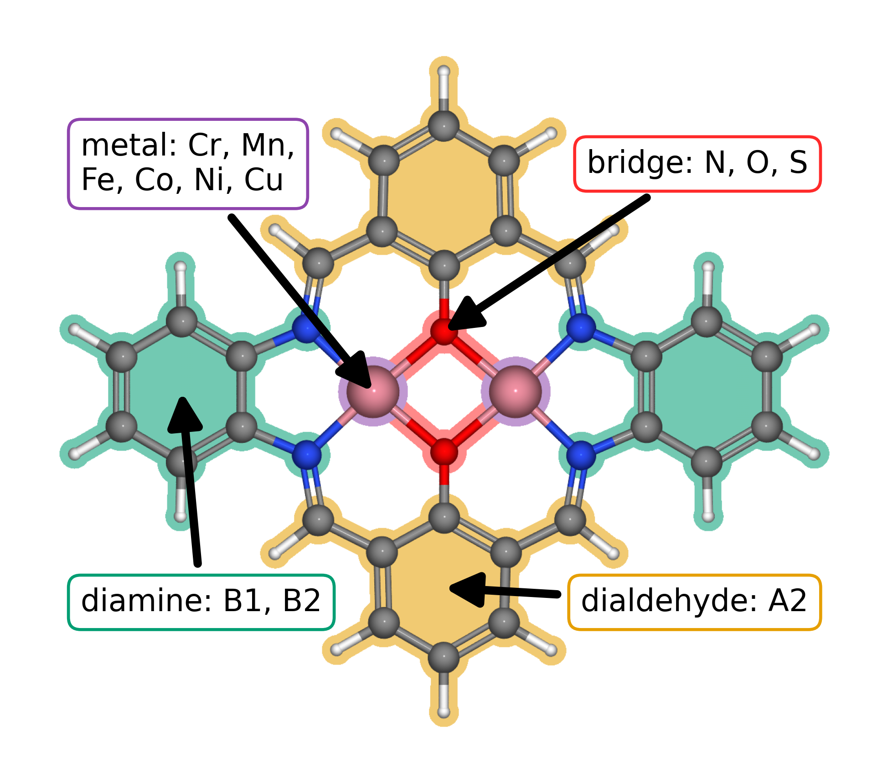
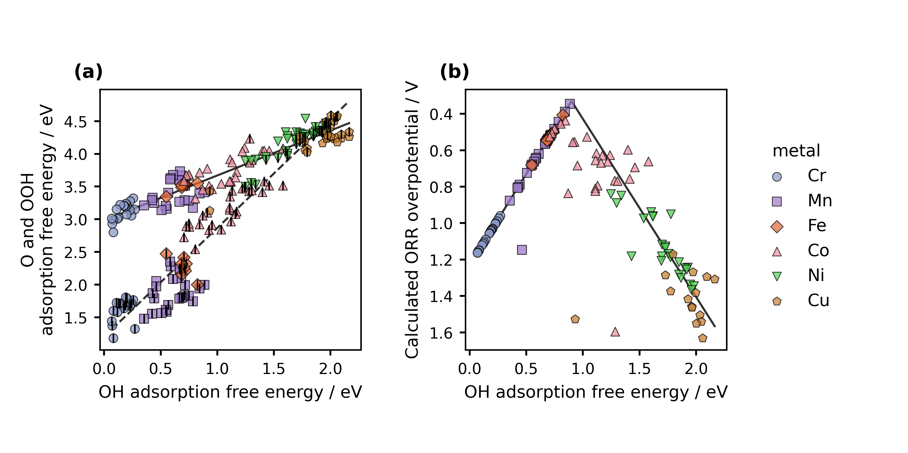

<!-- Reconstructed from ../manuscript_versions/Electrochimica_Acta_research_article_draft_v29.docx. -->

# **Accelerating Catalyst Discovery and Design with Artificial Intelligence: Molecular Dual-Atom Site Catalysts as a Case Study**

Bruno Inácio da Silva Roux Leite,1 Denis Savchenko,1 Timmo-Henrik Pukk,1 Ba Long Nguyen,1 Vladislav Ivanistsev,2† Nadezda Kongi,1†

1 Institute of Chemistry, University of Tartu, Ravila 14a, 50411 Tartu, Estonia

2 Department of Chemistry, University of Latvia, Jelgavas iela 1, Riga, LV-1004, Latvia

*Corresponding authors: nadezda.kongi@ut.ee; vladislav.ivanistsev@lu.lv*

## **Abstract**

*We compare molecular catalysts for the oxygen reduction reaction using adsorption thermodynamics resolved by catalyst and adsorption site. Exact matching supports scaling analysis and conventional computational hydrogen electrode estimates, while reusable records permit alternative activity descriptors to be evaluated from the same calculations. The working dataset gives distinct O–OH and OOH–OH scaling relations and a provisional minimum overpotential of 0.34 V. The available hydroxyl regression comparison remains exploratory because independent validation has not been established. We also describe how a language model helped assemble a research account from a defined evidence base. These results show the value of preserving calculation identity and verifying each analysis; numerical conclusions remain provisional pending replacement and audit of the working data.*

*Keywords: artificial intelligence; computational hydrogen electrode; density functional theory; machine learning; oxygen reduction reaction; molecular dual-atom site catalysts*

## **1. Introduction**

*Artificial intelligence is changing how researchers search large design spaces, combine evidence, and select the next calculations in catalyst discovery. Density functional theory supplies chemically grounded energies and structures, while data driven models can identify patterns across related candidates and estimate properties for structures that have not yet been calculated. The value of this combination depends on more than model choice: the records must retain enough structural and computational context for researchers to test, reproduce, and extend each analysis [1,2] [3].*

*We use the oxygen reduction reaction (ORR) as an example of this broader challenge. Its multistep thermodynamics depend on the relative stabilization of oxygen intermediates, which commonly follow correlated adsorption free energies and thereby constrain activity predictions [4]. Molecular dual-atom site catalysts provide a defined chemical space in which metal identity, bridge composition, diamine, and the adsorption site can be compared. Calculations and experiments on related molecular systems show that binding geometry and the second metal can alter oxygen-intermediate energetics [5,6]. These comparisons require each adsorbate energy to remain linked to the same catalyst and the same metal adsorption site.*

*A recurring view across scientific editorials is that research becomes legible when a paper develops one coherent argument and selects figures that make its evidence easy to follow. Editors have described the central scientific theme as the organizing principle of a paper, emphasized the explanatory role of figures and captions, and advised authors to connect context, question, evidence, and interpretation [7,8] [9,10]. This advice treats narrative as part of scientific communication: readers need to understand why a question was asked, what the evidence shows, and how the result changes current understanding.*

*The counterpoint is equally important. A polished narrative can distort research if authors select only observations that support a preferred conclusion or suppress uncertainty to make the result appear complete. Editorial guidance has warned that story driven presentation can encourage such bias [11]. Narrative therefore cannot determine which data count or what the results mean. Those decisions must follow the methods, the complete record, and explicit treatment of uncertainty.*

*We bring these positions together by treating the research record as the authority and the article narrative as its concise, inspectable explanation. Here, we examine how exact catalyst and adsorption site matching supports ORR scaling analysis and conventional computational hydrogen electrode estimates in a modular molecular catalyst library. We also retain alternative activity analyses and an exploratory regression comparison to show how reusable records can support a change in analytical question without repeating density functional theory calculations. Figure 1 defines the structural variables, Figure 2 presents the scaling relations and conventional ORR volcano, and Figure 3 summarizes the available regression comparison. We then discuss how a language model can help assemble this account while researchers retain responsibility for data integrity, analysis choices, interpretation, and verification. The working databases and regression evidence remain provisional, so the electrochemical conclusions are limited to the records currently available.*

## **2. Computational methods**

### **2.1. Catalyst structures**

*The molecular catalyst library was assembled from two metal centers, a fixed A2 dialdehyde, a B1 or B2 diamine, and two N, O, or S bridge atoms. The current clean catalyst database contains 88 structures with Cr, Mn, Fe, Co, Ni, or Cu at the two metal positions. The parent structures were generated by modular assembly and spin polarized GFN2-xTB optimization; selected DFT optimized structures were reused as templates, with one metal substituted at a time. An xTB optimized geometry was used when a suitable DFT template was unavailable [12].*

*The Atomic Simulation Environment (ASE) rows carry a custom total_charge value of +2. This value is database metadata. The stored rows do not include GPAW calculator parameters or the original run inputs, so the metadata alone does not verify the charge passed to GPAW. We therefore report the database label without treating it as an independently audited calculation setting.*

### **2.2. Density functional theory calculations**

*We performed spin polarized DFT calculations with the GPAW and ASE framework [13,14]. The calculations used the projector augmented wave method, the revised Perdew–Burke–Ernzerhof functional, and the D4 dispersion correction [15]. A plane wave basis with a 550 eV kinetic energy cutoff and a real space grid spacing of 0.16 Å were used. Molecules were placed in isolated cells with 6.00 Å vacuum and Γ point sampling. Atomic positions were relaxed to self consistency. Gas phase H₂ and H₂O reference molecules were calculated with the same settings. The calculation report describes this setup as following the GPAW methodology used for related molecular catalysts [6].*

### **2.3. Adsorption structures and database matching**

*We optimized O, OH, and OOH on each available metal atom. Two initial OOH geometries, OOH-x and OOH-z, were tested. We joined records by the exact pair (catalyst name, adsorption site label), selected the lower total energy OOH orientation separately for each pair, and retained its orientation label. A pathway was accepted only when its reconstructed values agreed with the corresponding raw database records within 10⁻⁸ eV. The observation unit throughout the analysis was one catalyst and one adsorption site combination.*

*We calculated adsorption energies from the clean catalyst, adsorbed structures, and gas phase references as follows:*

$$ΔE_OH = E_*OH + ½ E_H₂ − E_* − E_H₂O$$

$$ΔE_O = E_*O + E_H₂ − E_* − E_H₂O$$

$$ΔE_OOH = E_*OOH + 3⁄2 E_H₂ − E_* − 2E_H₂O$$

### **2.4. Adsorption free energies and ORR thermodynamics**

*Adsorption free energies were obtained by adding zero point energy and entropic terms to the adsorption energies. The calculation report gives constant corrections of 0.30 eV for OH, 0.07 eV for O, and 0.39 eV for OOH, with reference corrections of −0.14 eV for H₂ and −0.11 eV for H₂O. The computational hydrogen electrode (CHE) treatment represents the chemical potential of a proton and electron pair as one half of the chemical potential of H₂ at zero potential [4].*

*For the associative four electron ORR pathway, the four step free energy differences at zero applied potential are defined below. The limiting potential is the minimum step potential, and the calculated overpotential is referenced to the equilibrium potential of 1.23 V.*

$$ΔG_X = ΔE_X + ΔZPE_X − TΔS_X$$

$$ΔG₁ = 4.92 − ΔG_OOH;   ΔG₂ = ΔG_OOH − ΔG_O;   ΔG₃ = ΔG_O − ΔG_OH;   ΔG₄ = ΔG_OH$$

$$U_L = min(ΔG₁, ΔG₂, ΔG₃, ΔG₄) / e$$

$$η_ORR = 1.23 V − U_L$$

### **2.5. Scaling and thermodynamic activity analyses**

*We fitted the O–OH and OOH–OH adsorption free energy relations by ordinary least squares. We applied the author specified filters after exact matching: OH adsorption energy at least 0.00 eV and O adsorption energy no greater than 4.92 eV. The final Figure 2 contains the raw scaling relations and the conventional CHE overpotential volcano. The analysis notebook also retains calculations of the oxygen reduction electrochemical step symmetry index proposed by Calle-Vallejo and coauthors and the free energy span descriptor proposed by Exner and coauthors [16,17]. These descriptors use the same matched adsorption data and can be recalculated without repeating DFT when the input energies and conventions are unchanged.*

*A thermodynamic descriptor is not an explicit kinetic barrier. The symmetry index and free energy span provide alternative ways to rank a specified set of reaction free energies; they do not establish reaction rates or replace the conventional limiting potential. The notebook keeps these analyses available for comparison while the current publication figure emphasizes the conventional CHE result.*

$$ΔG_O = α_O ΔG_OH + β_O;   ΔG_OOH = α_OOH ΔG_OH + β_OOH$$

### **2.6. Regression analysis and manuscript preparation**

*The intended model for this project is linear regression with second-order polynomial features. The current Figure 3 compares model predicted OH adsorption energies with 30 values compiled from literature and reports R² = 0.93, root mean square error = 0.37 eV, and mean absolute error = 0.30 eV. The available source material does not establish that the displayed fit came from the specified model, whether the points were independent of fitting, or whether the analysis used a reproducible split. A separate descriptor report describes ridge regression models and contains conflicts in predictor counts and validation sample counts. We therefore treat Figure 3 as exploratory and do not use it to claim validated prediction or broad transfer.*

*The authors report that they developed the article prompt over approximately two weeks and that execution of the finalized prompt produced an integrated draft in less than one hour. This estimate concerns draft generation, not calculation time, database preparation, source verification, editing, or final approval. No matched, timed human writing comparison was performed. The authors supplied the scientific question, calculation and database records, figures, source material, and writing constraints; they directed the language model to organize and draft the text. Human researchers remained responsible for calculation choices, database integrity, interpretation, and verification of scientific results.*

## **3. Results and discussion**

### **3.1. Molecular design space and site identity**

*Figure 1 shows the molecular scaffold and its modular components. The two metal positions use Cr, Mn, Fe, Co, Ni, or Cu; the bridge is N, O, or S; and the diamine is B1 or B2. The dialdehyde is fixed as A2. In each molecular catalyst, an adsorption site is a metal atom within the organic ligand framework at which an ORR intermediate is bound. The two metal atoms therefore define separate observations when both have adsorption data.*

Figure 1. Modular molecular structure of the catalyst library. The metal list gives the elements available at the two metal positions; bridge atoms are N, O, or S; diamines are B1 or B2; and the dialdehyde is fixed as A2. The arrows identify the metal region, bridge, diamine, and lower aromatic ring assigned to A2.

*The clean working database contains 88 catalyst structures. Exact matching of the raw O, OH, OOH-x, and OOH-z databases produced 123 complete pathways across 82 unique catalysts. Applying the specified energy filters retained 118 pathways across 79 unique catalysts. These counts describe the current working databases and remain provisional until the final databases are supplied and audited.*

### **3.2. Adsorption scaling and calculated ORR thermodynamics**

*Figure 2a compares O and OOH adsorption free energies with OH adsorption free energy. For the filtered working dataset, the global OOH–OH fit is ΔG(OOH*) = 0.69ΔG(OH*) + 2.98 eV (R² = 0.84), while the O–OH fit is ΔG(O*) = 1.66ΔG(OH*) + 1.20 eV (R² = 0.93). The two relations differ in slope and dispersion, showing that one descriptor does not capture the same variation for all oxygen intermediates. The current data do not establish that the conventional scaling constraint is removed. Prior work on molecular Co₂ catalysts reports bidentate OOH binding, and DFT analysis of related salphen units reports family dependent scaling behavior [5,2].*

Figure 2. Scaling relations and conventional computational hydrogen electrode analysis for the current working catalyst set. Catalyst structural features are summarized in Figure 1. (a) O and OOH adsorption free energies versus OH adsorption free energy. Colored markers and shapes identify the adsorption metal; OOH uses the colored marker, while O uses the same family marker with a fine black vertical stroke at its center. The solid and dashed lines are global least squares fits for OOH–OH and O–OH, respectively. (b) Calculated conventional computational hydrogen electrode overpotential versus OH adsorption free energy. The vertical axis is reversed so lower overpotential appears higher. The charcoal curve is calculated from the two global scaling fits in panel (a) through the four step reaction model; it is not fitted to the points. Each point represents one catalyst and one adsorption site combination.

*Figure 2b shows the positive conventional CHE overpotential with a reversed vertical axis. Within the filtered working set, the lowest calculated value is 0.34 V at the Mn adsorption site of a Cr–Mn catalyst with an S–S bridge and B1 diamine. Its reported adsorption free energies are 0.89 eV for OH, 1.99 eV for O, and 3.41 eV for OOH; the OH to water step determines the limiting potential. This ranking is conditional on the present structures, energy corrections, matching rules, and filters. It is a thermodynamic comparison, not a measured ORR rate. The lines in Figure 2a are the global least squares fits. The curve in Figure 2b is calculated from those two scaling relations through the four step CHE model; it is not an independent fit to the overpotential points.*

### **3.3. Regression evidence and its current limits**

*Figure 3 presents the available OH comparison and displays the fit statistics reported with that plot. Its 30 points and summary metrics do not, by themselves, show how well the model predicts catalyst structures excluded from fitting. The separate descriptor report cannot resolve this issue because its narrative and tables disagree about the number of predictors and the validation and grouped cross validation cohorts. We therefore retain the plot as an exploratory result and withhold a quantitative claim about independent prediction until the model inputs, sample identities, split assignments, and metrics are reconciled.*

Figure 3. Initial comparison of model predicted OH adsorption energy with OH adsorption energy values compiled from literature for 30 records. The dashed line denotes parity. The plot displays R² = 0.93, root mean square error = 0.37 eV, and mean absolute error = 0.30 eV. The available records do not establish whether these points were excluded from model fitting; the comparison is therefore exploratory and is not evidence of independent predictive performance.

### **3.4. Reanalysis from reusable data**

*The same exact, site matched adsorption records support the conventional CHE calculation and the alternative Calle-Vallejo and Exner analyses retained in the notebook. Once the adsorption energies, catalyst identity, adsorption site, OOH orientation, and thermochemical convention are stored in a reusable table, these descriptors can be recalculated by post processing; that step does not require repeating the underlying DFT calculations. Reanalysis that changes the molecular geometry, charge state, or adsorption structure does require new calculations.*

*We plan to release the catalyst structures and results as an Atomic Simulation Environment (ASE) database and a machine readable JSON representation, together with the code needed to reconstruct the joins and figures. These formats are intended to support findable, accessible, interoperable, and reusable data practices [18]. A language model can read a documented schema and produce a new analysis or plot at low computational cost, while its output remains a proposal until the researcher checks the inputs, equations, code, and resulting values. The present example makes data organization and verification part of the scientific method.*

*This distinction also bounds the time claim. The authors report a prompt development period of about two weeks followed by less than one hour to generate the integrated draft. They recall comparable manual writing efforts that took months, but neither the full project time nor a matched human writing task was measured. These observations therefore do not quantify general time savings. They describe one project in which a prepared prompt and structured evidence shifted effort toward specifying the analysis, curating data, and checking conclusions.*

## **4. Conclusions**

*The working calculations show that adsorption site identity must be preserved when oxygen reduction intermediates are compared across molecular dual-atom site catalysts. The matched pathways define distinct O–OH and OOH–OH relations and a provisional ranking by conventional computational hydrogen electrode thermodynamics. The current databases and regression evidence remain provisional. The calculated ranking therefore describes thermodynamic behavior within this working dataset, while the exploratory model comparison does not establish predictive transfer.*

*This case also shows how a language model can help assemble a research account from methods, data, figures, and references supplied by researchers. Reusable structures and site matched records will allow researchers to repeat the conventional analysis and evaluate the Calle-Vallejo and Exner descriptors from the same inputs. Reanalysis of stored energies requires no new density functional theory calculations when structures and conventions remain fixed; changed structures or conditions require new calculations. The planned Atomic Simulation Environment database and machine readable data release will make those records easier to inspect and reuse. Human researchers remain responsible for validating the data, choosing the analysis, interpreting the results, and editing the manuscript for submission.*

## **Funding**

*This work was supported by the Estonian Ministry of Education and Research (TK210) and the Estonian Research Council (PRG3174).*

## **CRediT authorship contribution statement**

*Bruno Inácio da Silva Roux Leite: investigation, data curation, formal analysis, and generation of DFT results. Denis Savchenko: methodology, software, formal analysis, visualization, and development of the regression model. Timmo-Henrik Pukk: investigation, data curation, formal analysis, and generation of DFT results. Ba Long Nguyen: investigation, software, data curation, formal analysis, visualization, and generation of DFT results. Vladislav Ivanistsev: conceptualization, supervision, and funding acquisition. Nadezda Kongi: conceptualization, supervision, and funding acquisition. Writing, review and editing: all authors. All authors reviewed and verified the manuscript text.*

## **Declaration of competing interest**

*The authors declare no competing interests.*

## **Data availability**

*The parent molecular dual-atom site catalyst dataset is available from Zenodo [19]. The final adsorption databases, processed site matched data, machine readable JSON records, analysis notebooks, and model predictions will be deposited with the final article. The databases used for the present working analysis are provisional.*

## **Declaration of generative AI and AI assisted technologies in the manuscript preparation process**

*During preparation of this manuscript, the authors used OpenAI Codex to organize project records and develop and execute a prompt for drafting the article. The authors reviewed the generated text, verified the scientific claims, and take responsibility for the manuscript. The prompt was developed over approximately two weeks, and its execution took less than one hour. These project specific estimates were not obtained in a controlled comparison with human writing time.*

## **Acknowledgments**

*We acknowledge the University of Latvia Artificial Intelligence and Computing Center and the High Performance Computing Center of the University of Tartu for providing computational resources.*

## **References**

[1] S. Jia et al., Machine Learning Reveals Role-Asymmetric Electronic Cooperation in Fe-Based Dual-Atom Catalysts, Advanced Materials 36 (2026) e74833. [https://doi.org/10.1002/adma.74833](https://doi.org/10.1002/adma.74833)

[2] Z. Zhang et al., Design and Synthesis of Electrocatalysts Based on Catalysis-Unit Engineering, Advanced Materials 36 (2024) 2403549. [https://doi.org/10.1002/adma.202403549](https://doi.org/10.1002/adma.202403549)

[3] X. Chen et al., Leveraging DFT and Machine Learning for Accelerated Screening of Cluster-Modified Single-Atom Catalysts in Oxygen Reduction Reactions, ACS Catalysis 16 (2026) 14399–14410. [https://doi.org/10.1021/acscatal.6c02383](https://doi.org/10.1021/acscatal.6c02383)

[4] J. K. Nørskov, J. Rossmeisl, A. Logadottir, L. Lindqvist, J. R. Kitchin, T. Bligaard, H. Jónsson, Origin of the Overpotential for Oxygen Reduction at a Fuel-Cell Cathode, Journal of Physical Chemistry B 108 (2004) 17886–17892. [https://doi.org/10.1021/jp047349j](https://doi.org/10.1021/jp047349j)

[5] Q. Sun et al., Well-Defined Co₂ Dual-Atom Catalyst Breaks Scaling Relations of Oxygen Reduction Reaction, Journal of the American Chemical Society 146 (2024) 35295–35304. [https://doi.org/10.1021/jacs.4c12705](https://doi.org/10.1021/jacs.4c12705)

[6] N. Žoglo et al., Intersite Geometry Controls Activity and Selectivity in the Oxygen Reduction Reaction on Dual-Atom-Site Catalysts, ChemRxiv preprint (2026). [https://doi.org/10.26434/chemrxiv.15001712/v1](https://doi.org/10.26434/chemrxiv.15001712/v1)

[7] L. X. Chen, P. Christopher, F. De Angelis, S. Jin, Y.-S. Hu, N.-G. Park, D. Das Sarma, Y.-K. Sun, P. V. Kamat, We Editors Are Authors, Too, ACS Energy Letters 4 (2019) 249–250. [https://doi.org/10.1021/acsenergylett.8b02322](https://doi.org/10.1021/acsenergylett.8b02322)

[8] Elements of style, Nature Physics 3 (2007) 581. [https://doi.org/10.1038/nphys724](https://doi.org/10.1038/nphys724)

[9] C. M. Biegel, P. V. Kamat, Five common pitfalls to avoid while composing scientific figures, ACS Energy Letters 6 (2021) 4309–4310. [https://doi.org/10.1021/acsenergylett.1c02401](https://doi.org/10.1021/acsenergylett.1c02401)

[10] Storytelling in research, Nature Biomedical Engineering 2 (2018) 53. [https://doi.org/10.1038/s41551-018-0202-5](https://doi.org/10.1038/s41551-018-0202-5)

[11] Should scientists tell stories?, Nature Methods 10 (2013) 1037. [https://doi.org/10.1038/nmeth.2726](https://doi.org/10.1038/nmeth.2726)

[12] B. L. Nguyen, T. K. Madsen, V. Ivanistsev, N. Kongi, Dataset of molecular dual-atom site complexes for catalysis, Data in Brief 66 (2026) 112806. [https://doi.org/10.1016/j.dib.2026.112806](https://doi.org/10.1016/j.dib.2026.112806)

[13] J. J. Mortensen et al., GPAW: An open Python package for electronic structure calculations, Journal of Chemical Physics 160 (2024) 092503. [https://doi.org/10.1063/5.0182685](https://doi.org/10.1063/5.0182685)

[14] A. H. Larsen et al., The Atomic Simulation Environment—A Python Library for Working with Atoms, Journal of Physics: Condensed Matter 29 (2017) 273002. [https://doi.org/10.1088/1361-648X/aa680e](https://doi.org/10.1088/1361-648X/aa680e)

[15] S. Grimme, A. Hansen, J. G. Brandenburg, C. Bannwarth, Dispersion-Corrected Mean-Field Electronic Structure Methods, Chemical Reviews 116 (2016) 5105–5154. [https://doi.org/10.1021/acs.chemrev.5b00533](https://doi.org/10.1021/acs.chemrev.5b00533)

[16] N. Govindarajan, J. M. García-Lastra, E. J. Meijer, F. Calle-Vallejo, Does the breaking of adsorption energy scaling relations guarantee enhanced electrocatalysis?, Current Opinion in Electrochemistry 8 (2018) 110–117. [https://doi.org/10.1016/j.coelec.2018.03.025](https://doi.org/10.1016/j.coelec.2018.03.025)

[17] S. Razzaq, K. S. Exner, Materials screening by the descriptor Gmax(η): The free energy span model in electrocatalysis, ACS Catalysis 13 (2023) 1740–1758. [https://doi.org/10.1021/acscatal.2c03997](https://doi.org/10.1021/acscatal.2c03997)

[18] M. D. Wilkinson et al., The FAIR guiding principles for scientific data management and stewardship, Scientific Data 3 (2016) 160018. [https://doi.org/10.1038/sdata.2016.18](https://doi.org/10.1038/sdata.2016.18)

[19] B. L. Nguyen, T. K. Madsen, V. Ivanistsev, N. Kongi, Dataset of molecular dual-atom site complexes for catalysis [dataset], Zenodo, version 1.0, 2026. [https://doi.org/10.5281/zenodo.18601379](https://doi.org/10.5281/zenodo.18601379)
