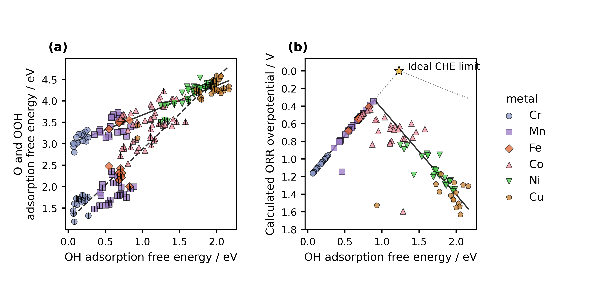
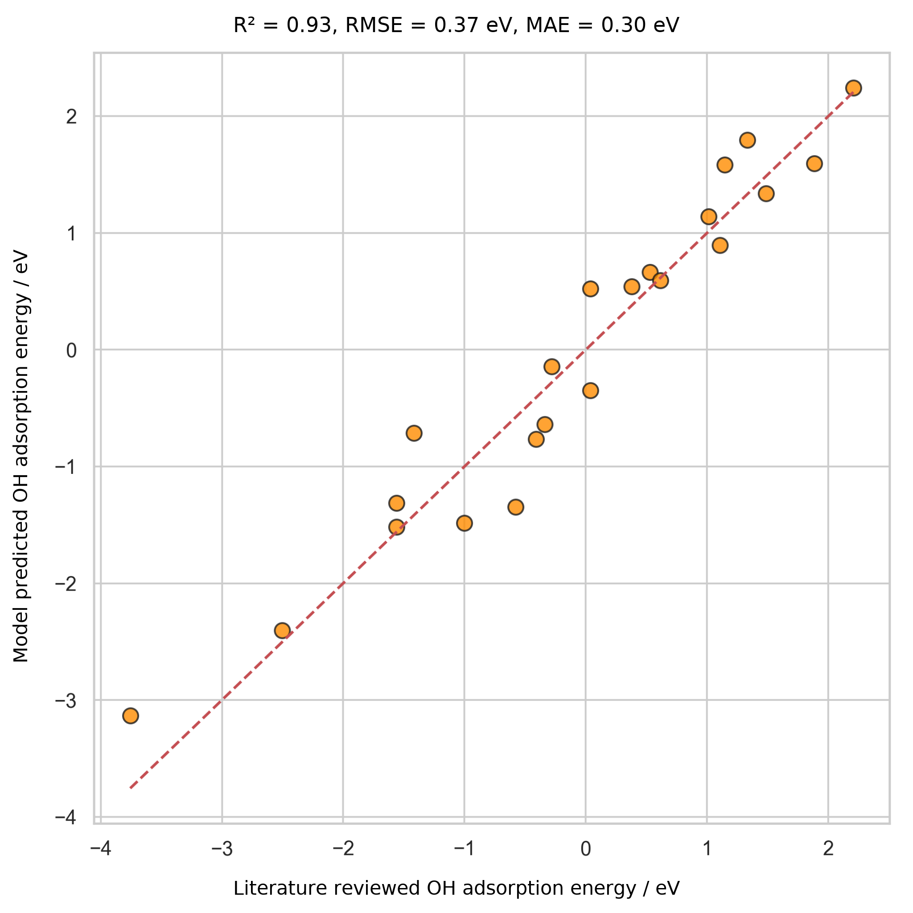

<!-- Reconstructed from ../manuscript_versions/Electrochimica_Acta_research_article_draft_v30.docx. -->

# **Accelerating Catalyst Discovery and Design with Artificial Intelligence: Molecular Dual-Atom Site Catalysts as a Case Study**

Bruno Inácio da Silva Roux Leite,1 Denis Savchenko,1 Timmo-Henrik Pukk,1 Ba Long Nguyen,1 Vladislav Ivanistsev,2† Nadezda Kongi,1†

1 Institute of Chemistry, University of Tartu, Ravila 14a, 50411 Tartu, Estonia

2 Department of Chemistry, University of Latvia, Jelgavas iela 1, Riga, LV-1004, Latvia

*Corresponding authors: nadezda.kongi@ut.ee; vladislav.ivanistsev@lu.lv*

## **Abstract**

*We **examine** **whether** **artificial** **intelligence can accelerate catalyst discovery and research communication when computational results retain their structural and methodological context. We use** the oxygen reduction reaction **on** **molecular** **dual-atom** **site catalysts as a case study. We match O, OH, and OOH calculations** by catalyst and adsorption **site,** **select** **the** **lower energy OOH orientation for each pair, and evaluate** scaling **relations** and conventional computational hydrogen electrode **thermodynamics.** The working **data** **show** distinct O–OH and OOH–OH **trends,** **while** **the** available** regression comparison remains exploratory because **its model provenance and **independent validation **are** **unresolved.** **Artificial** **intelligence** **generated** **the** **complete** **manuscript** **text** **from** **the** research **record** **supplied** **by** the **authors. Reusable data and human verification anchor this demonstration** of **AI** **generated** **article preparation; the reported project time has no matched writing benchmark,** and **clear** **scientific** **communication** **remains** **central** **to** **publication.*

*Keywords: artificial intelligence; computational hydrogen electrode; density functional theory; machine learning; oxygen reduction reaction; molecular dual-atom site catalysts*

## **1. Introduction**

*Catalyst** **discovery** **combines** calculations **that** **resolve** **candidate structures with decisions about which candidates to examine next.** Density functional theory **provides** **adsorption** energies **for defined** structures, while **regression** models **summarize** patterns across **a **related **catalyst** **set** [1,2] [3].** Artificial intelligence can also generate a research article from such records. This raises a practical question: can rapid article generation remain reliable when structural identity, methods, data, and citations are explicit and verifiable?*

*We use the oxygen reduction reaction (ORR) **to** **examine** this **problem.** **The** **four** **electron** **pathway** **depends** on the relative stabilization of oxygen intermediates, **whose** correlated adsorption free energies **constrain** **thermodynamic** activity **estimates** [4]. Molecular dual-atom site catalysts provide a **chemically **defined **set** in which metal identity, **bridge,** diamine, and** adsorption site can be **varied.** **Studies** **of** related molecular **catalysts** show that binding geometry and the second metal can alter **oxygen intermediate** energetics [5,6]. **A** **valid** **comparison therefore keeps** each adsorbate **value** **tied** to the same catalyst and **adsorption site.*

*Scientific** **editors** **have** **argued** that **a** coherent **theme** and **carefully selected** figures **help** **readers** **follow** the** question, evidence, and interpretation [7,8] [9,10]. **Yet** **a** **polished story can hide conflicting evidence or uncertainty when authors select observations to fit a** narrative **[11].** **The** **relevant** **test** **is** **whether** **AI can produce a coherent account while keeping claims traceable** to **data,** **methods,** and **sources.*

*Here, we examine that question using site matched adsorption records for a molecular catalyst library. We evaluate scaling relations and conventional oxygen reduction thermodynamics, retain the Calle-Vallejo and Exner descriptors for discussion, and present the available regression comparison with its validation limits. Figure 1 defines the catalyst structure, Figure 2 presents the scaling relations and conventional computational hydrogen electrode volcano, and Figure 3 summarizes the current regression evidence. **The **entire** **manuscript** **text** **was** **generated** **by** **AI** **from** **materials supplied by the researchers. The calculations and** research **records** **provide** the **evidence;** **human** **researchers** **remain** **responsible** **for** **checking** **its** **identity,** methods, **and **interpretation.*

## **2. Computational methods**

### **2.1. Catalyst structures**

*The molecular catalyst library was assembled from two metal centers, a fixed A2 dialdehyde, a B1 or B2 diamine, and two N, O, or S bridge atoms. The current clean catalyst database contains 88 structures with Cr, Mn, Fe, Co, Ni, or Cu at the two metal positions. The parent structures were generated by modular assembly and spin polarized GFN2-xTB optimization; selected DFT optimized structures were reused as templates, with one metal substituted at a time. An xTB optimized geometry was used when a suitable DFT template was unavailable [12].*

*The Atomic Simulation Environment (ASE) rows carry a custom total_charge value of +2. This value is database metadata. **Runtime charge must be established from GPAW inputs or outputs; the** stored **ASE **rows **contain** **neither** **those** **inputs nor** calculator **parameters.** We therefore report **+2 only as **the database **label.*

### **2.2. Density functional theory calculations**

*We performed spin polarized DFT calculations with the GPAW and ASE framework [13,14]. The calculations used the projector augmented wave method, the revised Perdew–Burke–Ernzerhof functional, and the D4 dispersion correction [15]. A plane wave basis with a 550 eV kinetic energy cutoff and a real space grid spacing of 0.16 Å were used. Molecules were placed in isolated cells with 6.00 Å vacuum and Γ point sampling. **We relaxed the atomic** positions **and** **converged** **the electronic density** self **consistently. Force and electronic convergence thresholds were absent from the supplied report.** Gas phase H₂ and H₂O reference molecules were calculated with the same settings. The calculation report describes this setup as following the GPAW methodology used for related molecular catalysts [6].*

### **2.3. Adsorption structures and database matching**

*We optimized O, OH, and OOH on each available metal atom. Two initial OOH geometries, OOH-x and OOH-z, were tested. We joined records by the exact pair (catalyst name, adsorption site label), selected the lower total energy OOH orientation separately for each pair, and retained its orientation label. A pathway was accepted only when its reconstructed values agreed with the corresponding raw database records within 10⁻⁸ eV. The observation unit throughout the analysis was one catalyst and one adsorption site combination.*

*We **derived the** adsorption **quantities from total **energies **of** the clean catalyst, adsorbed structures, and gas phase references **using** **Eqs. (1)–(3). The analysis applies fixed reference and thermochemical offsets and verifies that the resulting values match the clean database fields labeled E_ads. The same stored quantities enter the scaling fits, filters, and CHE analysis. The supplied database labels leave a separate uncorrected energy series unverified.*

$$ΔE_OH = E_*OH + ½ E_H₂ − E_* − E_H₂O\tag{1}$$

$$ΔE_O = E_*O + E_H₂ − E_* − E_H₂O\tag{2}$$

$$ΔE_OOH = E_*OOH + 3⁄2 E_H₂ − E_* − 2E_H₂O\tag{3}$$

### **2.4. Adsorption free energies and ORR thermodynamics**

*We obtained adsorption** free energies** by adding zero point energy and entropic terms to **adsorption **energies according to Eq. (4).** The calculation report gives constant corrections of 0.30 eV for OH, 0.07 eV for O, and 0.39 eV for OOH, with reference corrections of −0.14 eV for H₂ and −0.11 eV for H₂O. The computational hydrogen electrode (CHE) treatment represents the chemical potential of a proton and electron pair as one half of the chemical potential of H₂ at zero potential [4].*

*For the associative four electron ORR pathway, **Eq.** **(5)** **converts each zero potential forward reduction** free energy **change** **to** **a** **step reduction** potential **by** **dividing** **its negative by the elementary charge.** The limiting potential **in Eq. (6) **is the **smallest** step potential, and the **overpotential** **in Eq. (7)** is referenced to the equilibrium potential of 1.23 V.*

$$ΔG_X = ΔE_X + ΔZPE_X − TΔS_X\tag{4}$$

$$U₁ = (4.92 eV − ΔG_OOH*) / e;   U₂ = (ΔG_OOH* − ΔG_O*) / e;   U₃ = (ΔG_O* − ΔG_OH*) / e;   U₄ = ΔG_OH* / e\tag{5}$$

$$U_L = min(U₁, U₂, U₃, U₄)\tag{6}$$

$$η_ORR = 1.23 V − U_L\tag{7}$$

### **2.5. Scaling and thermodynamic activity analyses**

*We fitted the O–OH and OOH–OH adsorption free energy relations by ordinary least **squares using Eq. (8).** We applied the author specified filters **to the stored adsorption quantities **after exact matching: **the **OH **value** **was** at least 0.00 eV and **the **O **value** **was** no greater than 4.92 eV. The final Figure 2 contains the** scaling relations and the conventional CHE overpotential volcano. The analysis notebook also retains calculations of the oxygen reduction electrochemical step symmetry index proposed by Calle-Vallejo and coauthors and the free energy span descriptor proposed by Exner and coauthors [16,17]. These descriptors use the same matched adsorption data and can be recalculated without repeating DFT when the input energies and conventions are unchanged.*

*Thermodynamic** **descriptors** **rank** **reaction** **free** **energies;** explicit kinetic **barriers and measured reaction rates require separate data.** The symmetry index and free energy span provide alternative **rankings** **alongside** the conventional limiting potential. **These** analyses** remain** available for comparison while the current publication figure emphasizes the conventional CHE result.** The ideal single descriptor CHE envelope in Eq. (9) gives the lowest thermodynamic overpotential at each OH adsorption free energy when the four reduction steps are balanced; it reaches zero at 1.23 eV [4].*

$$ΔG_O = α_O ΔG_OH + β_O;   ΔG_OOH = α_OOH ΔG_OH + β_OOH\tag{8}$$

$$η_ideal = 1.23 V − min(ΔG_OH* / e, (4.92 eV − ΔG_OH*) / (3e))\tag{9}$$

### **2.6.**** ****AI**** ****assisted**** ****manuscript**** ****generation**

*OpenAI** **Codex,** **using** **an** **OpenAI** **language model, generated** the **complete** **manuscript** **text** **from** the **research** question, **calculations,** **databases,** figures, source material, and writing **instructions supplied by the researchers. The authors report that** they **reviewed and verified** the **manuscript** **text** and **take** **responsibility** for **its** **claims.*

## **3. Results and discussion**

### **3.1. Molecular design space and site identity**

*Figure 1 shows the molecular scaffold and its modular components. The two metal positions use Cr, Mn, Fe, Co, Ni, or Cu; the bridge is N, O, or S; and the diamine is B1 or B2. The dialdehyde is fixed as A2. In each molecular catalyst, an adsorption site is a metal atom within the organic ligand framework at which an ORR intermediate is bound. The two metal atoms therefore define separate observations when both have adsorption data.*

Figure 1. Modular molecular structure of the catalyst library. The metal list gives the elements available at the two metal positions; bridge atoms are N, O, or S; diamines are B1 or B2; and the dialdehyde is fixed as A2. The arrows identify the metal region, bridge, diamine, and lower aromatic ring assigned to A2.

*The clean working database contains 88 catalyst structures. Exact matching of the raw O, OH, OOH-x, and OOH-z databases produced 123 complete pathways across 82 unique **catalysts;** the specified** filters retained 118 pathways across 79 unique catalysts. **The** **calculation** **report** **gives** **114** **complete** **catalyst** and **adsorption** **site** **systems. Its cohort or inclusion definition remains to be identified, so** the final **pathway** **count** **awaits** **reconciliation.*

### **3.2. Adsorption scaling and calculated ORR thermodynamics**

*Figure 2a compares O and OOH adsorption free energies with OH adsorption free energy. For the filtered working dataset, the global OOH–OH fit is ΔG(OOH*) = 0.69ΔG(OH*) + 2.98 eV (R² = 0.84), while the O–OH fit is ΔG(O*) = 1.66ΔG(OH*) + 1.20 eV (R² = 0.93). **Their** **slopes** and **dispersion** **differ,** **motivating** **family** **resolved** **comparisons** **with** **established** scaling **constraints** **before** **claims about breaking those constraints.** Prior work on molecular Co₂ catalysts reports bidentate OOH binding, and DFT analysis of related salphen units reports family dependent scaling behavior [5,2].*

Figure 2. Scaling relations and conventional computational hydrogen electrode analysis for the current working catalyst set. Catalyst structural features are summarized in Figure 1. (a) O and OOH adsorption free energies versus OH adsorption free energy. Marker color identifies the element at the adsorption site, and marker shape distinguishes the adsorption site family; OOH uses the colored marker, while O uses the same family marker with a thin black vertical stroke whose width matches the marker border. The solid and dashed lines are global least squares fits for OOH–OH and O–OH, respectively. (b) Calculated conventional computational hydrogen electrode overpotential versus OH adsorption free energy. The vertical axis is reversed, with zero as the first labeled value and a small display margin above it. The charcoal curve propagates the global scaling fits in panel (a) through the four step reaction model. The gray dotted curve is the ideal CHE envelope, and the star marks its limit at zero overpotential and OH adsorption free energy 1.23 eV. Each data point represents one catalyst and one adsorption site combination.

*Figure 2b shows the **calculated** conventional **computational** **hydrogen electrode overpotential,** with **the** vertical **axis** **reversed. The lowest value in** the filtered working **dataset** is 0.34 V at the Mn adsorption site of a Cr–Mn catalyst with an S–S bridge and B1 diamine. Its **stored** adsorption **quantities** are 0.89 eV for OH, 1.99 eV for O, and 3.41 eV for OOH; the OH to water step determines the limiting potential. This **thermodynamic **ranking **applies** **to** the present structures,** corrections, matching rules, and filters. **The **curve** **propagates** the global **scaling **fits** through the four step **reaction** **model,** **as** **described** **in** the **Figure** **2 caption.*

### **3.3. Regression evidence and its current limits**

*Figure 3 presents the available OH comparison and **the fit statistics reported with **it.** **The** 30 **records summarize this comparison; independent predictive accuracy requires held out catalyst** and **adsorption** **site** **records.** The** descriptor report **gives** **conflicting** **predictor** **counts** and** validation and grouped cross validation **cohorts,** **so** **Figure** **3** **remains** an exploratory result **while** the model inputs, sample identities, split assignments, and metrics are reconciled.*

*The planned model is linear regression with second-order polynomial features, whereas the descriptor report describes ridge regression. The available records leave the plotted model, independence of its 30 values, and applicable validation cohort unresolved. Figure 3 remains exploratory pending the model code, sample identities, and prediction records.*

Figure 3. Initial comparison of model predicted OH adsorption energy with OH adsorption energy values compiled from literature for 30 records. The dashed line denotes parity. The plot displays R² = 0.93, root mean square error = 0.37 eV, and mean absolute error = 0.30 eV. The source records omit train and test assignments, so the independence of these points remains unknown and the comparison is exploratory.

### **3.4. Reanalysis from reusable data**

*The** exact, site matched adsorption records support the conventional CHE calculation and the alternative Calle-Vallejo and Exner **analyses.** **With** catalyst identity, adsorption site, OOH orientation, and **energy** convention **retained,** **researchers** **can** **recalculate** these descriptors **from** **stored** **energies** **without** repeating **DFT.** **Changes** **to** molecular geometry, charge state, or adsorption structure **require new calculations.*

*The** **planned** release **will include** catalyst structures and results as an Atomic Simulation Environment (ASE) database and **machine readable **JSON,** together with **code **for** **reconstructing** the joins and figures. These formats** support findable, accessible, interoperable, and reusable data practices [18]. A **documented schema lets a **language model **prepare** **an** **alternative** analysis or plot at low computational **cost;** **researchers can then check** its** inputs, equations, code, and **results** **before** **interpretation.*

*The authors report **that** prompt development **took** about two weeks **and** **generation of the integrated draft took** less than one **hour.** They recall comparable manual writing efforts that took **months.** **These** **time** **figures** **are** project **specific** **and qualitative; comparison with human writing requires** a matched **study.*

## **4. Conclusions**

*The working calculations show** distinct O–OH and OOH–OH **adsorption trends** and a provisional ranking **from** conventional computational hydrogen electrode thermodynamics. **These** **comparisons** **preserve catalyst** and **adsorption** **site** **identity.** The **pathway** **count** **remains** **provisional,** **and** **Figure** **3** **remains** **exploratory;** **predictive** **transfer** **awaits** **a defined** model **and** **validation** **set.*

*This case **shows **that AI can generate** a **coherent** research account from** structured** methods, data, figures, and **literature,** **while** **reusable** site matched records **make** **alternative** **thermodynamic analyses straightforward** to **reproduce.** **Researchers** remain responsible for **selecting** the analysis, **verifying every generated claim, and **interpreting the **evidence. Transparent data** and **methods** **support** **independent** **checking** **and reanalysis.*

## **Funding**

*This work was supported by the Estonian Ministry of Education and Research (TK210) and the Estonian Research Council (PRG3174).*

## **CRediT authorship contribution statement**

*Bruno Inácio da Silva Roux Leite: investigation, data curation, formal analysis, and generation of DFT results. Denis Savchenko: methodology, software, formal analysis, visualization, and development of the regression model. Timmo-Henrik Pukk: investigation, data curation, formal analysis, and generation of DFT results. Ba Long Nguyen: investigation, software, data curation, formal analysis, visualization, and generation of DFT results. Vladislav Ivanistsev: conceptualization, supervision, and funding acquisition. Nadezda Kongi: conceptualization, supervision, and funding acquisition. **Validation** **of** **the** **manuscript text:** all authors. All authors **approved** the **final** text.*

## **Declaration of competing interest**

*The authors declare no competing interests.*

## **Data availability**

*The parent molecular dual-atom site catalyst dataset is available from Zenodo [19]. The final adsorption databases, processed site matched data, machine readable JSON records, analysis notebooks, and model predictions will be deposited with the final article. The databases used for the present working analysis are provisional.*

## **Declaration of generative AI and AI assisted technologies in the manuscript preparation process**

*OpenAI** **Codex,** **using** **an** **OpenAI language model, generated** the **complete** **manuscript** **text** **from** project **records, figures, literature,** and **author** **supplied** **instructions.** The authors **report that they **reviewed **and** verified the **text** and take responsibility for **its **content.*

## **Acknowledgments**

*We acknowledge the University of Latvia Artificial Intelligence and Computing Center and the High Performance Computing Center of the University of Tartu for providing computational resources.*

## **References**

[1] S. Jia et al., Machine Learning Reveals Role-Asymmetric Electronic Cooperation in Fe-Based Dual-Atom Catalysts, Advanced Materials 36 (2026) e74833. [https://doi.org/10.1002/adma.74833](https://doi.org/10.1002/adma.74833)

[2] Z. Zhang et al., Design and Synthesis of Electrocatalysts Based on Catalysis-Unit Engineering, Advanced Materials 36 (2024) 2403549. [https://doi.org/10.1002/adma.202403549](https://doi.org/10.1002/adma.202403549)

[3] X. Chen et al., Leveraging DFT and Machine Learning for Accelerated Screening of Cluster-Modified Single-Atom Catalysts in Oxygen Reduction Reactions, ACS Catalysis 16 (2026) 14399–14410. [https://doi.org/10.1021/acscatal.6c02383](https://doi.org/10.1021/acscatal.6c02383)

[4] J. K. Nørskov, J. Rossmeisl, A. Logadottir, L. Lindqvist, J. R. Kitchin, T. Bligaard, H. Jónsson, Origin of the Overpotential for Oxygen Reduction at a Fuel-Cell Cathode, Journal of Physical Chemistry B 108 (2004) 17886–17892. [https://doi.org/10.1021/jp047349j](https://doi.org/10.1021/jp047349j)

[5] Q. Sun et al., Well-Defined Co₂ Dual-Atom Catalyst Breaks Scaling Relations of Oxygen Reduction Reaction, Journal of the American Chemical Society 146 (2024) 35295–35304. [https://doi.org/10.1021/jacs.4c12705](https://doi.org/10.1021/jacs.4c12705)

[6] N. Žoglo et al., Intersite Geometry Controls Activity and Selectivity in the Oxygen Reduction Reaction on Dual-Atom-Site Catalysts, ChemRxiv preprint (2026). [https://doi.org/10.26434/chemrxiv.15001712/v1](https://doi.org/10.26434/chemrxiv.15001712/v1)

[7] L. X. Chen, P. Christopher, F. De Angelis, S. Jin, Y.-S. Hu, N.-G. Park, D. Das Sarma, Y.-K. Sun, P. V. Kamat, We Editors Are Authors, Too, ACS Energy Letters 4 (2019) 249–250. [https://doi.org/10.1021/acsenergylett.8b02322](https://doi.org/10.1021/acsenergylett.8b02322)

[8] Elements of style, Nature Physics 3 (2007) 581. [https://doi.org/10.1038/nphys724](https://doi.org/10.1038/nphys724)

[9] C. M. Biegel, P. V. Kamat, Five common pitfalls to avoid while composing scientific figures, ACS Energy Letters 6 (2021) 4309–4310. [https://doi.org/10.1021/acsenergylett.1c02401](https://doi.org/10.1021/acsenergylett.1c02401)

[10] Storytelling in research, Nature Biomedical Engineering 2 (2018) 53. [https://doi.org/10.1038/s41551-018-0202-5](https://doi.org/10.1038/s41551-018-0202-5)

[11] Should scientists tell stories?, Nature Methods 10 (2013) 1037. [https://doi.org/10.1038/nmeth.2726](https://doi.org/10.1038/nmeth.2726)

[12] B. L. Nguyen, T. K. Madsen, V. Ivanistsev, N. Kongi, Dataset of molecular dual-atom site complexes for catalysis, Data in Brief 66 (2026) 112806. [https://doi.org/10.1016/j.dib.2026.112806](https://doi.org/10.1016/j.dib.2026.112806)

[13] J. J. Mortensen et al., GPAW: An open Python package for electronic structure calculations, Journal of Chemical Physics 160 (2024) 092503. [https://doi.org/10.1063/5.0182685](https://doi.org/10.1063/5.0182685)

[14] A. H. Larsen et al., The Atomic Simulation Environment—A Python Library for Working with Atoms, Journal of Physics: Condensed Matter 29 (2017) 273002. [https://doi.org/10.1088/1361-648X/aa680e](https://doi.org/10.1088/1361-648X/aa680e)

[15] E. Caldeweyher, S. Ehlert, A. Hansen, H. Neugebauer, S. Spicher, C. Bannwarth, S. Grimme, A generally applicable atomic-charge dependent London dispersion correction, Journal of Chemical Physics 150 (2019) 154122. [https://doi.org/10.1063/1.5090222](https://doi.org/10.1063/1.5090222)

[16] N. Govindarajan, J. M. García-Lastra, E. J. Meijer, F. Calle-Vallejo, Does the breaking of adsorption energy scaling relations guarantee enhanced electrocatalysis?, Current Opinion in Electrochemistry 8 (2018) 110–117. [https://doi.org/10.1016/j.coelec.2018.03.025](https://doi.org/10.1016/j.coelec.2018.03.025)

[17] S. Razzaq, K. S. Exner, Materials screening by the descriptor Gmax(η): The free energy span model in electrocatalysis, ACS Catalysis 13 (2023) 1740–1758. [https://doi.org/10.1021/acscatal.2c03997](https://doi.org/10.1021/acscatal.2c03997)

[18] M. D. Wilkinson et al., The FAIR guiding principles for scientific data management and stewardship, Scientific Data 3 (2016) 160018. [https://doi.org/10.1038/sdata.2016.18](https://doi.org/10.1038/sdata.2016.18)

[19] [dataset] B. L. Nguyen, T. K. Madsen, V. Ivanistsev, N. Kongi, Dataset of molecular dual-atom site complexes for catalysis, Zenodo, version 1.0, 2026. [https://doi.org/10.5281/zenodo.18601379](https://doi.org/10.5281/zenodo.18601379)
