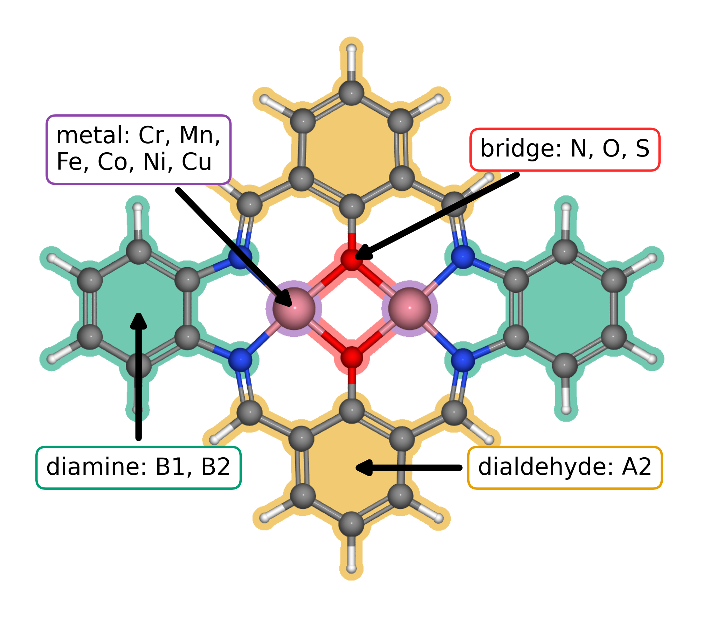
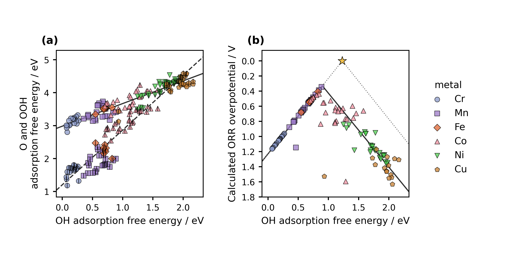
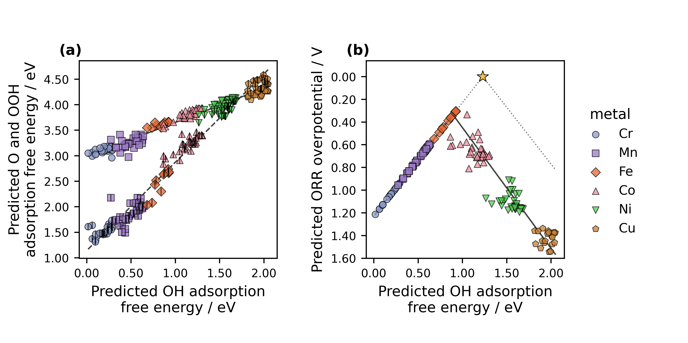

<!-- Reconstructed from ../manuscript_versions/Electrochimica_Acta_research_article_draft_v33.docx; source DOCX SHA-256: cb068be2bb359d2ef3af843f527b15a522c94c24f40e1f36f14487c7bc797b6f. -->

# **Accelerating Catalyst Discovery and Design with Artificial Intelligence: Molecular Dual-Atom Site Catalysts as a Case Study**

Bruno Inácio da Silva Roux Leite,1 Denis Savchenko,1 Timmo-Henrik Pukk,1 Ba Long Nguyen,1 Vladislav Ivanistsev,2† Nadezda Kongi,1†

***1 Institute of Chemistry, University of Tartu, Ravila 14a, 50411 Tartu, Estonia***

***2 Department of Chemistry, University of Latvia, Jelgavas iela 1, Riga, LV-1004, Latvia***

***Corresponding authors: nadezda.kongi@ut.ee; vladislav.ivanistsev@lu.lv***

## **Abstract**

***Accelerating catalyst discovery requires timely analysis and clear communication as well as new calculations. We examine how a guided language model can help with these tasks through a study of oxygen reduction on molecular dual-atom site catalysts. We connect optimized molecular structures to adsorption scaling, thermodynamic activity estimates, and regression predictions. The two analyses recover the broad adsorption trends but prioritize different sites, which gives us a concrete reason to inspect the predictions and plan further calculations. We also use the language model to generate the complete article from the research record. This deliberate demonstration asks how much narrative labor researchers need to retain when they can guide and verify its production. We argue that the opportunity is to devote more attention to research design, implementation, and interpretation while delegating much of the analysis and reporting to artificial intelligence.***

***Keywords: artificial intelligence; computational hydrogen electrode; density functional theory; machine learning; oxygen reduction reaction; molecular dual-atom site catalysts***

## **1. Introduction**

***Editors have made scientific storytelling a test of whether research deserves attention. Nature Physics calls the story the principle that should organize an entire paper, ACS Energy Letters asks authors to build discussion around a coherent story, and other editorials describe figures as the backbone or even the most persuasive part of an article ******[***[***10.1038/nphys724***](https://doi.org/10.1038/nphys724)***; ***[***10.1021/acsenergylett.8b02322***](https://doi.org/10.1021/acsenergylett.8b02322)***; ***[***10.1038/s44160-022-00067-8***](https://doi.org/10.1038/s44160-022-00067-8)***; ***[***10.1038/s41567-021-01332-x***](https://doi.org/10.1038/s41567-021-01332-x)***]******. This is a powerful thesis, and it is the thesis we challenge. A clear account helps readers understand a result. Yet the scientific value of the work resides in the data, methods, and decisions that let readers test that account.***

***Our counterclaim is direct: researchers need not spend months personally composing that story. When the data are structured, the methods are explicit, and every claim can be traced to evidence, we can outsource much of the analysis and narrative drafting to a guided large language model. The model can organize the argument and select a path through the results; we remain responsible for asking the question, producing the data, choosing the analysis, and deciding what the evidence means. That change moves human attention from polishing the story to strengthening the research that makes the story possible.***

***The antithesis is already visible. The same fluency that makes a language model useful can produce an authoritative story from weak evidence, conceal an inconvenient result, or decorate an unsupported claim with a plausible figure. Nature Methods warned that narrative can distort science even before generative AI made polished prose inexpensive ******[***[***10.1038/nmeth.2726***](https://doi.org/10.1038/nmeth.2726)***]******. We confront that danger by making the data, calculation rules, code, and source links inspectable. In this article, the story must answer to the record.***

***We test this argument through the oxygen reduction reaction (ORR). Its four electron pathway depends on the binding of O, OH, and OOH, so correlated adsorption free energies constrain thermodynamic activity ******[***[***10.1021/jp047349j***](https://doi.org/10.1021/jp047349j)***]******. Molecular dual-atom site catalysts give us a defined set in which metal identity, bridge, diamine, and adsorption site vary, see ******Figure 1******. Related molecular catalysts show how binding geometry and the second metal can change oxygen intermediate energetics ******[***[***10.1021/jacs.4c12705***](https://doi.org/10.1021/jacs.4c12705)***; ***[***10.26434/chemrxiv.15001712/v1***](https://doi.org/10.26434/chemrxiv.15001712/v1)***]******. We follow these changes through the DFT data in ******Figure 2****** and ask what regression retains in ******Figure 3******. The calculations provide the antithesis to an article driven by narrative alone: the language model can write the complete paper, but the data determine what it is allowed to say.***

## **2. Computational methods**

### **2.1. Catalyst structures**

***We assembled the molecular catalysts from the components shown in ******Figure 1******. Following the notation introduced in our data article ******[***[***10.1016/j.dib.2026.112806***](https://doi.org/10.1016/j.dib.2026.112806)***]******, A2 denotes the fixed dialdehyde and B1 and B2 denote the two diamines. Each molecule contains two metal centers chosen from Cr, Mn, Fe, Co, Ni, and Cu and bridge atoms selected from N, O, or *****S*****. The same article describes the molecular assembly and initial structure preparation. We fully optimized all structures used in the DFT analysis, including the clean catalysts and structures containing adsorbed intermediates. The clean database used here contains 88 molecular catalysts.***

***We retained the catalyst identity, metal positions, ligand components, and charge metadata in the Atomic Simulation Environment (ASE) database.***

### **2.2. Density functional theory calculations**

***We performed spin polarized DFT calculations using GPAW 26.7 and ASE 3.29.0 software ******[***[***10.1063/5.0182685***](https://doi.org/10.1063/5.0182685)***; ***[***10.1088/1361-648X/aa680e***](https://doi.org/10.1088/1361-648X/aa680e)***]******. We used the projector augmented wave method, the revised Perdew–Burke–Ernzerhof functional, and the D4 dispersion correction ******[***[***10.1063/1.5090222***](https://doi.org/10.1063/1.5090222)***]******. The calculations used a plane wave cutoff of 550 eV, a real space grid spacing of 0.16 Å, 6.00 Å vacuum, and Γ point sampling for isolated molecules. We fully relaxed the atomic positions and converged the electronic density. We calculated gas phase H₂ and H₂O with the same settings. This methodology follows our work on related molecular catalysts ******[***[***10.26434/chemrxiv.15001712/v1***](https://doi.org/10.26434/chemrxiv.15001712/v1)***]******.***

### **2.3. Adsorption structures and database matching**

***We placed O, OH, and OOH at the metal adsorption sites identified in ******Figure 1****** and fully optimized each structure. For OOH, we retained the lower energy of the two tested initial orientations at each site. We joined all intermediate energies by catalyst name and adsorption site label. Thus, each reaction pathway refers to one specific metal atom in one molecular catalyst.***

***We defined adsorption energies from the total energies of the clean catalyst, adsorbed structures, and gas phase references using Eqs. (1)–(3). An asterisk denotes the clean adsorption site or a bound intermediate, as appropriate. The analysis used the supplied corrected adsorption free energies directly for scaling, filtering, and thermodynamic activity estimates.***

$$Δ{E}_{OH} = {E}_{*OH} + (1/2) {E}_{{H}_{2}} − {E}_{*} − {E}_{{H}_{2}O}\tag{1}$$

$$Δ{E}_{O} = {E}_{*O} + {E}_{{H}_{2}} − {E}_{*} − {E}_{{H}_{2}O}\tag{2}$$

$$Δ{E}_{OOH} = {E}_{*OOH} + (3/2) {E}_{{H}_{2}} − {E}_{*} − 2{E}_{{H}_{2}O}\tag{3}$$

### **2.4. Adsorption free energies and ORR thermodynamics**

***Adsorption free energies include zero point energy and entropy contributions as expressed in Eq. (4), where X denotes O, OH, or OOH, ******E****** denotes electronic energy, ******G****** Gibbs free energy, ******T****** temperature, and ******S****** entropy. The subscript ZP denotes the zero point contribution. For this analysis, we treated the supplied values as already corrected. The computational hydrogen electrode (CHE) represents the chemical potential of a proton and electron pair by one half of that of H₂ at zero potential ******[***[***10.1021/jp047349j***](https://doi.org/10.1021/jp047349j)***]******.***

***For the associative four electron ORR pathway, Eq. (5) defines the step reduction potentials from the adsorption free energies and the elementary charge. Their minimum gives the limiting potential in Eq. (6). The overpotential in Eq. (7) is referenced to the equilibrium potential of 1.23 V. Chemical subscripts identify the adsorbed intermediate.***

$$Δ{G}_{X} = Δ{E}_{X} + Δ{E}_{ZP,X} − TΔ{S}_{X}\tag{4}$$

$${U}_{1} = (4.92 eV − Δ{G}_{OOH}) / e{U}_{2} = (Δ{G}_{OOH} − Δ{G}_{O}) / e{U}_{3} = (Δ{G}_{O} − Δ{G}_{OH}) / e{U}_{4} = Δ{G}_{OH} / e\tag{5}$$

$${U}_{L} = min({U}_{1}, {U}_{2}, {U}_{3}, {U}_{4})\tag{6}$$

$${η}_{ORR} = 1.23 V − {U}_{L}\tag{7}$$

### **2.5. Scaling and thermodynamic activity analyses**

***We fitted O–OH and OOH–OH adsorption free energy scaling relations by ordinary least squares using Eq. (8). We retained sites with OH adsorption free energy of at least 0.00 eV and O adsorption free energy no greater than 4.92 eV. The curves in Figures 2 and 3 propagate the corresponding global scaling fits through all four CHE steps. The electrochemical step symmetry index and free energy span offer complementary thermodynamic interpretations of the same adsorption records ******[***[***10.1016/j.coelec.2018.03.025***](https://doi.org/10.1016/j.coelec.2018.03.025)***; ***[***10.1021/acscatal.2c03997***](https://doi.org/10.1021/acscatal.2c03997)***]******.***

***The dotted ideal reference in Eq. (9) assumes an OOH–OH free energy separation of 2.46 eV. OH removal defines its left branch and OOH formation its right branch. The branches meet at OH adsorption free energy 1.23 eV and zero overpotential. This reference illustrates balanced binding; the catalyst points and fitted volcano curves use all four reaction steps. Thermodynamic rankings describe reaction free energies, while kinetic activity also depends on activation barriers.***

$$Δ{G}_{O} = {α}_{O} Δ{G}_{OH} + {β}_{O}Δ{G}_{OOH} = {α}_{OOH} Δ{G}_{OH} + {β}_{OOH}\tag{8}$$

$$Δ{{G}_{OOH}}^{ideal} = Δ{G}_{OH} + 2.46 eV{η}_{ideal} = 1.23 V − min(Δ{G}_{OH} / e, (2.46 eV − Δ{G}_{OH}) / e)\tag{9}$$

### 2.6. Regression analysis

***We used fitted ridge regression models for OH, O, and OOH adsorption free energies using descriptors of the clean catalysts in ******Figure 1******. These describe Bader charge and electron population, local spin, and ligand charge distribution. The supplied models contain eight predictors for OH and O and six for OOH. We applied the saved training medians, means, standard deviations, and coefficients to all available catalyst and adsorption site records. We then joined the three predictions at each site, applied the energy filters, and evaluated the overpotential with Eqs. (5)–(7).***

***Figure 3****** includes every available site that passes these filters, including sites used for model fitting. It describes predicted trends across the library. We used the supplied validation predictions to check reproduction of the saved models; the all-site figure itself does not measure independent predictive accuracy.***

### 2.7. AI assisted manuscript generation

***We used a large language model (LLM), accessed through OpenAI Codex, to generate the complete manuscript and develop analysis and figure code under our direction. Our motivation was to examine a practical response to the growing use of AI in scientific writing. Analysis of biomedical abstracts documents substantial uptake of LLM assisted writing ******[***[***10.1126/sciadv.adt3813***](https://doi.org/10.1126/sciadv.adt3813)***]******. That observation establishes the scale of adoption; it does not establish the reliability of any individual article. We address the risk that rapid generation can also multiply unsupported claims and invented figures by grounding this article in supplied calculations, explicit analysis choices, and identifiable sources.***

***We supplied the research question, databases, regression coefficients, literature, and writing instructions, then refined the analysis and text through successive corrections. We required figures to be generated by executable code from the molecular structures and numerical records. We used the LLM to organize the evidence, examine alternative analyses, and compose the narrative; we decided which questions to pursue and checked the resulting claims. The manuscript itself is part of this demonstration. Its coherence is useful only insofar as a reader can follow the account back to the calculations and assess our interpretation.***

## **3. Results and discussion**

### **3.1. Molecular design space and site identity**

***Figure 1****** gives us a common molecular structure in which to compare the effects of changing individual components. Both metal positions draw from the same six elements, while the bridge and diamine provide further variation and the dialdehyde remains fixed. We define an adsorption site as the metal atom within the organic ligands to which an ORR intermediate binds. Keeping that atom identifiable lets us distinguish the two possible pathways in the same molecule.***

***Figure 1.****** Modular molecular structure of the catalyst library. The metal list gives the elements available at the two metal positions; bridge atoms are N, O, or *****S*****. A2, B1, and B2 follow the dialdehyde and diamine notation introduced in our data article ******[***[***10.1016/j.dib.2026.112806***](https://doi.org/10.1016/j.dib.2026.112806)***]******. The arrows identify the metal region, bridge, diamine, and lower aromatic ring assigned to A2.***

***The clean database contains 88 catalyst structures. Exact matching of the raw adsorption databases produced 123 complete pathways across 82 catalysts. The energy filters retained 118 pathways across 79 catalysts for ******Figure 2******. ******Figure 3****** extends the analysis to sites with available clean catalyst descriptors.***

### **3.2. Adsorption scaling and calculated ORR thermodynamics**

***Figure 2a****** compares O and OOH adsorption free energies with OH adsorption free energy. The OOH–OH relation has a slope of 0.69 and an intercept of 2.98 eV; the O–OH relation has a slope of 1.66 and an intercept of 1.20 eV. The adsorption site families occupy different parts of these trends, with scatter around the global relations. Related molecular catalysts can alter OOH binding geometry and adsorption scaling through their paired metal centers ******[***[***10.1021/jacs.4c12705***](https://doi.org/10.1021/jacs.4c12705)***; ***[***10.1002/adma.202403549***](https://doi.org/10.1002/adma.202403549)***]******. The present trends provide a basis for examining such structural effects within a common molecular structure.***

***Figure 2.****** Adsorption scaling and oxygen reduction thermodynamics from DFT. ******Figure 1****** defines the structural components. (a) O and OOH adsorption free energies versus OH adsorption free energy. Color and marker shape identify the metal at the adsorption site; the centered vertical stroke denotes O. Solid and dashed lines are OOH–OH and O–OH scaling fits. (b) CHE overpotential for the same catalyst and adsorption site combinations. The solid curve follows the global scaling fits through all four reaction steps. The dotted ideal reference assumes an OOH–OH separation of 2.46 eV, with OH removal and OOH formation defining its left and right branches. The star marks zero overpotential at 1.23 eV. Lower overpotential appears higher on the reversed axis.***

***Figure 2b****** shows the calculated conventional computational hydrogen electrode overpotential, with the vertical axis reversed. The lowest value in the filtered working dataset is 0.34 V at the Mn adsorption site of a Cr–Mn catalyst with an *****S*****–*****S***** bridge and B1 diamine. Its stored adsorption quantities are 0.89 eV for OH, 1.99 eV for O, and 3.41 eV for OOH; the OH to water step determines the limiting potential. This thermodynamic ranking applies to the present structures, corrections, matching rules, and filters. The curve propagates the global scaling fits through the four step reaction model, as described in the ******Figure 2****** caption.***

### 3.3. Scaling and activity from regression predictions

***We next ask how much of this pattern the regression recovers. ******Figure 3****** applies the same analysis to predicted adsorption free energies. Complete predictions were available for 148 sites across 88 catalysts, and the filters retained 144 sites across 87 catalysts. The predicted OOH–OH slope and intercept are 0.67 and 2.98 eV, while those for O–OH are 1.73 and 1.14 eV. Their proximity to the DFT relations in ******Figure 2****** shows that the descriptors retain the broad variation across the molecular library. The narrower spread of the predictions also prompts a closer look at the individual rankings.***

***Near the volcano maximum, the distinction becomes consequential. The lowest predicted overpotential is 0.30 V at the Fe site of an Fe–Mn catalyst with *****S***** bridge atoms and B1 diamine. The DFT analysis in ******Figure 2****** instead prioritizes a Mn site. We can use this disagreement to select a useful next calculation: inspect the binding structures and descriptors of these candidates, then test whether the predicted order survives. ******Figure 3****** therefore helps us direct further research while displaying the broad trends that the regression has learned. Its all-site predictions include fitted records, so the figure describes the represented library rather than establishing transfer to new chemical families.***

***Figure 3.****** Adsorption scaling and oxygen reduction thermodynamics from regression predictions. (a) Predicted O and OOH adsorption free energies versus predicted OH adsorption free energy. (b) Overpotentials derived from the three predictions for each catalyst and adsorption site combination. All available sites passing the energy filters are shown. Colors, markers, and the ideal reference follow ******Figure 2******. The solid and dashed lines in (a) are the OOH–OH and O–OH fits; the solid curve in (b) follows those fits through the four reaction steps. The figure includes sites used for model fitting.***

### 3.4. From reusable data to the next research question

***The comparison between Figures 2 and 3 raises a further question: how much does candidate selection depend on the activity measure we choose? We can examine it with the same site matched records. The Calle-Vallejo electrochemical step symmetry index and the Exner free energy span emphasize different features of the reaction energetics ******[***[***10.1016/j.coelec.2018.03.025***](https://doi.org/10.1016/j.coelec.2018.03.025)***; ***[***10.1021/acscatal.2c03997***](https://doi.org/10.1021/acscatal.2c03997)***]******. Once the energies are stored with their molecular and site identities, we can ask an LLM to implement either analysis, inspect the code, and compare the resulting rankings. We reserve new DFT calculations for questions that change the geometry, charge state, or adsorption structure.***

***We will release the structures and results as an ASE database and machine readable JSON, together with code that reconstructs the analysis. These formats support findable, accessible, interoperable, and reusable data practices ******[***[***10.1038/sdata.2016.18***](https://doi.org/10.1038/sdata.2016.18)***]******. They also make our interpretation open to revision: another researcher can choose a different descriptor, regenerate the figures, and identify where the conclusions change. The value of the record grows when it can answer a question that we did not originally ask.***

***We developed the instructions over about two weeks and estimate that executing the resulting instructions to generate an integrated draft takes less than an hour. In our experience, composing comparable articles manually has taken months. This account describes our project rather than a controlled timing study. The concrete result is that we can revise an analysis and its written explanation together, while directing our attention to the assumptions and decisions that determine what the result means.***

## **4. Conclusions**

***Accelerating catalyst discovery with artificial intelligence includes accelerating how we analyze and report the research. We have used molecular catalyst calculations to make that possibility concrete: the same structured records support adsorption scaling, thermodynamic rankings, regression predictions, and alternative activity descriptors. A guided language model can help execute these analyses and explain their relationship. Where the rankings disagree, we gain a question for further research rather than a reason to force the results into one story.***

***We began with the claim that a convincing story is central to a scientific paper, and we deliberately outsourced the composition of that story to a language model. The model generated the complete article, connected the figures, and revised the argument under our direction. It could do so because the calculations, molecular identities, analysis rules, and sources constrained the prose. This demonstration changes where the intellectual burden should fall. Researchers can spend less time manufacturing narrative continuity and more time planning the research, producing reliable data, testing alternative interpretations, and verifying the final claims. The synthesis is therefore neither story without science nor data without explanation. It is researcher directed science in which an LLM carries much of the analytical and writing load while the researchers remain responsible for what the work establishes.***

## **CRediT authorship contribution statement**

***Bruno Inácio da Silva Roux Leite: investigation, data curation, formal analysis, and generation of DFT results. Denis Savchenko: methodology, software, formal analysis, visualization, and development of the regression model. Timmo-Henrik Pukk: investigation, data curation, formal analysis, and generation of DFT results. Ba Long Nguyen: investigation, software, data curation, formal analysis, visualization, and generation of DFT results. Vladislav Ivanistsev: conceptualization, supervision, and funding acquisition. Nadezda Kongi: conceptualization, supervision, and funding acquisition. Validation of the manuscript text: all authors. All authors approved the final text.***

## **Declaration of competing interest**

***The authors declare no competing interests.***

## **Data availability**

***The parent molecular dual-atom site catalyst dataset is available from Zenodo ******[***[***10.5281/zenodo.18601379***](https://doi.org/10.5281/zenodo.18601379)***]******. The final adsorption databases, processed site matched data, machine readable JSON records, analysis notebooks, and model predictions will be deposited with the final article. The databases used for the present working analysis are provisional.***

## **Declaration of generative AI and AI assisted technologies in the manuscript preparation process**

***We used OpenAI Codex with an OpenAI language model to generate the complete manuscript text and assist with analysis and figure code from our project records and instructions. We guided the work, reviewed and verified the text, and take responsibility for its content.***

## **Acknowledgments**

***This work was supported by the Estonian Ministry of Education and Research (TK210) and the Estonian Research Council (PRG3174). We acknowledge the University of Latvia Artificial Intelligence and Computing Center and the High Performance Computing Center of the University of Tartu for providing computational resources.***

## **References**

***S******. Jia et al., Machine Learning Reveals Role-Asymmetric Electronic Cooperation in Fe-Based Dual-Atom Catalysts, Advanced Materials 36 (2026) e74833. ******[***[***10.1002/adma.74833***](https://doi.org/10.1002/adma.74833)***]***

***Z. Zhang et al., Design and Synthesis of Electrocatalysts Based on Catalysis-Unit Engineering, Advanced Materials 36 (2024) 2403549. ******[***[***10.1002/adma.202403549***](https://doi.org/10.1002/adma.202403549)***]***

***X. Chen et al., Leveraging DFT and Machine Learning for Accelerated Screening of Cluster-Modified Single-Atom Catalysts in Oxygen Reduction Reactions, ACS Catalysis 16 (2026) 14399–14410. ******[***[***10.1021/acscatal.6c02383***](https://doi.org/10.1021/acscatal.6c02383)***]***

***J. K. Nørskov, J. Rossmeisl, A. Logadottir, L. Lindqvist, J. R. Kitchin, ******T******. Bligaard, H. Jónsson, Origin of the Overpotential for Oxygen Reduction at a Fuel-Cell Cathode, Journal of Physical Chemistry B 108 (2004) 17886–17892. ******[***[***10.1021/jp047349j***](https://doi.org/10.1021/jp047349j)***]***

***Q. Sun et al., Well-Defined Co₂ Dual-Atom Catalyst Breaks Scaling Relations of Oxygen Reduction Reaction, Journal of the American Chemical Society 146 (2024) 35295–35304. ******[***[***10.1021/jacs.4c12705***](https://doi.org/10.1021/jacs.4c12705)***]***

***N. Žoglo et al., Intersite Geometry Controls Activity and Selectivity in the Oxygen Reduction Reaction on Dual-Atom-Site Catalysts, ChemRxiv preprint (2026). ******[***[***10.26434/chemrxiv.15001712/v1***](https://doi.org/10.26434/chemrxiv.15001712/v1)***]***

***L. X. Chen, P. Christopher, F. De Angelis, ******S******. Jin, Y.-******S******. Hu, N.-******G******. Park, D. Das Sarma, Y.-K. Sun, P. V. Kamat, We Editors Are Authors, Too, ACS Energy Letters 4 (2019) 249–250. ******[***[***10.1021/acsenergylett.8b02322***](https://doi.org/10.1021/acsenergylett.8b02322)***]***

***Elements of style, Nature Physics 3 (2007) 581. ******[***[***10.1038/nphys724***](https://doi.org/10.1038/nphys724)***]***

***C. M. Biegel, P. V. Kamat, Five common pitfalls to avoid while composing scientific figures, ACS Energy Letters 6 (2021) 4309–4310. ******[***[***10.1021/acsenergylett.1c02401***](https://doi.org/10.1021/acsenergylett.1c02401)***]***

***Storytelling in research, Nature Biomedical Engineering 2 (2018) 53. ******[***[***10.1038/s41551-018-0202-5***](https://doi.org/10.1038/s41551-018-0202-5)***]***

***Should scientists tell stories?, Nature Methods 10 (2013) 1037. ******[***[***10.1038/nmeth.2726***](https://doi.org/10.1038/nmeth.2726)***]***

***B. L. Nguyen, ******T******. K. Madsen, V. Ivanistsev, N. Kongi, Dataset of molecular dual-atom site complexes for catalysis, Data in Brief 66 (2026) 112806. ******[***[***10.1016/j.dib.2026.112806***](https://doi.org/10.1016/j.dib.2026.112806)***]***

***J. J. Mortensen et al., GPAW: An open Python package for electronic structure calculations, Journal of Chemical Physics 160 (2024) 092503. ******[***[***10.1063/5.0182685***](https://doi.org/10.1063/5.0182685)***]***

***A. H. Larsen et al., The Atomic Simulation Environment—A Python Library for Working with Atoms, Journal of Physics: Condensed Matter 29 (2017) 273002. ******[***[***10.1088/1361-648X/aa680e***](https://doi.org/10.1088/1361-648X/aa680e)***]***

***E******. Caldeweyher, ******S******. Ehlert, A. Hansen, H. Neugebauer, ******S******. Spicher, C. Bannwarth, ******S******. Grimme, A generally applicable atomic-charge dependent London dispersion correction, Journal of Chemical Physics 150 (2019) 154122. ******[***[***10.1063/1.5090222***](https://doi.org/10.1063/1.5090222)***]***

***N. Govindarajan, J. M. García-Lastra, ******E******. J. Meijer, F. Calle-Vallejo, Does the breaking of adsorption energy scaling relations guarantee enhanced electrocatalysis?, Current Opinion in Electrochemistry 8 (2018) 110–117. ******[***[***10.1016/j.coelec.2018.03.025***](https://doi.org/10.1016/j.coelec.2018.03.025)***]***

***S******. Razzaq, K. ******S******. Exner, Materials screening by the descriptor Gmax(η): The free energy span model in electrocatalysis, ACS Catalysis 13 (2023) 1740–1758. ******[***[***10.1021/acscatal.2c03997***](https://doi.org/10.1021/acscatal.2c03997)***]***

***M. D. Wilkinson et al., The FAIR guiding principles for scientific data management and stewardship, Scientific Data 3 (2016) 160018. ******[***[***10.1038/sdata.2016.18***](https://doi.org/10.1038/sdata.2016.18)***]***

***[dataset] B. L. Nguyen, ******T******. K. Madsen, V. Ivanistsev, N. Kongi, Dataset of molecular dual-atom site complexes for catalysis, Zenodo, version 1.0, 2026. ******[***[***10.5281/zenodo.18601379***](https://doi.org/10.5281/zenodo.18601379)***]***

***D. Kobak, R. González-Márquez, ******E******.-Á. Horvát, J. Lause, Delving into LLM-assisted writing in biomedical publications through excess vocabulary, Science Advances 11 (2025) eadt3813. ******[***[***10.1126/sciadv.adt3813***](https://doi.org/10.1126/sciadv.adt3813)***]***
