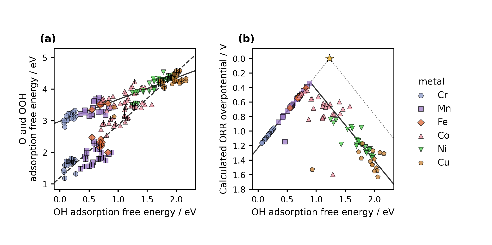
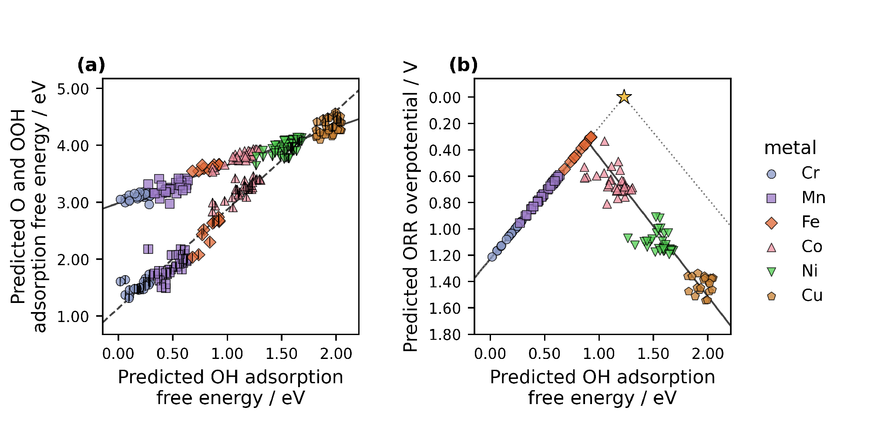

<!-- Reconstructed from ../manuscript_versions/Electrochimica_Acta_research_article_draft_v38.docx. -->

# Accelerating Catalyst Discovery with Artificial Intelligence: Molecular Dual-Atom Site Catalysts as a Case Study

Bruno Inácio da Silva Roux Leite,1 Denis Savchenko,1 Timmo-Henrik Pukk,1 Ba Long Nguyen,1 Vladislav Ivanistsev,2† Nadezda Kongi,1†

1 Institute of Chemistry, University of Tartu, Ravila 14a, 50411 Tartu, Estonia

2 Department of Chemistry, University of Latvia, Jelgavas iela 1, Riga, LV-1004, Latvia

Corresponding authors: vladislav.ivanistsev@lu.lv; nadezda.kongi@ut.ee

## Abstract

Artificial intelligence (AI) can accelerate catalyst discovery by shortening the route from verified results to reusable scientific communication. We test this proposition with molecular dual-atom site catalysts (DASCs) for the oxygen reduction reaction (ORR). Human researchers used density functional theory (DFT) to calculate adsorption energetics for 88 molecular catalysts. These calculations form the training source for a machine learning (ML) regression model designed to screen a separate database of 1176 optimized catalysts and prioritize structures for further calculation or experiment. We also developed a large language model (LLM) writing procedure through iterative scientific, editorial, and technical guidance. The procedure consolidates verified data, analyses, literature, figures, and writing rules into one final prompt for complete manuscript generation. The catalyst calculations and predictions constitute genuine electrochemical research; the article itself tests whether their communication can be delegated. Human researchers choose the questions and methods, interpret and verify the results, and remain responsible for the article. This division can reduce the delay between obtaining reliable results and making them available for reuse.

Keywords: AI; DFT; ML; LLM; oxygen reduction reaction; molecular dual-atom site catalysts

## 1. Introduction

Accelerating catalyst discovery with AI means shortening the interval between a scientific question and the next informed decision. DFT and ML can reduce the time required to evaluate candidates, yet a result cannot guide another calculation or experiment until other researchers can inspect and reuse it. We therefore examine scientific writing as part of catalyst discovery: communication determines when verified results become available to the scientific community.

Publication can add months between submission and the appearance of a scientific result. Bibliometric studies reported chemistry submission-to-publication intervals of approximately nine months across a journal sample and a median of 154 days for chemistry articles on the PLOS platform [10.1016/j.joi.2013.09.001](https://doi.org/10.1016/j.joi.2013.09.001); [10.1007/s11192-023-04640-6](https://doi.org/10.1007/s11192-023-04640-6). These intervals begin at submission. They exclude preparation before the first submission, time spent at journals that reject a manuscript, and part of the subsequent rewriting. LLM generation cannot remove editorial, reviewer, or production delays, but it can address manuscript preparation and revision.

Scientific publishing treats the coherent story as a measure of a successful paper. Editors describe story as the organizing principle of an article and give figures a central role in making a result intelligible [10.1038/nphys724](https://doi.org/10.1038/nphys724); [10.1021/acsenergylett.8b02322](https://doi.org/10.1021/acsenergylett.8b02322); [10.1021/acsenergylett.1c02401](https://doi.org/10.1021/acsenergylett.1c02401); [10.1038/s41551-018-0202-5](https://doi.org/10.1038/s41551-018-0202-5). We agree that readers need a clear account. We question why the release of useful results should depend so strongly on the time and specialized skill required to compose that account.

Scientific data and scientific narratives are different products. No research group can test every question that its data may later answer. Machine readable data let other researchers combine results, evaluate alternative descriptors, and pursue hypotheses that the original authors did not anticipate [10.1038/sdata.2016.18](https://doi.org/10.1038/sdata.2016.18). The value of a calculation should therefore extend beyond the narrative selected for its first publication.

LLMs can close part of the resulting communication gap, provided that fluent text remains answerable to evidence. Storytelling can conceal an inconvenient result even without generative AI [10.1038/nmeth.2726](https://doi.org/10.1038/nmeth.2726), while changes in published abstract vocabulary indicate that LLM-assisted writing is already widespread [10.1126/sciadv.adt3813](https://doi.org/10.1126/sciadv.adt3813). Ifargan and colleagues showed that interacting LLM agents can produce human verifiable papers from annotated data, while human guidance becomes more important as the research question grows more complex [10.1056/aioa2400555](https://doi.org/10.1056/aioa2400555). Their work establishes the closest precedent; our test focuses on reproducible generation of the complete article from one developed prompt.

We examine this proposition through ORR on molecular DASCs. Recent studies show how DFT and ML can screen ORR catalysts and resolve cooperation between metal atoms in dual-atom catalysts [10.1021/acscatal.6c02383](https://doi.org/10.1021/acscatal.6c02383); [10.1002/adma.74833](https://doi.org/10.1002/adma.74833). Figure 1 defines the molecular variation. Figure 2 reports adsorption free energy scaling and calculated thermodynamic activity from the fixed DFT set of 88 catalysts. The regression analysis in Figure 3 tests prediction within the represented molecular library, and the final model will extend the screening to a separate database of 1176 optimized catalysts. Our final objective is to consolidate the verified scientific inputs and tested writing instructions into one prompt that generates the complete article for human verification.

## 2. Computational methods

### 2.1. Catalyst structures

We assembled the molecular catalysts from the components shown in Figure 1. Following the notation introduced in our data article [10.1016/j.dib.2026.112806](https://doi.org/10.1016/j.dib.2026.112806), A2 denotes the fixed dialdehyde and B1 and B2 denote the two diamines. Each molecule contains two metal centers chosen from Cr, Mn, Fe, Co, Ni, and Cu and bridge atoms selected from N, O, or S. The same article describes the molecular assembly and initial structure preparation. We fully optimized all structures used in the DFT analysis, including the clean catalysts and structures containing adsorbed intermediates. The clean database used here contains 88 molecular catalysts.

The Atomic Simulation Environment (ASE) database stores each optimized structure and energy with its catalyst name, metal positions, ligand components, and charge metadata. For adsorbed structures, the literal database field ads_site identifies which metal-atom adsorption center carries the intermediate.

### 2.2. DFT calculations and adsorption structures

We performed spin polarized DFT calculations with GPAW 26.7 and ASE 3.29.0 software [10.1063/5.0182685](https://doi.org/10.1063/5.0182685); [10.1088/1361-648X/aa680e](https://doi.org/10.1088/1361-648X/aa680e). We used the projector augmented wave method, the revised Perdew–Burke–Ernzerhof functional, and the D4 dispersion correction [10.1063/1.5090222](https://doi.org/10.1063/1.5090222). The calculations used a plane wave cutoff of 550 eV, a real space grid spacing of 0.16 Å, and 6.00 Å vacuum. We fully optimized every atomic structure until the maximum force was below 0.05 eV Å⁻¹. We previously used the same calculation setup for related molecular catalysts [10.26434/chemrxiv.15001712/v1](https://doi.org/10.26434/chemrxiv.15001712/v1).

We placed O, OH, and OOH at either of the two metal-atom adsorption centers in the dual-atom site and fully optimized each structure. We calculated gas phase H₂ and H₂O with the same settings. We matched all total energies by catalyst name and the ads_site center label, so every reaction pathway refers to the same center of the same molecular catalyst.

We obtained the adsorption energies of O, OH, and OOH from the total energies of the corresponding adsorbed structure, clean catalyst, H₂, and H₂O:

$$Δ{E}_{OH} = {E}_{*OH} + (1/2) {E}_{{H}_{2}} - {E}_{*} - {E}_{{H}_{2}O}\tag{1}$$

$$Δ{E}_{O} = {E}_{*O} + {E}_{{H}_{2}} - {E}_{*} - {E}_{{H}_{2}O}\tag{2}$$

$$Δ{E}_{OOH} = {E}_{*OOH} + (3/2) {E}_{{H}_{2}} - {E}_{*} - 2{E}_{{H}_{2}O}\tag{3}$$

In Eqs. (1)–(3), the left side is the adsorption energy of the named intermediate. The terms on the right are the total energies of the adsorbed catalyst, the clean catalyst, gas phase H₂, and gas phase H₂O; * denotes the chosen adsorption center. We used the supplied corrected adsorption free energies for scaling and thermodynamic analyses.

### 2.3. Adsorption free energies and ORR thermodynamics

We converted adsorption energies to adsorption free energies by adding the zero point and entropic corrections:

$$Δ{G}_{X} = Δ{E}_{X} + Δ{E}_{ZP,X} - TΔ{S}_{X}\tag{4}$$

In Eq. (4), *X* denotes O, OH, or OOH; *E* and *G* denote electronic energy and Gibbs free energy; *T* is temperature; *S* is entropy; and ZP identifies the zero point contribution. The supplied adsorption free energies already include these corrections. We evaluated the four reduction potentials for the associative four electron ORR pathway with the computational hydrogen electrode (CHE) method [10.1021/jp047349j](https://doi.org/10.1021/jp047349j):

$${U}_{1} = (4.92 eV - Δ{G}_{OOH}) / e{U}_{2} = (Δ{G}_{OOH} - Δ{G}_{O}) / e{U}_{3} = (Δ{G}_{O} - Δ{G}_{OH}) / e{U}_{4} = Δ{G}_{OH} / e\tag{5}$$

Equation (5) lists the positive step reduction potentials for four reductions: O₂ to OOH, OOH to O, O to OH, and OH to H₂O; *e* is the elementary charge. The limiting potential is the lowest of the four step potentials:

$${U}_{L} = min({U}_{1}, {U}_{2}, {U}_{3}, {U}_{4})\tag{6}$$

The symbol on the left of Eq. (6) is the limiting potential. We evaluated the ORR overpotential relative to the 1.23 V equilibrium potential:

$${η}_{ORR} = 1.23 V - {U}_{L}\tag{7}$$

Equation (7) gives the ORR overpotential. Chemical subscripts in Eqs. (5)–(7) identify the adsorbed intermediate or the reaction quantity.

### 2.4. Scaling and thermodynamic activity analyses

We described the correlations of O and OOH adsorption free energies with OH adsorption free energy by ordinary least squares:

$$Δ{G}_{O} = {α}_{O} Δ{G}_{OH} + {β}_{O}Δ{G}_{OOH} = {α}_{OOH} Δ{G}_{OH} + {β}_{OOH}\tag{8}$$

In Eq. (8), α and β are the slope and intercept for the intermediate identified by the subscript. The curves in Figures 2 and 3 propagate the corresponding global fits through the four reaction steps. For comparison, we defined an ideal relation with an OOH–OH free energy separation of 2.46 eV and the corresponding two branch overpotential:

$$Δ{{G}_{OOH}}^{ideal} = Δ{G}_{OH} + 2.46 eV{η}_{ideal} = 1.23 V - min(Δ{G}_{OH} / e, (2.46 eV - Δ{G}_{OH}) / e)\tag{9}$$

In Eq. (9), OH removal defines the left branch and OOH formation the right branch. They meet at an OH adsorption free energy of 1.23 eV and zero overpotential. This reference represents balanced binding; the catalyst points and fitted curves use all four reaction steps. Thermodynamic rankings describe reaction free energies, while kinetic activity also depends on activation barriers.

### 2.5. Regression analysis and wider screening

The wider screening uses the DFT results for the 88 molecular catalysts as training data for linear regression models with second-order polynomial features. The adsorbate-specific models predict OH, O, and OOH adsorption free energies from catalyst descriptors and preserve parent-catalyst grouping during validation. We then apply the trained models to a separate ASE database containing exactly 1176 optimized clean catalysts. Catalyst-name comparison identifies 87 structures shared with the DFT library and 1089 structures outside it. The clean structures in the screening database were calculated with GPAW 25.7 and ASE 3.28.0 using the remaining settings stated in Section 2.2. The wider predictions are pending and are not reported as completed results.

Before the wider screening, we reproduced the supplied saved ridge models for OH, O, and OOH adsorption free energies. These models use eight predictors for OH and O and six for OOH. Figure 3 presents their descriptive predictions for the molecular structures represented in the current analysis. Because the plotted combinations include values used for model fitting, Figure 3 does not measure independent predictive accuracy or establish transfer to the 1089 structures outside the DFT library.

### 2.6. LLM manuscript generation

We used an LLM accessed through OpenAI Codex to develop and generate the complete manuscript from the scientific inputs. Ifargan and colleagues demonstrated data-to-paper generation with interacting LLM agents and source-linked outputs [10.1056/aioa2400555](https://doi.org/10.1056/aioa2400555). We focus on a complementary question: can extensive human guidance be consolidated into one final prompt that reproducibly generates a complete scientific article?

Development proceeded through repeated human-guided iterations. We supplied the scientific questions, databases, analyses, figures, literature, journal requirements, terminology, and writing guidance. Ten defined functions covered project curation, data auditing, programming, figure preparation, scientific supervision, drafting, domain review, document construction, style editing, and release auditing. We corrected scientific, terminological, structural, and stylistic failures during development and incorporated the resulting rules into the project knowledge bases.

The final execution will combine the verified scientific inputs and tested instructions in one prompt. We define success as generation of the complete article without subsequent textual correction, followed by human verification of the calculations, predictions, figures, citations, interpretations, and claims. This criterion separates reproducible execution from the substantial human effort required to develop the prompt. The human authors retain responsibility for the scientific questions, methods, interpretation, verification, and final approval.

## 3. Results and discussion

### 3.1. Molecular structures and adsorption centers

Figure 1 shows the common molecular structure and its variable components. Each DASC has one dual-atom site containing two metal-atom adsorption centers. Both metal positions draw from Cr, Mn, Fe, Co, Ni, and Cu; the bridge atoms and diamine vary, while the dialdehyde remains A2. An ORR intermediate can bind at either metal-atom center. We preserve that choice in the databases and in every comparison of adsorption energies.

**Figure 1.** Modular molecular structure of the catalyst library. The metal list gives the elements available at the two metal positions; bridge atoms are N, O, or S. A2, B1, and B2 follow the dialdehyde and diamine notation introduced in our data article [10.1016/j.dib.2026.112806](https://doi.org/10.1016/j.dib.2026.112806). The arrows identify the metal region, bridge, diamine, and lower aromatic ring assigned to A2.

The final DFT library contains 88 molecular catalyst structures. Exact matching of the adsorption databases by catalyst and adsorption center produced 123 complete pathways across 82 catalysts. Figure 2 contains 118 filtered pathways across 79 catalysts. Figure 3 contains descriptive predictions for 144 catalyst and adsorption center combinations across 87 catalysts.

### 3.2. Adsorption scaling and calculated ORR thermodynamics

Figure 2a compares O and OOH adsorption free energies with OH adsorption free energy. The OOH–OH relation has a slope of 0.69 and an intercept of 2.98 eV; the O–OH relation has a slope of 1.66 and an intercept of 1.20 eV. Groups defined by the metal carrying the intermediate occupy different parts of these global relations. Related molecular catalysts show that paired metals can change OOH binding geometry [10.1021/jacs.4c12705](https://doi.org/10.1021/jacs.4c12705); [10.1002/adma.202403549](https://doi.org/10.1002/adma.202403549). Our calculations permit comparisons across molecular structures without treating the two adsorption centers of one DASC as separate catalysts.

Figure 2. Adsorption scaling and oxygen reduction thermodynamics from DFT. Figure 1 defines the molecular components and the two metal-atom adsorption centers of each dual-atom site. (a) O and OOH adsorption free energies versus OH adsorption free energy. Color and marker shape identify the metal carrying the intermediate; the centered vertical stroke denotes O. Solid and dashed lines are OOH–OH and O–OH scaling fits. (b) CHE overpotential for the corresponding catalyst and adsorption center combinations. The solid curve follows the global scaling fits through all four reaction steps. The dotted ideal reference assumes an OOH–OH separation of 2.46 eV, with OH removal and OOH formation defining its left and right branches. The star marks zero overpotential at 1.23 eV. Lower overpotential appears higher on the reversed axis.

Figure 2b shows the calculated CHE overpotential, with the vertical axis reversed. The lowest value in the plotted dataset is 0.34 V for a Cr–Mn molecular catalyst with *S* bridge atoms and B1 diamine when the intermediates bind at its Mn adsorption center. The adsorption free energies are 0.89 eV for OH, 1.99 eV for O, and 3.41 eV for OOH. The corresponding step potentials are 1.51, 1.42, 1.10, and 0.89 V, so reduction of OH to water determines the limiting potential. This calculation prioritizes a molecular structure for further investigation; assigning a causal role to its bridge or diamine requires comparisons across matched structures.

### 3.3. Regression predictions and wider screening

We first used the supplied ridge models to test whether the stored catalyst descriptors preserve the broad adsorption trends within the represented molecular library. Figure 3 contains predictions for 144 catalyst and adsorption center combinations across 87 catalysts. Its OOH–OH fit has a slope of 0.67 and an intercept of 2.98 eV, and its O–OH fit has a slope of 1.73 and an intercept of 1.14 eV. These descriptive predictions follow the broad relations from the DFT calculations in Figure 2.

The lowest predicted overpotential in the current descriptive analysis is 0.30 V for an Fe–Mn molecular catalyst with *S* bridge atoms and B1 diamine when the intermediates bind at its Fe adsorption center. We would examine this molecular structure with further DFT calculations or experiment. The larger screening will train the final regression model on the 88-catalyst DFT library and apply it to all 1176 clean catalyst structures. Those predictions are not yet available, so Figure 3 does not identify candidates from the 1089 structures outside the DFT library.

Figure 3. Adsorption scaling and oxygen reduction thermodynamics from ML predictions. (a) Predicted O and OOH adsorption free energies versus predicted OH adsorption free energy. (b) Overpotentials derived from the three predictions for 144 catalyst and adsorption center combinations. Colors, markers, and the ideal reference follow Figure 2. The solid and dashed lines in (a) are the OOH–OH and O–OH fits; the solid curve in (b) follows those fits through the four reaction steps. All trend lines extend across the displayed descriptor range. The figure includes combinations used for model fitting and does not show the pending 1176-structure screening.

### 3.4. Reusable data and further discovery

Reusable adsorption center matched data let us change the scientific question without rebuilding the dataset. The conventional CHE overpotential, the Calle-Vallejo electrochemical step symmetry index, and the Exner free energy span emphasize different features of the same reaction energetics [10.1016/j.coelec.2018.03.025](https://doi.org/10.1016/j.coelec.2018.03.025); [10.1021/acscatal.2c03997](https://doi.org/10.1021/acscatal.2c03997). When each energy remains attached to its molecular structure and adsorption center, another researcher can evaluate a different activity measure directly. Questions that change geometry, charge state, or adsorption structure still require new DFT calculations.

We will release the optimized structures and DFT calculations as ASE databases and machine readable JSON, together with code that reconstructs the analysis. These formats support findable, accessible, interoperable, and reusable data practices [10.1038/sdata.2016.18](https://doi.org/10.1038/sdata.2016.18). Other researchers can combine these calculations with additional data, test analyses that we did not anticipate, and determine where another descriptor changes the molecular ranking.

### 3.5. Closing the scientific communication gap

The catalyst study illustrates why scientific writing belongs inside the discussion of discovery speed. DFT calculations create reusable scientific evidence, and ML extends its reach across a larger molecular library. Neither contribution can guide another research group until the methods, results, limitations, and data become accessible. The same separation applies beyond this catalyst family: researchers generate and verify scientific results, while a developed LLM system can compose the article that communicates them.

We developed the writing instructions through repeated interaction over approximately two weeks. The development stage required scientific corrections, terminology decisions, literature selection, document construction, and independent audits. The final execution condenses that work into one prompt. We will report its elapsed generation time as a project measurement, without treating our previous writing experience or journal publication delays as a controlled comparison.

This division of labor does not transfer scientific responsibility to the LLM. We choose the research questions, produce the DFT calculations, define and verify the ML predictions, interpret the results, and decide which statements the evidence permits. The LLM generates the scientific text. Human verification closes the chain before publication, and release of the data and final prompt makes both the catalyst analysis and manuscript generation open to examination.

## 4. Conclusions

The molecular DASC study establishes the scientific basis of the demonstration. DFT calculations for 88 catalysts revealed O–OH and OOH–OH adsorption free energy scaling and prioritized a Cr–Mn molecular structure with a calculated ORR overpotential of 0.34 V. The current regression analysis preserved the broad adsorption trends and prioritized an Fe–Mn molecular structure for further study. The final model will use the 88-catalyst DFT library to screen 1176 optimized catalysts, including 1089 structures outside that library. This extension can reduce the number of structures that require preliminary DFT calculations, although the wider predictions and their validation remain pending.

The main result we seek concerns how verified research becomes reusable knowledge. We developed a human-guided LLM writing system whose final execution will generate the complete article from one prompt. The article itself provides the test: its scientific statements must remain traceable to the calculations, predictions, figures, and literature supplied to the LLM. If the final execution requires no textual correction after human scientific verification, it will show that manuscript preparation can be delegated without delegating scientific responsibility. This reduces one communication delay while leaving peer review and publication outside the scope of the method. Researchers remain responsible for the questions, evidence, interpretation, verification, and final approval.

## CRediT authorship contribution statement

Bruno Inácio da Silva Roux Leite: investigation, data curation, formal analysis, and generation of DFT results. Denis Savchenko: methodology, software, formal analysis, visualization, and development of the regression model. Timmo-Henrik Pukk: investigation, data curation, formal analysis, and generation of DFT results. Ba Long Nguyen: investigation, software, data curation, formal analysis, visualization, and generation of DFT results. Vladislav Ivanistsev: conceptualization, supervision, LLM prompting, LLM outputs verification. Nadezda Kongi: conceptualization, supervision, and funding acquisition. Validation of the manuscript text: all authors. All authors approved the final text.

## Declaration of competing interest

The authors declare no competing interests.

## Data availability

The parent molecular dual-atom site catalyst dataset is available from Zenodo [10.5281/zenodo.18601379](https://doi.org/10.5281/zenodo.18601379). The five ASE databases used here constitute the final DFT calculation set. We will deposit the corresponding JSON files, joined analysis data, code, and final model predictions with the article. A separate public ASE database contains 1176 optimized clean molecular catalysts for the wider ML screening: [https://github.com/doublelayer/ACSEnergyLetters_2026_resonance/raw/refs/heads/main/DASC_Bare_Catalysts_RPBE_D4.db](https://github.com/doublelayer/ACSEnergyLetters_2026_resonance/raw/refs/heads/main/DASC_Bare_Catalysts_RPBE_D4.db). The wider predictions are pending.

## Declaration of generative AI and AI assisted technologies in the manuscript preparation process

During development of this article, we used OpenAI Codex with an LLM to generate and revise the manuscript and to assist with analysis and figure code from the project data, sources, and instructions. The final reproducibility test will document generation of the complete article from one consolidated prompt. The human authors reviewed the generated content against the calculations, predictions, methods, figures, and literature and take full responsibility for the published article.

## Acknowledgments

This work was supported by the Estonian Ministry of Education and Research (TK210) and the Estonian Research Council (PRG3174). We acknowledge the University of Latvia Artificial Intelligence and Computing Center and the High Performance Computing Center of the University of Tartu for providing computational resources.

## References

S. Jia et al., Machine Learning Reveals Role-Asymmetric Electronic Cooperation in Fe-Based Dual-Atom Catalysts, Advanced Materials 36 (2026) e74833. [10.1002/adma.74833](https://doi.org/10.1002/adma.74833)

Z. Zhang et al., Design and Synthesis of Electrocatalysts Based on Catalysis-Unit Engineering, Advanced Materials 36 (2024) 2403549. [10.1002/adma.202403549](https://doi.org/10.1002/adma.202403549)

X. Chen et al., Leveraging DFT and Machine Learning for Accelerated Screening of Cluster-Modified Single-Atom Catalysts in Oxygen Reduction Reactions, ACS Catalysis 16 (2026) 14399–14410. [10.1021/acscatal.6c02383](https://doi.org/10.1021/acscatal.6c02383)

J. K. Nørskov, J. Rossmeisl, A. Logadottir, L. Lindqvist, J. R. Kitchin, T. Bligaard, H. Jónsson, Origin of the Overpotential for Oxygen Reduction at a Fuel-Cell Cathode, Journal of Physical Chemistry B 108 (2004) 17886–17892. [10.1021/jp047349j](https://doi.org/10.1021/jp047349j)

Q. Sun et al., Well-Defined Co₂ Dual-Atom Catalyst Breaks Scaling Relations of Oxygen Reduction Reaction, Journal of the American Chemical Society 146 (2024) 35295–35304. [10.1021/jacs.4c12705](https://doi.org/10.1021/jacs.4c12705)

N. Žoglo et al., Intersite Geometry Controls Activity and Selectivity in the Oxygen Reduction Reaction on Dual-Atom-Site Catalysts, ChemRxiv preprint (2026). [10.26434/chemrxiv.15001712/v1](https://doi.org/10.26434/chemrxiv.15001712/v1)

L. X. Chen, P. Christopher, F. De Angelis, S. Jin, Y.-S. Hu, N.-G. Park, D. Das Sarma, Y.-K. Sun, P. V. Kamat, We Editors Are Authors, Too, ACS Energy Letters 4 (2019) 249–250. [10.1021/acsenergylett.8b02322](https://doi.org/10.1021/acsenergylett.8b02322)

Elements of style, Nature Physics 3 (2007) 581. [10.1038/nphys724](https://doi.org/10.1038/nphys724)

C. M. Biegel, P. V. Kamat, Five common pitfalls to avoid while composing scientific figures, ACS Energy Letters 6 (2021) 4309–4310. [10.1021/acsenergylett.1c02401](https://doi.org/10.1021/acsenergylett.1c02401)

Storytelling in research, Nature Biomedical Engineering 2 (2018) 53. [10.1038/s41551-018-0202-5](https://doi.org/10.1038/s41551-018-0202-5)

Should scientists tell stories?, Nature Methods 10 (2013) 1037. [10.1038/nmeth.2726](https://doi.org/10.1038/nmeth.2726)

B. L. Nguyen, T. K. Madsen, V. Ivanistsev, N. Kongi, Dataset of molecular dual-atom site complexes for catalysis, Data in Brief 66 (2026) 112806. [10.1016/j.dib.2026.112806](https://doi.org/10.1016/j.dib.2026.112806)

J. J. Mortensen et al., GPAW: An open Python package for electronic structure calculations, Journal of Chemical Physics 160 (2024) 092503. [10.1063/5.0182685](https://doi.org/10.1063/5.0182685)

A. H. Larsen et al., The Atomic Simulation Environment—A Python Library for Working with Atoms, Journal of Physics: Condensed Matter 29 (2017) 273002. [10.1088/1361-648X/aa680e](https://doi.org/10.1088/1361-648X/aa680e)

E. Caldeweyher, S. Ehlert, A. Hansen, H. Neugebauer, S. Spicher, C. Bannwarth, S. Grimme, A generally applicable atomic-charge dependent London dispersion correction, Journal of Chemical Physics 150 (2019) 154122. [10.1063/1.5090222](https://doi.org/10.1063/1.5090222)

N. Govindarajan, J. M. García-Lastra, E. J. Meijer, F. Calle-Vallejo, Does the breaking of adsorption energy scaling relations guarantee enhanced electrocatalysis?, Current Opinion in Electrochemistry 8 (2018) 110–117. [10.1016/j.coelec.2018.03.025](https://doi.org/10.1016/j.coelec.2018.03.025)

S. Razzaq, K. S. Exner, Materials screening by the descriptor Gmax(η): The free energy span model in electrocatalysis, ACS Catalysis 13 (2023) 1740–1758. [10.1021/acscatal.2c03997](https://doi.org/10.1021/acscatal.2c03997)

M. D. Wilkinson et al., The FAIR guiding principles for scientific data management and stewardship, Scientific Data 3 (2016) 160018. [10.1038/sdata.2016.18](https://doi.org/10.1038/sdata.2016.18)

[dataset] B. L. Nguyen, T. K. Madsen, V. Ivanistsev, N. Kongi, Dataset of molecular dual-atom site complexes for catalysis, Zenodo, version 1.0, 2026. [10.5281/zenodo.18601379](https://doi.org/10.5281/zenodo.18601379)

D. Kobak, R. González-Márquez, E.-Á. Horvát, J. Lause, Delving into LLM-assisted writing in biomedical publications through excess vocabulary, Science Advances 11 (2025) eadt3813. [10.1126/sciadv.adt3813](https://doi.org/10.1126/sciadv.adt3813)

*T*. Ifargan, L. Hafner, M. Kern, O. Alcalay, R. Kishony, Autonomous LLM-Driven Research: from Data to Human-Verifiable Research Papers, NEJM AI 2 (2025). [10.1056/aioa2400555](https://doi.org/10.1056/aioa2400555)

B.-C. Björk, D. Solomon, The publishing delay in scholarly peer-reviewed journals, Journal of Informetrics 7 (2013) 914–923. [10.1016/j.joi.2013.09.001](https://doi.org/10.1016/j.joi.2013.09.001)

J. Ding, D. Du, A study of the correlation between publication delays and measurement indicators of journal articles in the social network environment: based on online data in PLOS, Scientometrics 128 (2023) 1711–1743. [10.1007/s11192-023-04640-6](https://doi.org/10.1007/s11192-023-04640-6)
