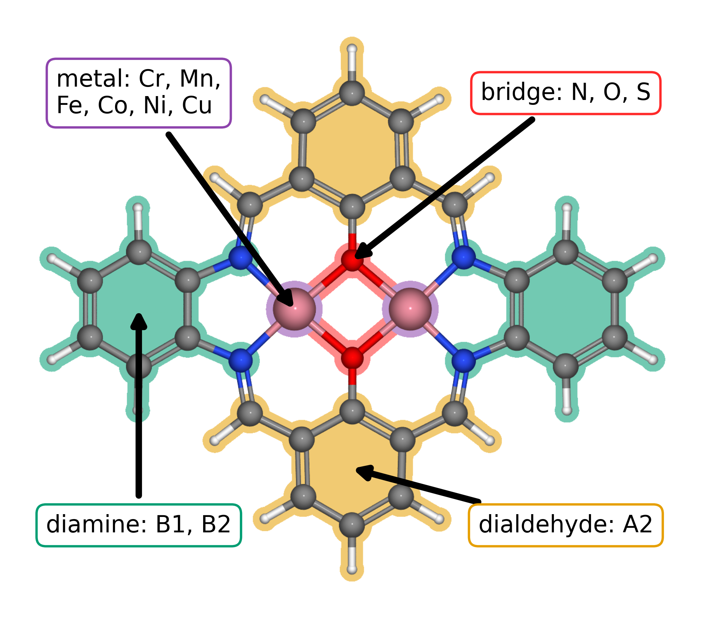
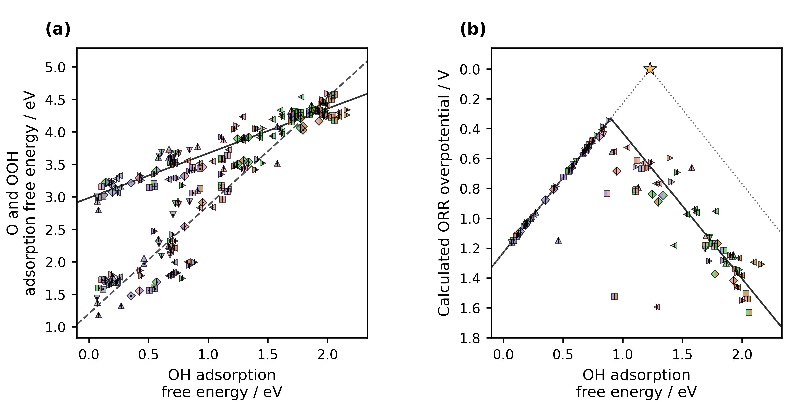
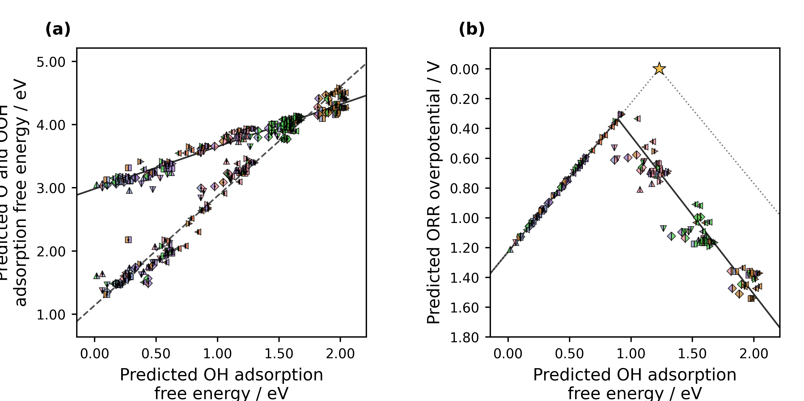

<!-- Reconstructed from ../manuscript_versions/Electrochimica_Acta_research_article_draft_v40.docx; source DOCX SHA-256: a76a90ec720736a8269713b1fdafd43075cf1bcc78cb13de9264407d3bb1d835. -->

# Accelerating Catalyst Discovery with Artificial Intelligence: Molecular Dual-Atom Site Catalysts as a Case Study

Bruno Inácio da Silva Roux Leite,1 Denis Savchenko,1 Timmo-Henrik Pukk,1 Ba Long Nguyen,1 Vladislav Ivanistsev,2† Nadezda Kongi,1†

1 Institute of Chemistry, University of Tartu, Ravila 14a, 50411 Tartu, Estonia

2 Department of Chemistry, University of Latvia, Jelgavas iela 1, Riga, LV-1004, Latvia

Corresponding authors: vladislav.ivanistsev@lu.lv; nadezda.kongi@ut.ee

## Abstract

Scientific discovery advances when researchers produce trustworthy evidence and make it available for reuse. Here, we connect density functional theory (DFT), machine learning (ML), and large language models (LLMs) in a study of the oxygen reduction reaction (ORR) on molecular dual-atom site catalysts (DASCs). Human researchers calculated adsorption energetics for 88 molecular catalysts and used regression predictions to examine how catalyst composition relates to ORR thermodynamics. The DFT calculations identify three molecular structures with calculated overpotentials of 0.34, 0.39, and 0.41 V. Regression analysis identifies promising Fe- and Co-containing molecular families. We then used a carefully guided LLM procedure to prepare the complete article from verified calculations, predictions, literature, figures, and instructions. The researchers chose the questions, produced the calculations, checked the analysis, and verified the manuscript. This study shows how researchers can delegate scientific writing to an LLM while keeping the science in human hands, so they can give more time to scientific methods and the pleasure of discovery.

Keywords: AI; DFT; ML; LLM; oxygen reduction reaction; molecular dual-atom site catalysts

## 1. Introduction

Accelerating catalyst discovery has usually meant faster calculations, larger candidate sets, or better prioritization. Each can help researchers choose the next structure to calculate or test. Yet a result becomes useful to another group only after its evidence and reasoning are communicated. We examine both stages through ORR on molecular DASCs, and we ask whether an LLM can carry the scientific writing that connects verified results to further research.

Independent analyses place chemistry publication timelines at several months after submission, with reported averages of approximately nine months across a journal sample and a median of 154 days for chemistry articles on the PLOS platform [10.1016/j.joi.2013.09.001](https://doi.org/10.1016/j.joi.2013.09.001); [10.1007/s11192-023-04640-6](https://doi.org/10.1007/s11192-023-04640-6). The time required to prepare a manuscript adds to this interval. Scientific writing therefore belongs in any practical account of how quickly research can reach the wider community.

Editors have argued that a coherent story should organize a paper and that carefully chosen figures carry much of its message [10.1038/nphys724](https://doi.org/10.1038/nphys724); [10.1021/acsenergylett.8b02322](https://doi.org/10.1021/acsenergylett.8b02322); [10.1021/acsenergylett.1c02401](https://doi.org/10.1021/acsenergylett.1c02401); [10.1038/s41551-018-0202-5](https://doi.org/10.1038/s41551-018-0202-5). We accept the value of a clear account, yet we challenge the idea that researchers must spend months shaping every article themselves. Our thesis is that an LLM can prepare the scientific narrative when verified data, reproducible methods, traceable sources, and explicit instructions constrain its work. The story should explain the evidence; the evidence should determine the story.

A research group can produce only part of the data that its questions might support, and it cannot anticipate every use another researcher may find for those records. FAIR data let other groups combine results, test alternative descriptors, and pursue questions beyond the original study [10.1038/sdata.2016.18](https://doi.org/10.1038/sdata.2016.18). A paper gives readers one reasoned interpretation; a structured dataset can support many. We therefore treat reliable, reusable data as the foundation on which LLM-assisted communication can build.

LLMs can help close this communication gap, provided that their prose remains answerable to evidence. Scientific stories can conceal inconvenient observations when coherence becomes the goal [10.1038/nmeth.2726](https://doi.org/10.1038/nmeth.2726), while changes in published abstract vocabulary show that LLM-assisted writing has entered routine use [10.1126/sciadv.adt3813](https://doi.org/10.1126/sciadv.adt3813). Ifargan and colleagues generated human-verifiable papers from annotated research data with interacting LLM agents [10.1056/aioa2400555](https://doi.org/10.1056/aioa2400555). We extend this line of work by testing whether a carefully developed set of scientific and editorial instructions can generate a complete article from verified research inputs.

Our study links three stages. We first calculated ORR adsorption energetics for 88 molecular DASCs with DFT. We then used regression predictions to identify patterns across the available molecular set and to prioritize structural families for further investigation. Finally, we used a human-guided LLM procedure to prepare the complete scientific article from the calculations, predictions, literature, figures, and writing instructions. Figure 1 defines the molecular variation; Figure 2 presents the DFT scaling relations and CHE volcano; Figure 3 presents the regression-predicted relations and activity. The article itself is the demonstration: the LLM prepares the text, while human researchers direct and verify the science.

## 2. Computational methods

### 2.1. Catalyst structures

The molecular catalysts were assembled from the components shown in Figure 1. The notation in the data article [10.1016/j.dib.2026.112806](https://doi.org/10.1016/j.dib.2026.112806) identifies A2 as the fixed dialdehyde and B1 and B2 as the two diamines. Each molecule contains a dual-atom site with two metal-atom adsorption centers. The metal identities were selected from Cr, Mn, Fe, Co, Ni, and Cu, and the bridge atoms were selected from N, O, or *S*. All catalyst and adsorbate structures used in the DFT analysis were fully optimized. The clean database contained 88 molecular catalysts.

Each optimized structure and its energy were stored in an Atomic Simulation Environment (ASE) database with the catalyst name, metal identities, ligand components, and charge metadata. The `ads_site` field identifies the metal-atom adsorption center occupied by each intermediate.

### 2.2. DFT calculations and adsorption structures

Spin polarized DFT calculations were performed with GPAW 25.7 and ASE 3.28.0 software [10.1063/5.0182685](https://doi.org/10.1063/5.0182685); [10.1088/1361-648X/aa680e](https://doi.org/10.1088/1361-648X/aa680e). The projector augmented wave method, the revised Perdew–Burke–Ernzerhof functional, and the D4 dispersion correction were used [10.1063/1.5090222](https://doi.org/10.1063/1.5090222). A plane wave cutoff of 550 eV, a real space grid spacing of 0.16 Å, and 6.00 Å of vacuum were used. Every atomic structure was optimized until the maximum force fell below 0.05 eV Å⁻¹. The same calculation setup was previously used for related molecular catalysts [10.26434/chemrxiv.15001712/v1](https://doi.org/10.26434/chemrxiv.15001712/v1).

O, OH, and OOH were placed at either metal-atom adsorption center in the dual-atom site, and each structure was fully optimized. Gas phase H₂ and H₂O reference structures were calculated with the same settings. Total energies were matched by catalyst name and `ads_site`, so each reaction pathway contains values for the same molecular structure and adsorption center.

Adsorption energies for O, OH, and OOH were calculated from the total energies of the corresponding adsorbed structure, clean catalyst, H₂, and H₂O:

$$Δ{E}_{OH} = {E}_{*OH} + (1/2) {E}_{{H}_{2}} - {E}_{*} - {E}_{{H}_{2}O}\tag{1}$$

$$Δ{E}_{O} = {E}_{*O} + {E}_{{H}_{2}} - {E}_{*} - {E}_{{H}_{2}O}\tag{2}$$

$$Δ{E}_{OOH} = {E}_{*OOH} + (3/2) {E}_{{H}_{2}} - {E}_{*} - 2{E}_{{H}_{2}O}\tag{3}$$

In Eqs. (1)–(3), the left side is the adsorption energy of the named intermediate. The terms on the right are the total energies of the adsorbed catalyst, clean catalyst, gas phase H₂, and gas phase H₂O; * identifies the selected adsorption center. The supplied adsorption free energies were used in the scaling and thermodynamic analyses.

### 2.3. Adsorption free energies and ORR thermodynamics

Adsorption energies were converted to adsorption free energies by adding zero point and entropic corrections:

$$Δ{G}_{X} = Δ{E}_{X} + Δ{E}_{ZP,X} - TΔ{S}_{X}\tag{4}$$

In Eq. (4), *X* denotes O, OH, or OOH; *E* and *G* denote electronic energy and Gibbs free energy; *T* is temperature; *S* is entropy; and ZP identifies the zero point contribution. The supplied adsorption free energies already include these corrections. The four reduction potentials for the associative four electron ORR pathway were evaluated with the computational hydrogen electrode (CHE) method [10.1021/jp047349j](https://doi.org/10.1021/jp047349j):

$${U}_{1} = (4.92 eV - Δ{G}_{OOH}) / e{U}_{2} = (Δ{G}_{OOH} - Δ{G}_{O}) / e{U}_{3} = (Δ{G}_{O} - Δ{G}_{OH}) / e{U}_{4} = Δ{G}_{OH} / e\tag{5}$$

Equation (5) defines the positive reduction potentials for the four steps O₂ to OOH, OOH to O, O to OH, and OH to H₂O; * identifies an adsorbed intermediate and *e* is the elementary charge. The limiting potential is defined as the lowest of the four step potentials:

$${U}_{L} = min({U}_{1}, {U}_{2}, {U}_{3}, {U}_{4})\tag{6}$$

The symbol on the left of Eq. (6) denotes the limiting potential. The ORR overpotential was evaluated relative to the equilibrium potential of 1.23 V:

$${η}_{ORR} = 1.23 V - {U}_{L}\tag{7}$$

Equation (7) defines the ORR overpotential. Chemical subscripts in Eqs. (5)–(7) identify the adsorbed intermediate or reaction quantity.

### 2.4. Scaling and thermodynamic activity analyses

The relations of O and OOH adsorption free energies to OH adsorption free energy were evaluated by ordinary least squares:

$$Δ{G}_{O} = {α}_{O} Δ{G}_{OH} + {β}_{O}Δ{G}_{OOH} = {α}_{OOH} Δ{G}_{OH} + {β}_{OOH}\tag{8}$$

In Eq. (8), α and β are the slope and intercept for the intermediate identified by the subscript. The fitted relations were propagated through the four ORR steps to obtain the scaling based activity curve in Figures 2 and 3. An ideal reference relation was defined with an OOH–OH free energy separation of 2.46 eV:

$$Δ{{G}_{OOH}}^{ideal} = Δ{G}_{OH} + 2.46 eV{η}_{ideal} = 1.23 V - min(Δ{G}_{OH} / e, (2.46 eV - Δ{G}_{OH}) / e)\tag{9}$$

In Eq. (9), OH removal defines the left branch and OOH formation defines the right branch. The branches meet at an OH adsorption free energy of 1.23 eV and zero overpotential. Catalyst activity was interpreted thermodynamically; kinetic activity also depends on activation barriers.

### 2.5. Regression analysis and catalyst-family screening

The DFT adsorption results for the molecular catalyst library supplied the scientific basis for regression analysis. The separate clean catalyst database contains 1176 optimized structures; these structures were calculated with GPAW 25.7 and ASE 3.28.0 using the other settings reported in Section 2.2. Figure 3 reproduces the supplied fixed ridge models for OH, O, and OOH adsorption free energies. Eight predictors were used for the OH and O models, and six were used for OOH. The saved validation predictions were reproduced for 69 observations, with a maximum difference of 1.11 × 10⁻¹⁵ eV. The 1176 structures define a separate screening library, and their adsorption predictions are not represented by Figure 3.

The predicted values were joined by catalyst name and `ads_site` before the CHE step potentials and overpotentials were calculated. The energy filters used for the DFT analysis were then applied. All 144 filtered site pairs from 87 catalysts are shown in Figure 3, including records used to fit the supplied models. The plot therefore describes the represented molecular set and its fitted relations.

### 2.6. LLM manuscript generation

A large language model (LLM) accessed through OpenAI Codex was used to prepare the manuscript from the scientific inputs. Data to paper generation with interacting LLM agents and source linked outputs has been reported by Ifargan and colleagues [10.1056/aioa2400555](https://doi.org/10.1056/aioa2400555). The present procedure was designed to generate a complete article from a consolidated prompt after human guided development.

The manuscript instructions were developed through repeated human guided iterations over approximately two weeks. Scientific questions, databases, analyses, figures, literature, journal requirements, terminology, and writing guidance were supplied to the LLM. Ten defined functions were assigned to project curation, scientific auditing, programming, figure preparation, supervision, drafting, literature review, document construction, style editing, and release auditing. Scientific, terminological, structural, and stylistic corrections were incorporated into the project instructions.

The complete article was generated by applying the consolidated prompt to the verified scientific inputs and tested instructions. The resulting text was checked against the calculations, predictions, figures, literature, and data records by the human researchers, who approved the scientific account.

## 3. Results and discussion

### 3.1. Molecular structures and adsorption centers

Figure 1 shows the common molecular structure and the components that define the 88 catalyst library. Every molecule contains one dual-atom site with two metal-atom adsorption centers. The two metal identities, bridge atoms, and diamine distinguish molecular structures, while A2 is the fixed dialdehyde. The DFT calculations preserve the identity of the occupied adsorption center when an intermediate binds at either metal atom.

**Figure 1.** Modular molecular structure of the catalyst library. The metal list gives the elements available at the two metal positions; bridge atoms are N, O, or S. A2, B1, and B2 follow the dialdehyde and diamine notation introduced in our data article [10.1016/j.dib.2026.112806](https://doi.org/10.1016/j.dib.2026.112806). The arrows identify the metal region, bridge, diamine, and lower aromatic ring assigned to A2.

The 88 catalyst structures yielded 123 complete pathways after exact matching of each catalyst and adsorption center. The author approved energy filters retained 118 pathways across 79 catalysts for the scaling and CHE analyses.

### 3.2. Adsorption scaling and calculated ORR thermodynamics

Figure 2a shows the O and OOH adsorption free energies as functions of OH adsorption free energy. The OOH–OH relation has a slope of 0.69 and intercept of 2.98 eV, while the O–OH relation has a slope of 1.66 and intercept of 1.20 eV. These relations describe two different balances: OOH binding tracks OH binding more closely, whereas O varies more strongly across the sampled structures. The two relations then determine how adsorption thermodynamics propagates through the four ORR steps.

Figure 2. DFT adsorption scaling and conventional computational hydrogen electrode (CHE) activity for the molecular catalysts; Figure 1 identifies their structural components and dual-atom sites. (a) O and OOH adsorption free energies versus OH adsorption free energy. Marker shape identifies bridge and diamine: square, O/B1; diamond, O/B2; upward triangle, N/B1; downward triangle, N/B2; right-pointing triangle, *S*/B1; left-pointing triangle, *S*/B2. Each marker is split vertically: the left half gives the Jmol color of the other metal, and the right half gives the Jmol color of the adsorption-center metal. A centered black dot marks O; markers without a dot mark OOH. Solid and dashed lines show the OOH–OH and O–OH scaling fits. (b) CHE overpotential for the corresponding catalyst and adsorption-center combinations, using the same shape and split-color key; the dot is omitted because each point gives the overall activity. The solid curve follows the scaling fits through the four ORR steps. The dotted ideal reference has an OOH–OH separation of 2.46 eV, with OH removal and OOH formation defining its left and right branches. The star marks zero overpotential at 1.23 eV. Lower overpotential appears higher on the reversed axis.

The three lowest calculated CHE overpotentials belong to a Cr–Mn DASC with an *S* bridge and B1 diamine at the Mn adsorption center (0.34 V), a Mn–Mn DASC with an *S* bridge and B1 diamine at the Mn adsorption center (0.39 V), and an Fe–Cu DASC with an *S* bridge and B2 diamine at the Fe adsorption center (0.41 V). These examples show that favorable ORR thermodynamics occurs in several molecular compositions within the calculated library. The volcano places the structures on a common thermodynamic scale, while the molecular identities retain the chemical choices that produced each result.

### 3.3. Regression predictions across catalyst families

The regression predictions extend the comparison across the molecular structures represented by the supplied models. Among the 144 filtered catalyst and adsorption-center pairs, the mean predicted ORR overpotential is lowest for Fe adsorption centers (0.40 V) and next lowest for Co adsorption centers (0.65 V). Mn, Cr, Ni, and Cu groups have higher means of 0.73, 1.04, 1.10, and 1.42 V, respectively. The model predicts adsorption free energies; the ORR overpotentials are calculated from those predictions through the CHE step potentials. The family-level pattern identifies Fe and Co centers as useful priorities for further catalyst investigation.

The predicted family pattern complements the DFT results. Explicit calculations establish how the sampled molecular structures bind O, OH, and OOH, while regression estimates the same adsorption quantities across represented structures without a separate adsorption calculation for each point. The available predictions therefore help narrow molecular choices for the next scientific question. The 1176-structure clean database defines a distinct target set whose adsorption predictions are outside the present Figure 3 results.

Figure 3. Regression-predicted adsorption scaling and conventional computational hydrogen electrode (CHE) activity for the molecular catalysts. (a) Predicted O and OOH adsorption free energies versus predicted OH adsorption free energy. Marker shape identifies bridge and diamine: square, O/B1; diamond, O/B2; upward triangle, N/B1; downward triangle, N/B2; right-pointing triangle, *S*/B1; left-pointing triangle, *S*/B2. Each marker is split vertically: the left half gives the Jmol color of the other metal, and the right half gives the Jmol color of the adsorption-center metal. A centered black dot marks O; markers without a dot mark OOH. Solid and dashed lines show the OOH–OH and O–OH scaling fits. (b) Overpotentials calculated from regression-predicted adsorption free energies for 144 represented catalyst and adsorption-center combinations, with the same shape and split-color key; the dot is omitted because each point gives overall activity. The ideal reference and scaling-derived activity curve follow Figure 2. Trend lines extend across the displayed descriptor range.

### 3.4. Alternative activity descriptors and reusable DFT data

The same site matched adsorption data support more than one thermodynamic reading of ORR. The conventional CHE overpotential identifies the least favorable individual reaction step. Calle-Vallejo's electrochemical step symmetry index (ESSI) instead summarizes how evenly the four step potentials share the 1.23 V reaction free energy, while Exner's free energy span identifies the largest cumulative uphill change across consecutive reaction states at a selected potential [10.1016/j.coelec.2018.03.025](https://doi.org/10.1016/j.coelec.2018.03.025); [10.1021/acscatal.2c03997](https://doi.org/10.1021/acscatal.2c03997). These descriptors ask different questions of the same adsorption energetics. Their calculation from one verified dataset illustrates why molecular identity and adsorption-center identity should remain attached to every value.

The parent molecular catalyst dataset is available as ASE and JSON records in Zenodo [10.5281/zenodo.18601379](https://doi.org/10.5281/zenodo.18601379). The five adsorption databases used for the DFT analysis and the analysis code will accompany the final data release. The separate bare catalyst database contains 1176 optimized molecular structures and is available at the project repository. Each adsorption record retains its catalyst and adsorption-center identifiers, which support CHE, ESSI, and free energy span analyses from the same molecular data.

### 3.5. Closing the scientific communication gap

The catalyst study gives the LLM a concrete body of scientific evidence to communicate. DFT calculations establish the adsorption record, and regression predictions expose family level patterns. The complete article joins those results to the relevant literature and explains their chemical meaning. Scientific communication thus becomes the third stage of the research itself: it carries verified knowledge to the researchers who will use it.

Over approximately two weeks, we taught the LLM the project terminology, scientific methods, source hierarchy, journal requirements, figure rules, and manuscript voice. We tested its drafts against the ASE records, calculations, regression outputs, literature, and our scientific interpretation. That preparation produced a consolidated prompt that generated the complete article. The development required sustained human judgment; the final prompt gathered that judgment into a repeatable writing procedure.

We chose the research questions, performed the DFT calculations, selected and checked the regression analysis, and decided what the results support. The LLM organized and wrote the article from those verified inputs. This division gives researchers a practical way to hand off prose while keeping the scientific method in their hands. It also lets the same structured data support analyses that the original manuscript did not need to anticipate.

## 4. Conclusions

A guided LLM procedure generated the complete scientific article from the verified research inputs. That is the central result of this study: researchers can delegate the work of composing a scientific manuscript after they have made its evidence, methods, and sources explicit. The article communicates genuine ORR research on molecular DASCs rather than a demonstration detached from scientific practice.

Our DFT calculations identified three molecular DASCs with calculated ORR overpotentials of 0.34, 0.39, and 0.41 V. Regression analysis identified Fe- and Co-containing molecular families as promising across the represented set. The same adsorption data also support CHE, ESSI, and free energy span analyses, so other researchers can ask related questions from a reusable molecular record.

## CRediT authorship contribution statement

Bruno Inácio da Silva Roux Leite: investigation, data curation, formal analysis, and generation of DFT results. Denis Savchenko: methodology, software, formal analysis, visualization, and development of the regression model. Timmo-Henrik Pukk: investigation, data curation, formal analysis, and generation of DFT results. Ba Long Nguyen: investigation, software, data curation, formal analysis, visualization, and generation of DFT results. Vladislav Ivanistsev: conceptualization, supervision, and funding acquisition. Nadezda Kongi: conceptualization, supervision, and funding acquisition. All authors validated and approved the final manuscript text.

## Declaration of competing interest

The authors declare no competing interests.

## Data availability

The parent molecular dual-atom site catalyst dataset is available from Zenodo [10.5281/zenodo.18601379](https://doi.org/10.5281/zenodo.18601379). The density functional theory analysis used the five ASE databases described in this article. The corresponding adsorption data, JSON records, analysis code, and final model predictions are associated with the article data release. The separate bare catalyst database contains 1176 optimized molecular structures: [https://github.com/doublelayer/ACSEnergyLetters_2026_resonance/raw/refs/heads/main/DASC_Bare_Catalysts_RPBE_D4.db](https://github.com/doublelayer/ACSEnergyLetters_2026_resonance/raw/refs/heads/main/DASC_Bare_Catalysts_RPBE_D4.db).

## Declaration of generative AI and AI assisted technologies in the manuscript preparation process

During the preparation of this work, OpenAI Codex with an LLM was used to organize and write the complete scientific article and to assist with analysis and figure code from the project data, sources, and instructions. The human authors reviewed the text against the calculations, model predictions, methods, figures, and literature and take full responsibility for the article's content.

## Acknowledgments

This work was supported by the Estonian Ministry of Education and Research (TK210) and the Estonian Research Council (PRG3174). We acknowledge the University of Latvia Artificial Intelligence and Computing Center and the High Performance Computing Center of the University of Tartu for providing computational resources.

## References

S. Jia et al., Machine Learning Reveals Role-Asymmetric Electronic Cooperation in Fe-Based Dual-Atom Catalysts, Advanced Materials 36 (2026) e74833. [10.1002/adma.74833](https://doi.org/10.1002/adma.74833)

Z. Zhang et al., Design and Synthesis of Electrocatalysts Based on Catalysis-Unit Engineering, Advanced Materials 36 (2024) 2403549. [10.1002/adma.202403549](https://doi.org/10.1002/adma.202403549)

X. Chen et al., Leveraging DFT and Machine Learning for Accelerated Screening of Cluster-Modified Single-Atom Catalysts in Oxygen Reduction Reactions, ACS Catalysis 16 (2026) 14399–14410. [10.1021/acscatal.6c02383](https://doi.org/10.1021/acscatal.6c02383)

J. K. Nørskov, J. Rossmeisl, A. Logadottir, L. Lindqvist, J. R. Kitchin, T. Bligaard, H. Jónsson, Origin of the Overpotential for Oxygen Reduction at a Fuel-Cell Cathode, Journal of Physical Chemistry B 108 (2004) 17886–17892. [10.1021/jp047349j](https://doi.org/10.1021/jp047349j)

Q. Sun et al., Well-Defined Co₂ Dual-Atom Catalyst Breaks Scaling Relations of Oxygen Reduction Reaction, Journal of the American Chemical Society 146 (2024) 35295–35304. [10.1021/jacs.4c12705](https://doi.org/10.1021/jacs.4c12705)

N. Žoglo et al., Intersite Geometry Controls Activity and Selectivity in the Oxygen Reduction Reaction on Dual-Atom-Site Catalysts, ChemRxiv preprint (2026). [10.26434/chemrxiv.15001712/v1](https://doi.org/10.26434/chemrxiv.15001712/v1)

L. X. Chen, P. Christopher, F. De Angelis, S. Jin, Y.-S. Hu, N.-G. Park, D. Das Sarma, Y.-K. Sun, P. V. Kamat, We Editors Are Authors, Too, ACS Energy Letters 4 (2019) 249–250. [10.1021/acsenergylett.8b02322](https://doi.org/10.1021/acsenergylett.8b02322)

Elements of style, Nature Physics 3 (2007) 581. [10.1038/nphys724](https://doi.org/10.1038/nphys724)

C. M. Biegel, P. V. Kamat, Five common pitfalls to avoid while composing scientific figures, ACS Energy Letters 6 (2021) 4309–4310. [10.1021/acsenergylett.1c02401](https://doi.org/10.1021/acsenergylett.1c02401)

Storytelling in research, Nature Biomedical Engineering 2 (2018) 53. [10.1038/s41551-018-0202-5](https://doi.org/10.1038/s41551-018-0202-5)

Should scientists tell stories?, Nature Methods 10 (2013) 1037. [10.1038/nmeth.2726](https://doi.org/10.1038/nmeth.2726)

B. L. Nguyen, T. K. Madsen, V. Ivanistsev, N. Kongi, Dataset of molecular dual-atom site complexes for catalysis, Data in Brief 66 (2026) 112806. [10.1016/j.dib.2026.112806](https://doi.org/10.1016/j.dib.2026.112806)

J. J. Mortensen et al., GPAW: An open Python package for electronic structure calculations, Journal of Chemical Physics 160 (2024) 092503. [10.1063/5.0182685](https://doi.org/10.1063/5.0182685)

A. H. Larsen et al., The Atomic Simulation Environment—A Python Library for Working with Atoms, Journal of Physics: Condensed Matter 29 (2017) 273002. [10.1088/1361-648X/aa680e](https://doi.org/10.1088/1361-648X/aa680e)

E. Caldeweyher, S. Ehlert, A. Hansen, H. Neugebauer, S. Spicher, C. Bannwarth, S. Grimme, A generally applicable atomic-charge dependent London dispersion correction, Journal of Chemical Physics 150 (2019) 154122. [10.1063/1.5090222](https://doi.org/10.1063/1.5090222)

N. Govindarajan, J. M. García-Lastra, E. J. Meijer, F. Calle-Vallejo, Does the breaking of adsorption energy scaling relations guarantee enhanced electrocatalysis?, Current Opinion in Electrochemistry 8 (2018) 110–117. [10.1016/j.coelec.2018.03.025](https://doi.org/10.1016/j.coelec.2018.03.025)

S. Razzaq, K. S. Exner, Materials screening by the descriptor Gmax(η): The free energy span model in electrocatalysis, ACS Catalysis 13 (2023) 1740–1758. [10.1021/acscatal.2c03997](https://doi.org/10.1021/acscatal.2c03997)

M. D. Wilkinson et al., The FAIR guiding principles for scientific data management and stewardship, Scientific Data 3 (2016) 160018. [10.1038/sdata.2016.18](https://doi.org/10.1038/sdata.2016.18)

[dataset] B. L. Nguyen, T. K. Madsen, V. Ivanistsev, N. Kongi, Dataset of molecular dual-atom site complexes for catalysis, Zenodo, version 1.0, 2026. [10.5281/zenodo.18601379](https://doi.org/10.5281/zenodo.18601379)

D. Kobak, R. González-Márquez, E.-Á. Horvát, J. Lause, Delving into LLM-assisted writing in biomedical publications through excess vocabulary, Science Advances 11 (2025) eadt3813. [10.1126/sciadv.adt3813](https://doi.org/10.1126/sciadv.adt3813)

*T*. Ifargan, L. Hafner, M. Kern, O. Alcalay, R. Kishony, Autonomous LLM-Driven Research: from Data to Human-Verifiable Research Papers, NEJM AI 2 (2025). [10.1056/aioa2400555](https://doi.org/10.1056/aioa2400555)

B.-C. Björk, D. Solomon, The publishing delay in scholarly peer-reviewed journals, Journal of Informetrics 7 (2013) 914–923. [10.1016/j.joi.2013.09.001](https://doi.org/10.1016/j.joi.2013.09.001)

J. Ding, D. Du, A study of the correlation between publication delays and measurement indicators of journal articles in the social network environment: based on online data in PLOS, Scientometrics 128 (2023) 1711–1743. [10.1007/s11192-023-04640-6](https://doi.org/10.1007/s11192-023-04640-6)
