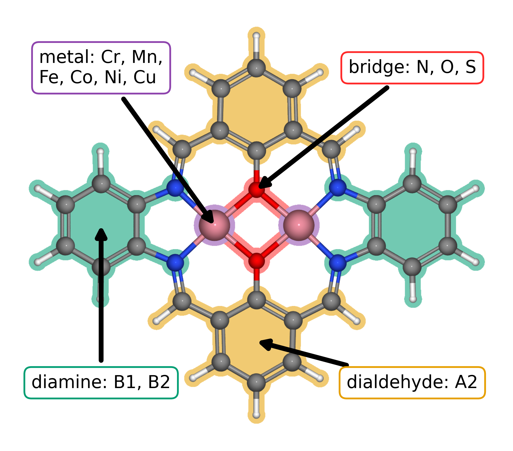
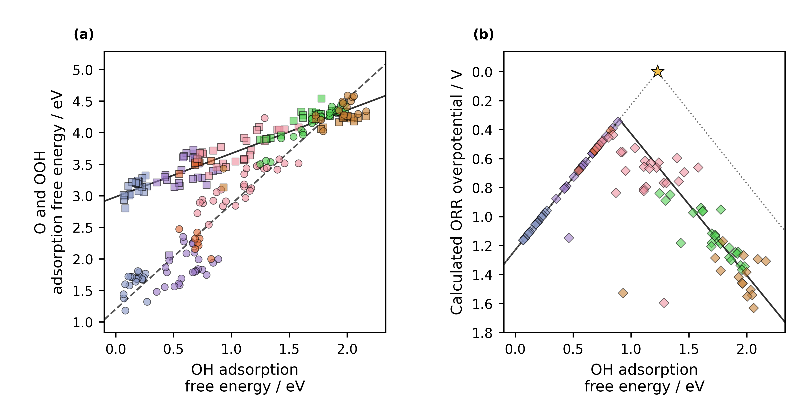
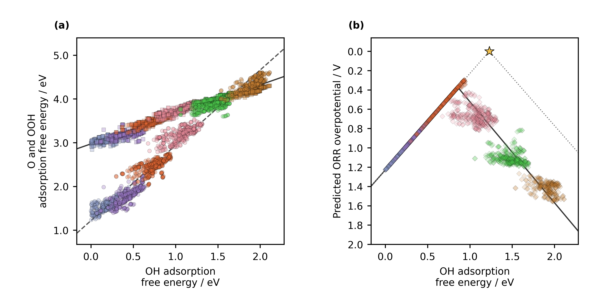

<!-- Reconstructed from ../manuscript_versions/Electrochimica_Acta_research_article_draft_v45.docx; source DOCX SHA-256: c3b5240fa42a22c5fc2c9440ab1302a6d2b6a67b2b0d7fc134c85e4ba5d4696d. -->

# Accelerating Catalyst Discovery with Artificial Intelligence: Molecular Dual-Atom Site Catalysts as a Case Study

Bruno Inácio da Silva Roux Leite,1 Denis Savchenko,1 Timmo-Henrik Pukk,1 Ba Long Nguyen,1 Vladislav Ivanistsev,2† Nadezda Kongi,1†

1 Institute of Chemistry, University of Tartu, Ravila 14a, 50411 Tartu, Estonia

2 Department of Chemistry, University of Latvia, Jelgavas iela 1, Riga, LV-1004, Latvia

Corresponding authors: vladislav.ivanistsev@lu.lv; nadezda.kongi@ut.ee

## Abstract

Accelerating catalyst discovery with artificial intelligence (AI) means shortening the path from trustworthy evidence to reusable knowledge. We demonstrate this progression with the oxygen reduction reaction (ORR) on molecular dual-atom site catalysts (DASCs). We used density functional theory (DFT) to calculate adsorption energetics for 88 molecular catalysts and identified three structures with calculated ORR overpotentials of 0.34, 0.39, and 0.41 V. Machine learning (ML) ridge regression extended the analysis to 1176 optimized catalysts. The final screen retained 2021 catalyst and adsorption center combinations across 1156 catalysts and concentrated the lowest predicted overpotentials at Fe adsorption centers, with S bridge atoms favored and B1 diamine a weaker preference. We stored the structures and results in machine readable formats designed for findable, accessible, interoperable, and reusable (FAIR) release. A human-guided large language model (LLM) procedure then generated the complete article from the verified calculations, predictions, literature, figures, and writing instructions. We chose the questions and methods, interpreted the results, and verified the manuscript. The article itself shows how accelerating catalyst discovery with AI can connect rigorous science, FAIR data, and rapid communication.

Keywords: AI; DFT; ML; LLM; oxygen reduction reaction; molecular dual-atom site catalysts

## 1. Introduction

Accelerating catalyst discovery with artificial intelligence (AI) means shortening the path from trustworthy evidence to reusable knowledge. Density functional theory (DFT) establishes atomistic thermodynamic evidence, machine learning (ML) expands candidate screening, and findable, accessible, interoperable, and reusable (FAIR) data allow the results to answer questions beyond the first article. Scientific communication closes this path by making the evidence understandable and exploitable. We ask whether a carefully guided large language model (LLM) can carry that final stage.

Independent analyses place chemistry publication timelines at several months after submission. Reported averages reach approximately nine months across a journal sample, while chemistry articles on the PLOS platform had a median submission to publication interval of 154 days [10.1016/j.joi.2013.09.001](https://doi.org/10.1016/j.joi.2013.09.001); [10.1007/s11192-023-04640-6](https://doi.org/10.1007/s11192-023-04640-6). These estimates omit preparation before the first submission and rewriting after rejection. Manuscript preparation therefore adds a separate delay between a completed study and the point at which other researchers can use it.

Scientific publishing often treats a coherent story as the organizing principle of a paper, and editors give carefully selected figures a central role in carrying that story [10.1038/nphys724](https://doi.org/10.1038/nphys724); [10.1021/acsenergylett.8b02322](https://doi.org/10.1021/acsenergylett.8b02322); [10.1021/acsenergylett.1c02401](https://doi.org/10.1021/acsenergylett.1c02401); [10.1038/s41551-018-0202-5](https://doi.org/10.1038/s41551-018-0202-5). Clear writing serves science. Yet scientific value resides in verifiable evidence, sound methods, and reasoning that survives inspection, rather than in the author's writing skill alone. Our thesis is direct: a guided LLM can compose the story when researchers make the evidence and its limits explicit. The story must answer to the data.

No research group can anticipate every reaction, descriptor, or comparison that its catalyst data may later support. FAIR records let other researchers combine results, test alternative interpretations, and pursue questions beyond the original study [10.1038/sdata.2016.18](https://doi.org/10.1038/sdata.2016.18). A paper offers a finite scientific account; a structured dataset can support many. We therefore place FAIR data before narrative construction: the data preserve the science, and the article explains one supported reading of it.

LLMs can reduce the effort required to turn such evidence into a readable article, provided that every sentence remains traceable to its source. Scientific stories can conceal inconvenient observations when coherence becomes the goal [10.1038/nmeth.2726](https://doi.org/10.1038/nmeth.2726), and vocabulary changes in published abstracts show that LLM assisted writing has entered routine use [10.1126/sciadv.adt3813](https://doi.org/10.1126/sciadv.adt3813). Ifargan and colleagues generated human verifiable papers from annotated data with interacting LLM agents [10.1056/aioa2400555](https://doi.org/10.1056/aioa2400555). Their results also show why complex research benefits from human direction. We extend that work by generating a complete article from verified electrochemical calculations, model predictions, figures, literature, and project rules.

Our molecular DASC case study links three completed stages. We first calculated ORR adsorption energetics for 88 molecular catalysts with DFT. We then trained adsorbate specific ridge regression models on the DFT results and screened 1176 optimized molecular structures with ML. Finally, a human-guided LLM procedure prepared the complete scientific article. Figure 1 defines the molecular design variables, Figure 2 presents the DFT scaling relations and CHE volcano, and Figure 3 presents the ML predicted relations and activity across the larger library. Together, these stages demonstrate how accelerating catalyst discovery with AI can move from calculation, through screening, to reusable scientific communication.

## 2. Computational methods

### 2.1. Catalyst structures

The molecular catalysts were assembled from the components shown in Figure 1. The notation in the data article [10.1016/j.dib.2026.112806](https://doi.org/10.1016/j.dib.2026.112806) identifies A2 as the fixed dialdehyde and B1 and B2 as the two diamines. Each molecule contains one dual-atom site with two metal-atom adsorption centers. The two metal positions were occupied by Cr, Mn, Fe, Co, Ni, or Cu, and each of the two bridge positions contained N, O, or S. Every clean and adsorbate structure in the DFT analysis was fully optimized. The fixed clean database contained 88 molecular catalysts.

Each optimized structure and its energy were stored in an Atomic Simulation Environment (ASE) database with the catalyst name, metal identities, ligand components, and charge metadata. The `ads_site` field identifies the metal-atom adsorption center occupied by each intermediate.

### 2.2. DFT calculations and adsorption structures

Spin polarized DFT calculations were performed with GPAW 25.7 and ASE 3.28.0 software [10.1063/5.0182685](https://doi.org/10.1063/5.0182685); [10.1088/1361-648X/aa680e](https://doi.org/10.1088/1361-648X/aa680e). The projector augmented wave method, revised Perdew–Burke–Ernzerhof functional, and D4 dispersion correction were used [10.1063/1.5090222](https://doi.org/10.1063/1.5090222). A plane wave cutoff of 550 eV, real space grid spacing of 0.16 Å, and 6.00 Å of vacuum were applied. Each atomic structure was optimized until the maximum force fell below 0.05 eV Å⁻¹, and only calculations that converged with these parameters entered the fixed DFT set. The setup follows earlier work on related molecular catalysts [10.26434/chemrxiv.15001712/v1](https://doi.org/10.26434/chemrxiv.15001712/v1). The total charge was set to +2 for every modeled catalyst, including N bridged structures. This consistent cohort represents one charge assignment and the spin states reached by the spin polarized optimizations. A broader electronic structure survey should compare alternative charges, mixed oxidation states, and spin states.

O, OH, and OOH were placed at either metal-atom adsorption center in the dual-atom site, and each structure was fully optimized. Gas phase H₂ and H₂O reference structures were calculated with the same settings. Total energies were matched by catalyst name and `ads_site`, so each reaction pathway contains values for the same molecular structure and adsorption center.

Adsorption energies for O, OH, and OOH were calculated from the total energies of the corresponding adsorbed structure, clean catalyst, H₂, and H₂O:

$$Δ{E}_{OH} = {E}_{*OH} + (1/2) {E}_{{H}_{2}} - {E}_{*} - {E}_{{H}_{2}O}\tag{1}$$

$$Δ{E}_{O} = {E}_{*O} + {E}_{{H}_{2}} - {E}_{*} - {E}_{{H}_{2}O}\tag{2}$$

$$Δ{E}_{OOH} = {E}_{*OOH} + (3/2) {E}_{{H}_{2}} - {E}_{*} - 2{E}_{{H}_{2}O}\tag{3}$$

In Eqs. (1)–(3), the left side is the adsorption energy of the named intermediate. The terms on the right are the total energies of the adsorbed catalyst, clean catalyst, gas phase H₂, and gas phase H₂O; * identifies the selected adsorption center. The supplied adsorption free energies were used in the scaling and thermodynamic analyses.

### 2.3. Adsorption free energies and ORR thermodynamics

Adsorption energies were converted to adsorption free energies by adding zero point and entropic corrections:

$$Δ{G}_{X} = Δ{E}_{X} + Δ{E}_{ZP,X} - TΔ{S}_{X}\tag{4}$$

In Eq. (4), *X* denotes O, OH, or OOH; *E* and *G* denote electronic energy and Gibbs free energy; *T* is temperature; *S* is entropy; and ZP identifies the zero point contribution. The supplied adsorption free energies already include these corrections. The four reduction potentials for the associative four electron ORR pathway were evaluated with the computational hydrogen electrode (CHE) method [10.1021/jp047349j](https://doi.org/10.1021/jp047349j):

$${U}_{1} = (4.92 eV - Δ{G}_{OOH}) / e{U}_{2} = (Δ{G}_{OOH} - Δ{G}_{O}) / e{U}_{3} = (Δ{G}_{O} - Δ{G}_{OH}) / e{U}_{4} = Δ{G}_{OH} / e\tag{5}$$

Equation (5) defines the positive reduction potentials for the four steps O₂ to OOH, OOH to O, O to OH, and OH to H₂O; * identifies an adsorbed intermediate and *e* is the elementary charge. The limiting potential is defined as the lowest of the four step potentials:

$${U}_{L} = min({U}_{1}, {U}_{2}, {U}_{3}, {U}_{4})\tag{6}$$

The symbol on the left of Eq. (6) denotes the limiting potential. The ORR overpotential was evaluated relative to the equilibrium potential of 1.23 V:

$${η}_{ORR} = 1.23 V - {U}_{L}\tag{7}$$

Equation (7) defines the ORR overpotential. Chemical subscripts in Eqs. (5)–(7) identify the adsorbed intermediate or reaction quantity.

### 2.4. Scaling and thermodynamic activity analyses

The relations of O and OOH adsorption free energies to OH adsorption free energy were evaluated by ordinary least squares:

$$Δ{G}_{O} = {α}_{O} Δ{G}_{OH} + {β}_{O}Δ{G}_{OOH} = {α}_{OOH} Δ{G}_{OH} + {β}_{OOH}\tag{8}$$

In Eq. (8), α and β are the slope and intercept for the intermediate identified by the subscript. The fitted relations were propagated through the four ORR steps to obtain the scaling based activity curve in Figures 2 and 3. An ideal reference relation was defined with an OOH–OH free energy separation of 2.46 eV:

$$Δ{{G}_{OOH}}^{ideal} = Δ{G}_{OH} + 2.46 eV{η}_{ideal} = 1.23 V - min(Δ{G}_{OH} / e, (2.46 eV - Δ{G}_{OH}) / e)\tag{9}$$

In Eq. (9), OH removal defines the left branch and OOH formation defines the right branch. The branches meet at an OH adsorption free energy of 1.23 eV and zero overpotential. Catalyst activity was interpreted thermodynamically; kinetic activity also depends on activation barriers.

### 2.5. Regression analysis and catalyst-family screening

The adsorption free energies from the fixed 88 catalyst DFT set were used to train separate ridge regression models for OH, O, and OOH. Descriptors of the clean catalysts represented the electron population, charge, spin, metal pair polarization, and ligand environment. Eight predictors were used for OH and O, and six were used for OOH. The supplied parameter tables retained the training medians, means, standard deviations, standardized coefficients, and ridge parameters. The ridge parameter was 0.10 for OH and 1.00 for O and OOH. The models were applied to a separate database of 1176 optimized structures calculated with GPAW 25.7 and ASE 3.28.0 under the settings in Section 2.2.

The predicted OH, O, and OOH values were joined by catalyst name and `ads_site` before the CHE step potentials and overpotentials were evaluated. This produced 2080 complete catalyst and adsorption center combinations across all 1176 structures. The Figure 2 energy filters retained 2021 combinations across 1156 catalysts for Figure 3. For comparison of structural families, the most active pool in each DFT or ML dataset was defined as the lowest 10% of retained overpotentials, rounded upward to a whole catalyst and adsorption center combination.

### 2.6. LLM manuscript generation

An LLM accessed through OpenAI Codex was used to prepare the complete manuscript from the calculations, model predictions, figures, literature, and project instructions. Data to paper generation with interacting LLM agents and source linked outputs has been reported by Ifargan and colleagues [10.1056/aioa2400555](https://doi.org/10.1056/aioa2400555). The present procedure was developed for one consolidated prompt that generates a complete electrochemistry article after extensive human guidance.

The manuscript instructions were developed through repeated human guidance over approximately two weeks. Scientific terminology, source authority, database matching, analysis code, figure construction, journal requirements, article structure, and writing style were tested and corrected. Ten defined functions covered project curation, scientific auditing, programming, figure preparation, supervision, drafting, literature synthesis, document construction, style editing, and release auditing.

The consolidated prompt was applied to the verified scientific inputs and tested instructions to generate the complete article. The calculations, predictions, figures, citations, terminology, and scientific interpretation were then checked by the human researchers, who approved the resulting account.

## 3. Results and discussion

### 3.1. Molecular structures and adsorption centers

Figure 1 shows the common molecular structure and the four component classes used to build the catalyst library. Each molecule contains one dual-atom site with two metal-atom adsorption centers. The metal identities, bridge atoms, and diamine vary in the 88 catalyst DFT set, while A2 remains the fixed dialdehyde. The database retains the occupied adsorption center when an intermediate binds at either metal atom.

**Figure 1****. Modular molecular structure of the catalyst library. **Colored regions and arrows identify the metal positions (purple), bridge atoms (red), diamine derived region (green), and dialdehyde derived region (orange). The metal positions can contain Cr, Mn, Fe, Co, Ni, or Cu; the two bridge atoms can be N, O, or S; the diamine is B1 or B2; and A2 is the fixed dialdehyde. A2, B1, and B2 follow the notation in our data article [10.1016/j.dib.2026.112806](https://doi.org/10.1016/j.dib.2026.112806).

The 88 catalyst structures yielded 123 complete pathways after exact matching of each catalyst and adsorption center. The author approved energy filters retained 118 pathways across 79 catalysts for the scaling and CHE analyses.

### 3.2. Adsorption scaling and calculated ORR thermodynamics

Figure 2a relates the DFT calculated O and OOH adsorption free energies to OH adsorption free energy for the 118 retained catalyst and adsorption center combinations. The OOH–OH fit has a slope of 0.69 and an intercept of 2.98 eV, while the O–OH fit has a slope of 1.66 and an intercept of 1.20 eV. The steeper O–OH relation gives O binding the larger response to changes in OH binding. Figure 2b carries both fits through the four CHE steps, so the adsorption relations and the calculated ORR overpotential remain part of one thermodynamic analysis.

**Figure 2****. Density functional theory **adsorption scaling and conventional computational hydrogen electrode activity for the molecular dual-atom site catalysts defined in Figure 1. (a) Calculated O and OOH adsorption free energies versus OH adsorption free energy for 118 catalyst and adsorption center combinations across 79 catalysts. Circles denote O and squares denote OOH. Jmol colors identify the adsorption-center metal: Cr, blue gray; Mn, violet; Fe, orange; Co, pink; Ni, green; and Cu, brown. The solid and dashed black lines are the OOH–OH and O–OH linear fits. (b) Calculated ORR overpotentials for the same combinations, shown as diamonds with the same metal colors. The solid black curve propagates the two fitted scaling relations through the four reaction steps. The gray dotted line is the ideal CHE envelope, and the star marks zero overpotential at an OH adsorption free energy of 1.23 eV. Lower overpotential appears higher on the reversed axis. The plotted dataset excludes combinations with OH adsorption free energy below 0.00 eV or O adsorption free energy above 4.92 eV.

The three lowest calculated CHE overpotentials belong to a Cr–Mn DASC with S bridge atoms and B1 diamine at the Mn adsorption center (0.34 V), a Mn–Mn DASC with S bridge atoms and B1 diamine at the Mn adsorption center (0.39 V), and an Fe–Cu DASC with S bridge atoms and B2 diamine at the Fe adsorption center (0.41 V). All three contain S bridge atoms, while their metals and diamines differ. These calculations therefore identify S bridged molecular structures as concrete candidates while leaving metal and diamine effects to the broader family comparison.

### 3.3. Regression predictions across catalyst families

The lowest DFT overpotential decile contains 12 catalyst and adsorption center combinations. Five have Co adsorption centers, four have Mn, and three have Fe; none have Cr, Ni, or Cu adsorption centers. Seven contain S–S bridges, four contain N–N bridges, and one contains an O–O bridge. B1 and B2 each occur six times. The DFT pool therefore selects a restricted set of adsorption-center metals and moderately favors S bridge atoms, while it gives no preference between the two diamines.

The ML screen sharpens the metal trend across the larger library. The lowest predicted decile contains 203 catalyst and adsorption center combinations: 187 have Fe adsorption centers and 16 have Co adsorption centers. S–S bridges account for 65 combinations, or 32%, compared with 18% in the full retained screen. B1 occurs in 122 combinations, or 60%, compared with 54% in the full screen. The strongest design principle is therefore an Fe adsorption center in an S bridged molecular structure; B1 is a secondary preference, and Co provides the next metal family. No single component determines activity by itself. The three lowest individual predictions illustrate the pattern: an Fe–Fe DASC with A9 dialdehyde, O bridge atoms, and B1 diamine gives 0.29 V; an Fe–Fe DASC with A1 dialdehyde, S bridge atoms, and B1 gives 0.30 V; and an Mn–Fe DASC with A9 dialdehyde, S bridge atoms, and B1 at the Fe adsorption center gives 0.30 V. These model predictions remain subject to the charge and spin scope in Section 2.2.

**Figure 3****. **Machine learning predicted adsorption scaling and conventional computational hydrogen electrode activity for the 1176 structure molecular catalyst library. (a) Predicted O and OOH adsorption free energies versus predicted OH adsorption free energy. Circles denote O and squares denote OOH. Jmol colors identify the adsorption-center metal: Cr, blue gray; Mn, violet; Fe, orange; Co, pink; Ni, green; and Cu, brown. The solid and dashed black lines are the predicted OOH–OH and O–OH linear fits. (b) Predicted ORR overpotentials, shown as diamonds with the same metal colors. The solid black curve propagates the predicted scaling relations through the four reaction steps. The gray dotted line and star show the ideal CHE reference from Figure 2. The plots contain 2021 retained catalyst and adsorption center combinations across 1156 catalysts after exclusion of predicted OH adsorption free energies below 0.00 eV and predicted O adsorption free energies above 4.92 eV. Axis tick labels are shown to one decimal place.

### 3.4. Molecular catalyst design in context

Molecular definition makes catalyst variables experimentally meaningful. Our data article established the modular A2, B1, and B2 notation and preserved each molecular structure as a reusable record [10.1016/j.dib.2026.112806](https://doi.org/10.1016/j.dib.2026.112806). Work on the same catalyst family then showed that a phenylene or naphthalene spacer can change the distance between two Co centers, the binding geometry of oxygen intermediates, and ORR selectivity [10.26434/chemrxiv.15001712/v1](https://doi.org/10.26434/chemrxiv.15001712/v1). Related molecular studies reached the same physical lesson from different structures: two metals can stabilize a bidentate OOH configuration, while bridge and ligand chemistry can shift metal coordination and oxygen binding [10.1021/jacs.4c12705](https://doi.org/10.1021/jacs.4c12705); [10.1021/acscatal.6c00046](https://doi.org/10.1021/acscatal.6c00046). These results justify treating metal identity, bridge, diamine, and adsorption center as connected design variables rather than isolated labels.

Zhang and colleagues provide the closest precedent through catalysis-unit engineering [10.1002/adma.202403549](https://doi.org/10.1002/adma.202403549). They evaluated 60 homonuclear salphen units assembled from ten metals and six coordination environments, calculated OER free energies and scaling relations with DFT, ranked 27 descriptors with XGBoost, and constructed an interpretable SISSO model before incorporating selected Ni and Co units into salphen covalent organic materials. Our ORR study covers 88 molecular catalysts in the DFT stage, includes homo- and heteronuclear metal pairs, resolves adsorption at either metal center, and extends prediction to 1176 optimized structures. The reactions and regression models differ, yet both studies reach the same practical division of labor: DFT supplies internally consistent thermodynamic labels, while ML expands the candidate screen and exposes structural trends.

That division is also visible in recent screening of extended phthalocyanine dual-atom catalysts, where 81 DFT structures supported predictions for 360 additional metal pairs and identified Fe as an adsorption anchor whose neighboring metal regulates activity [10.1002/adma.74833](https://doi.org/10.1002/adma.74833). In our data, DFT establishes the favorable S bridged examples, and ML carries the metal and ligand comparison across an order of magnitude more molecular structures. The regression screen therefore substitutes fast predictions for many preliminary adsorption calculations; targeted DFT and experiment can then concentrate on the families selected from that screen. This is the specific way in which ML accelerates catalyst discovery in the present study.

### 3.5. Alternative activity descriptors and reusable DFT data

The same adsorption center matched DFT data support several thermodynamic readings of ORR. The conventional CHE overpotential is set by the least favorable individual reduction step. Calle-Vallejo's electrochemical step symmetry index evaluates how evenly the four step potentials divide the 1.23 V reaction free energy, while Exner's free energy span identifies the largest cumulative uphill change across consecutive reaction states at a selected potential [10.1016/j.coelec.2018.03.025](https://doi.org/10.1016/j.coelec.2018.03.025); [10.1021/acscatal.2c03997](https://doi.org/10.1021/acscatal.2c03997). Each descriptor asks a different question of the same verified adsorption energetics. Because molecular and adsorption-center identities remain attached to every value, another researcher can apply any of these analyses without reconstructing the DFT dataset.

The fixed DFT dataset for 88 molecular catalysts is available from the project [GitHub repository](https://github.com/doublelayer/EActa_2026_AI-acceleration). The larger dataset used for screening 1176 optimized structures is available at [Zenodo record 23320178](https://zenodo.org/records/23320178). The matched analysis records preserve the molecular and adsorption center identities required to reproduce the scaling and CHE comparisons and support alternative analyses of ORR.

### 3.6. Closing the scientific communication gap

The catalyst study gives the LLM verified science to communicate. DFT establishes adsorption thermodynamics for a defined molecular library, ML extends screening to 1176 structures, and FAIR records preserve every prediction with its catalyst and adsorption center. The article completes the path by connecting those results to methods, figures, literature, and chemical interpretation. Scientific communication is therefore a practical part of accelerating catalyst discovery with AI.

Over approximately two weeks, we taught the LLM the project terminology, evidence hierarchy, scientific methods, journal rules, figure standards, and manuscript voice. We checked successive drafts against the ASE databases, analysis outputs, literature, and our scientific interpretation. Those corrections became reusable instructions, and the consolidated prompt generated the complete article. The development required sustained human judgment; the final execution gathered that judgment into a repeatable writing procedure.

We chose the research questions, produced and verified the DFT results, directed the ML analysis, interpreted the structural trends, and decided what the evidence supports. The LLM composed the article from those verified inputs. This division lets researchers concentrate on scientific method and discovery while a prepared LLM carries the writing. The same division raises the standard for source traceability, data organization, and human review because fluent prose must remain answerable to the science.

## 4. Conclusions

Accelerating catalyst discovery with artificial intelligence means shortening the path from trustworthy evidence to reusable knowledge. Our molecular DASC case study completed that path in three stages: DFT established adsorption thermodynamics for 88 catalysts, ML extended the screen to 1176 optimized structures, and a guided LLM generated the complete article from the verified results. The article itself is the principal demonstration. Scientific communication can be delegated after researchers have made the evidence, methods, sources, and interpretive limits explicit.

The DFT calculations prioritized three S bridged molecular catalysts with calculated ORR overpotentials of 0.34, 0.39, and 0.41 V. The ML screen identified Fe adsorption centers as the dominant feature of its lowest predicted decile, with S bridge atoms favored and B1 diamine a secondary preference. FAIR ASE and JSON records keep these results available for other descriptors, comparisons, and reactions. Human researchers remain the authors of the scientific questions and judgments; the LLM carries the prose. This use of AI returns time to scientific investigation while bringing verified results into reusable form sooner.

## CRediT authorship contribution statement

Bruno Inácio da Silva Roux Leite: investigation, data curation, formal analysis, and generation of DFT results. Denis Savchenko: methodology, software, formal analysis, visualization, and development of the regression model. Timmo-Henrik Pukk: investigation, data curation, formal analysis, and generation of DFT results. Ba Long Nguyen: investigation, software, data curation, formal analysis, visualization, and generation of DFT results. Vladislav Ivanistsev: conceptualization, supervision, and funding acquisition. Nadezda Kongi: conceptualization, supervision, and funding acquisition. All authors validated and approved the final manuscript text.

## Declaration of competing interest

The authors declare no competing interests.

## Data availability

The fixed DFT dataset for 88 molecular catalysts is available from the project [GitHub repository](https://github.com/doublelayer/EActa_2026_AI-acceleration). The larger dataset used for screening 1176 optimized structures is available at [Zenodo record 23320178](https://zenodo.org/records/23320178).

## Declaration of generative AI and AI assisted technologies in the manuscript preparation process

During the preparation of this work, OpenAI Codex with an LLM was used to organize and write the complete scientific article and to assist with reproducible analysis and figure code from the project data, literature, and instructions. The human authors reviewed the text against the calculations, model predictions, methods, figures, and sources and take full responsibility for the article's content.

## Acknowledgments

This work was supported by the Estonian Ministry of Education and Research (TK210) and the Estonian Research Council (PRG3174). We acknowledge the University of Latvia Artificial Intelligence and Computing Center and the High Performance Computing Center of the University of Tartu for providing computational resources.

## References

S. Jia et al., Machine Learning Reveals Role-Asymmetric Electronic Cooperation in Fe-Based Dual-Atom Catalysts, Advanced Materials 36 (2026) e74833. [10.1002/adma.74833](https://doi.org/10.1002/adma.74833)

Z. Zhang et al., Design and Synthesis of Electrocatalysts Based on Catalysis-Unit Engineering, Advanced Materials 36 (2024) 2403549. [10.1002/adma.202403549](https://doi.org/10.1002/adma.202403549)

X. Chen et al., Leveraging DFT and Machine Learning for Accelerated Screening of Cluster-Modified Single-Atom Catalysts in Oxygen Reduction Reactions, ACS Catalysis 16 (2026) 14399–14410. [10.1021/acscatal.6c02383](https://doi.org/10.1021/acscatal.6c02383)

J. K. Nørskov, J. Rossmeisl, A. Logadottir, L. Lindqvist, J. R. Kitchin, T. Bligaard, H. Jónsson, Origin of the Overpotential for Oxygen Reduction at a Fuel-Cell Cathode, Journal of Physical Chemistry B 108 (2004) 17886–17892. [10.1021/jp047349j](https://doi.org/10.1021/jp047349j)

Q. Sun et al., Well-Defined Co₂ Dual-Atom Catalyst Breaks Scaling Relations of Oxygen Reduction Reaction, Journal of the American Chemical Society 146 (2024) 35295–35304. [10.1021/jacs.4c12705](https://doi.org/10.1021/jacs.4c12705)

N. Žoglo et al., Intersite Geometry Controls Activity and Selectivity in the Oxygen Reduction Reaction on Dual-Atom-Site Catalysts, ChemRxiv preprint (2026). [10.26434/chemrxiv.15001712/v1](https://doi.org/10.26434/chemrxiv.15001712/v1)

L. X. Chen, P. Christopher, F. De Angelis, S. Jin, Y.-S. Hu, N.-G. Park, D. Das Sarma, Y.-K. Sun, P. V. Kamat, We Editors Are Authors, Too, ACS Energy Letters 4 (2019) 249–250. [10.1021/acsenergylett.8b02322](https://doi.org/10.1021/acsenergylett.8b02322)

Elements of style, Nature Physics 3 (2007) 581. [10.1038/nphys724](https://doi.org/10.1038/nphys724)

C. M. Biegel, P. V. Kamat, Five common pitfalls to avoid while composing scientific figures, ACS Energy Letters 6 (2021) 4309–4310. [10.1021/acsenergylett.1c02401](https://doi.org/10.1021/acsenergylett.1c02401)

Storytelling in research, Nature Biomedical Engineering 2 (2018) 53. [10.1038/s41551-018-0202-5](https://doi.org/10.1038/s41551-018-0202-5)

Should scientists tell stories?, Nature Methods 10 (2013) 1037. [10.1038/nmeth.2726](https://doi.org/10.1038/nmeth.2726)

B. L. Nguyen, T. K. Madsen, V. Ivanistsev, N. Kongi, Dataset of molecular dual-atom site complexes for catalysis, Data in Brief 66 (2026) 112806. [10.1016/j.dib.2026.112806](https://doi.org/10.1016/j.dib.2026.112806)

J. J. Mortensen et al., GPAW: An open Python package for electronic structure calculations, Journal of Chemical Physics 160 (2024) 092503. [10.1063/5.0182685](https://doi.org/10.1063/5.0182685)

A. H. Larsen et al., The Atomic Simulation Environment—A Python Library for Working with Atoms, Journal of Physics: Condensed Matter 29 (2017) 273002. [10.1088/1361-648X/aa680e](https://doi.org/10.1088/1361-648X/aa680e)

E. Caldeweyher, S. Ehlert, A. Hansen, H. Neugebauer, S. Spicher, C. Bannwarth, S. Grimme, A generally applicable atomic-charge dependent London dispersion correction, Journal of Chemical Physics 150 (2019) 154122. [10.1063/1.5090222](https://doi.org/10.1063/1.5090222)

N. Govindarajan, J. M. García-Lastra, E. J. Meijer, F. Calle-Vallejo, Does the breaking of adsorption energy scaling relations guarantee enhanced electrocatalysis?, Current Opinion in Electrochemistry 8 (2018) 110–117. [10.1016/j.coelec.2018.03.025](https://doi.org/10.1016/j.coelec.2018.03.025)

S. Razzaq, K. S. Exner, Materials screening by the descriptor Gmax(η): The free energy span model in electrocatalysis, ACS Catalysis 13 (2023) 1740–1758. [10.1021/acscatal.2c03997](https://doi.org/10.1021/acscatal.2c03997)

M. D. Wilkinson et al., The FAIR guiding principles for scientific data management and stewardship, Scientific Data 3 (2016) 160018. [10.1038/sdata.2016.18](https://doi.org/10.1038/sdata.2016.18)

D. Kobak, R. González-Márquez, E.-Á. Horvát, J. Lause, Delving into LLM-assisted writing in biomedical publications through excess vocabulary, Science Advances 11 (2025) eadt3813. [10.1126/sciadv.adt3813](https://doi.org/10.1126/sciadv.adt3813)

*T*. Ifargan, L. Hafner, M. Kern, O. Alcalay, R. Kishony, Autonomous LLM-Driven Research: from Data to Human-Verifiable Research Papers, NEJM AI 2 (2025). [10.1056/aioa2400555](https://doi.org/10.1056/aioa2400555)

B.-C. Björk, D. Solomon, The publishing delay in scholarly peer-reviewed journals, Journal of Informetrics 7 (2013) 914–923. [10.1016/j.joi.2013.09.001](https://doi.org/10.1016/j.joi.2013.09.001)

J. Ding, D. Du, A study of the correlation between publication delays and measurement indicators of journal articles in the social network environment: based on online data in PLOS, Scientometrics 128 (2023) 1711–1743. [10.1007/s11192-023-04640-6](https://doi.org/10.1007/s11192-023-04640-6)
