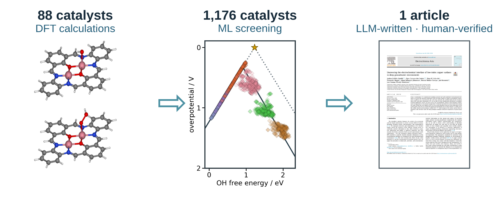
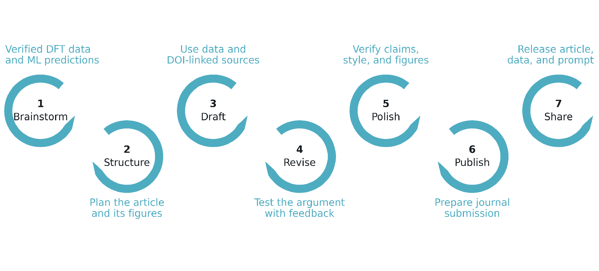
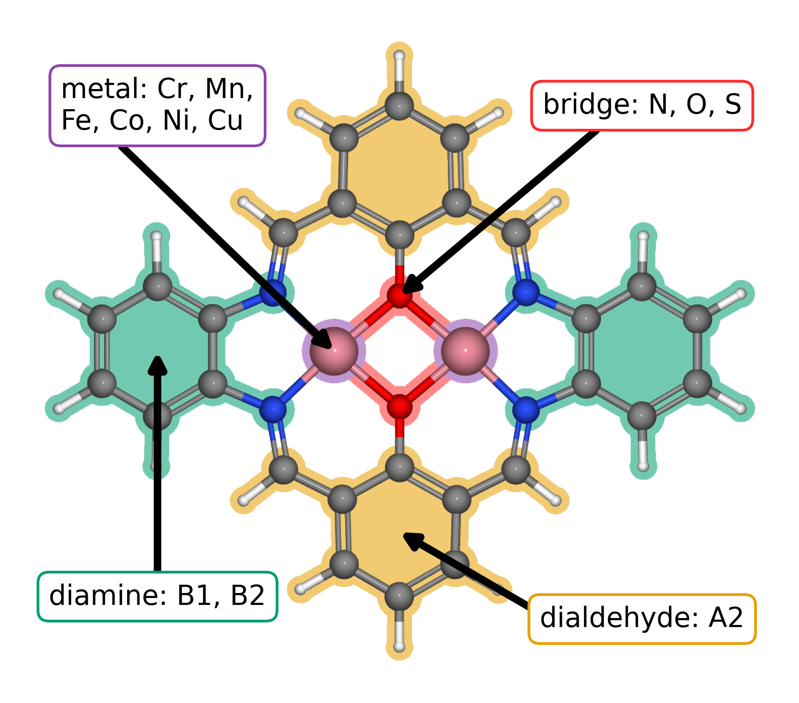
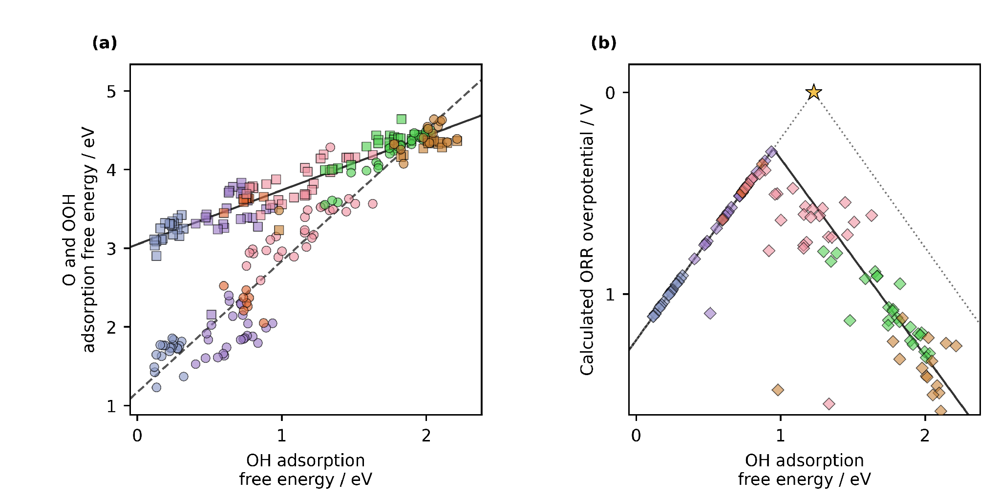
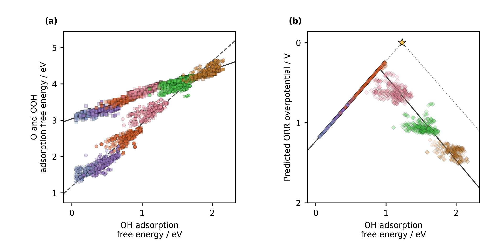

<!-- Reconstructed from ../manuscript_versions/Electrochimica_Acta_research_article_draft_v49.docx; source DOCX SHA-256: ad76dd5dc256229b1e7541f4de745700629c059104123d35d760f8ed46fedac6. -->

# Accelerating Catalyst Discovery with Artificial Intelligence Using Molecular Dual-Atom Site Catalysts as a Case Study

Bruno Inácio da Silva Roux Leite,1 Denis Savchenko,1 Timmo-Henrik Pukk,1 Ba Long Nguyen,1 Vladislav Ivanistsev,2† Nadezda Kongi,1†

*1** Institute of Chemistry, University of Tartu, Ravila 14a, 50411 Tartu, Estonia*

*2** Department of Chemistry, University of Latvia, Jelgavas iela 1, Riga, LV-1004, Latvia*

*Corresponding authors: **vladislav.ivanistsev@lu.lv**; **nadezda.kongi@ut.ee*

## Abstract

Accelerating catalyst discovery with artificial intelligence (AI) requires accurate density functional theory (DFT) calculations, useful machine learning (ML) predictions, and clear scientific writing. We demonstrate this with the oxygen reduction reaction (ORR) on molecular dual-atom site catalysts (DASCs). DFT calculations for 88 molecular catalysts identified three structures with the lowest calculated ORR overpotentials of 0.29, 0.34, and 0.36 V. Ridge regression models trained on these computational results predicted adsorption potential energies for 1176 optimized molecular catalysts, which enabled their ranking. In the lowest predicted overpotential decile, iron (Fe) adsorption centers predominated, while sulfur (S) bridge atoms and 1,2-phenylenediamine were enriched relative to the full predicted set. We then guided a large language model (LLM) to write this whole article using verified computational results, ML predictions, three databases, literature supplied as portable document format files, and figures. This case study illustrates how AI can accelerate catalyst discovery through predictive screening and LLM assisted scientific writing.

Keywords: artificial intelligence; density functional theory; machine learning; large language models; oxygen reduction reaction; molecular dual-atom site catalysts.

TOC figure (draft)

## 1. Introduction

Independent analyses place chemistry publication timelines at several months after submission. One journal sample reported an average interval of approximately nine months, while a study of chemistry articles published by the Public Library of Science reported a median submission to publication interval of 154 days [10.1016/j.joi.2013.09.001](https://doi.org/10.1016/j.joi.2013.09.001); [10.1007/s11192-023-04640-6](https://doi.org/10.1007/s11192-023-04640-6). These measurements begin at submission and exclude preparation of the first manuscript and revisions after rejection. Manuscript preparation therefore adds time before the publication interval even begins.

Editors have argued that a coherent scientific story and carefully selected figures help readers understand a paper [10.1038/nphys724](https://doi.org/10.1038/nphys724); [10.1021/acsenergylett.8b02322](https://doi.org/10.1021/acsenergylett.8b02322); [10.1021/acsenergylett.1c02401](https://doi.org/10.1021/acsenergylett.1c02401); [10.1038/s41551-018-0202-5](https://doi.org/10.1038/s41551-018-0202-5). Clear writing supports research, but writing skill alone does not establish scientific value. Our thesis is direct: researchers can delegate article writing to a guided LLM when DFT calculations, ML predictions, and databases constrain every claim. The story must follow the data.

Catalyst databases can support analyses that their creators did not anticipate. Researchers can combine datasets, re-evaluate data points, and test new interpretations [10.1038/sdata.2016.18](https://doi.org/10.1038/sdata.2016.18). A database preserves molecular structures and calculated values; each article presents specific analyses of those data. Reusable databases let researchers test further questions against the same scientific results.

Vocabulary analyses of published abstracts have documented changes associated with LLM assisted writing [10.1126/sciadv.adt3813](https://doi.org/10.1126/sciadv.adt3813). Editorials also warn that story driven selection can hide conflicting observations [10.1038/nmeth.2726](https://doi.org/10.1038/nmeth.2726). Ifargan and colleagues showed that interacting LLM agents can prepare human verifiable papers from annotated data [10.1056/aioa2400555](https://doi.org/10.1056/aioa2400555). We build on this work by supplying the LLM with verified DFT calculations, ML predictions, three databases, literature, figures, and project instructions.

Figure 1 shows the seven article writing stages used to organize the final LLM procedure. At each stage, the LLM can contribute as an active writing team member while researchers guide the work and verify scientific claims.

**Figure 1. **Seven stages of scientific article preparation, adapted from the authors' writing lecture: brainstorm, structure, draft, revise, polish, publish, and share. The surrounding text shows how verified DFT data, ML predictions, sources, figures, and human feedback enter the process. A guided LLM can contribute at each writing stage as an active team member; researchers direct the process and verify the scientific content.

Our study links three stages. DFT calculations establish adsorption energetics for 88 molecular catalysts. ML predictions extend the analysis to 1176 optimized molecular structures and identify catalyst features associated with lower predicted overpotentials. A guided LLM then prepares the complete article from the verified results. Figure 2 shows the molecular variables, Figure 3 presents DFT scaling relations and ORR thermodynamics, and Figure 4 presents the corresponding ML predictions. Together, these results show how artificial intelligence can accelerate catalyst discovery through DFT calculations, ML predictions, and scientific writing.

## 2. Computational methods

### 2.1. Catalyst structures

The molecular catalysts were assembled from the components shown in Figure 2. Our previous data article defined B1 as the 1,2-phenylenediamine fragment and B2 as a 1,8-naphthalenediamine fragment [10.1016/j.dib.2026.112806](https://doi.org/10.1016/j.dib.2026.112806). A2 is 2-hydroxyisophthalaldehyde fragment. Each molecule contains one dual-atom site with two metal-atom adsorption centers. The two metal positions were occupied by Cr, Mn, Fe, Co, Ni, or Cu, and each of the two bridge positions contained N, O, or S. Every clean and adsorbate structure in the DFT analysis was fully optimized. Three linked molecular catalyst databases were used: the published structure database, the fixed DFT dataset of 88 catalysts, and the larger dataset of 1176 optimized catalysts used for ML predictions. Each optimized structure and its energy were stored in an Atomic Simulation Environment (ASE) database with the catalyst name, metal identities, ligand components, and charge metadata. The ads_site field identifies the metal-atom adsorption center occupied by each intermediate.

### 2.2. DFT calculations and adsorption structures

Spin polarized DFT calculations were performed with GPAW 25.7 and ASE 3.28.0 software [10.1063/5.0182685](https://doi.org/10.1063/5.0182685); [10.1088/1361-648X/aa680e](https://doi.org/10.1088/1361-648X/aa680e). The projector augmented wave method, revised Perdew–Burke–Ernzerhof functional, and D4 dispersion correction were used [10.1063/1.5090222](https://doi.org/10.1063/1.5090222). A plane wave cutoff of 550 eV, real space grid spacing of 0.16 Å, and 6.00 Å of vacuum were applied. Each atomic structure was optimized until the maximum force fell below 0.05 eV Å⁻¹, and only calculations that converged with these parameters entered the fixed DFT set. The setup follows earlier work on related molecular catalysts [10.26434/chemrxiv.15001712/v1](https://doi.org/10.26434/chemrxiv.15001712/v1). The total charge was set to +2 for every modeled catalyst, including N bridged structures. This consistent cohort represents one charge assignment and the spin states reached by the spin polarized optimizations. A broader electronic structure survey should compare alternative charges, mixed oxidation states, and spin states.

O, OH, and OOH were placed at either metal-atom adsorption center in the active site, and each structure was fully optimized. Gas phase H₂ and H₂O reference structures were calculated with the same settings. Total energies were matched by catalyst name and `ads_site`, so each reaction pathway contains values for the same molecular structure and adsorption center.

Adsorption energies for O, OH, and OOH were calculated from the total energies of the corresponding adsorbed structure, clean catalyst, H₂, and H₂O:

$$Δ{E}_{OH} = {E}_{*OH} + (1/2) {E}_{{H}_{2}} - {E}_{*} - {E}_{{H}_{2}O}\tag{1}$$

$$Δ{E}_{O} = {E}_{*O} + {E}_{{H}_{2}} - {E}_{*} - {E}_{{H}_{2}O}\tag{2}$$

$$Δ{E}_{OOH} = {E}_{*OOH} + (3/2) {E}_{{H}_{2}} - {E}_{*} - 2{E}_{{H}_{2}O}\tag{3}$$

In Eqs. (1)–(3), the left side is the adsorption potential energy of the named intermediate. The terms on the right are the electronic total energies of the adsorbed catalyst, clean catalyst, gas phase H₂, and gas phase H₂O; * identifies the selected adsorption center.

### 2.3. Adsorption free energies and ORR thermodynamics

Adsorption potential energies were converted to adsorption free energies by adding combined zero point energy and entropy corrections and an empirical solvation contribution:

$$Δ{G}_{X} = Δ{E}_{X} + Δ{E}_{ZP,X} - TΔ{S}_{X} + Δ{G}_{solv,X}\tag{4}$$

In Eq. (4), *X* denotes O, OH, or OOH; *E* and *G* denote potential energy and Gibbs free energy; *T* is temperature; S is entropy; ZP identifies the zero point contribution; and solv identifies solvation. The adopted combined zero point energy and entropy corrections were 0.35 eV for OH, 0.05 eV for O, and 0.40 eV for OOH at 300 K, using the tabulated reference convention and the additive O + OH approximation for OOH []. Solvation corrections of −0.30 eV were applied to OH and OOH, corresponding to two hydrogen bonds with an estimated stabilization of 0.15 eV each; no solvation correction was applied to O []. The resulting net additions were 0.05, 0.05, and 0.10 eV for OH, O, and OOH, respectively. These rounded combined corrections were applied consistently to the DFT and ML adsorption energies. The separately evaluated gas ZPEs were not added again because the adopted reaction corrections already include gas-reference contributions. The four reduction potentials were evaluated with the computational hydrogen electrode (CHE) method [10.1021/jp047349j](https://doi.org/10.1021/jp047349j):

$${U}_{1} = (4.92 eV - Δ{G}_{OOH}) / e {U}_{2} = (Δ{G}_{OOH} - Δ{G}_{O}) / e {U}_{3} = (Δ{G}_{O} - Δ{G}_{OH}) / e {U}_{4} = Δ{G}_{OH} / e \tag{5}$$

Equation (5) defines the positive reduction potentials for the four steps O₂ to OOH, OOH to O, O to OH, and OH to H₂O; * identifies an adsorbed intermediate and *e* is the elementary charge. The limiting potential is defined as the lowest of the four step potentials:

$${U}_{L} = min({U}_{1}, {U}_{2}, {U}_{3}, {U}_{4})\tag{6}$$

The symbol on the left of Eq. (6) denotes the limiting potential. The ORR overpotential was evaluated relative to the equilibrium potential of 1.23 V:

$${η}_{ORR} = 1.23 V - {U}_{L}\tag{7}$$

Equation (7) defines the ORR overpotential. Chemical subscripts in Eqs. (5)–(7) identify the adsorbed intermediate or reaction quantity.

### 2.4. Scaling and thermodynamic activity analyses

The relations of O and OOH adsorption free energies to OH adsorption free energy were evaluated by ordinary least squares:

$$Δ{G}_{O} = {α}_{O} Δ{G}_{OH} + {β}_{O} Δ{G}_{OOH} = {α}_{OOH} Δ{G}_{OH} + {β}_{OOH} \tag{8}$$

In Eq. (8), α and β are the slope and intercept for the intermediate identified by the subscript. The fitted relations were propagated through the four ORR steps to obtain the scaling based activity curve in Figures 3 and 4. An ideal reference relation was defined with an OOH–OH free energy separation of 2.46 eV:

$$Δ{{G}_{OOH}}^{ideal} = Δ{G}_{OH} + 2.46 eV {η}_{ideal} = 1.23 V - min(Δ{G}_{OH} / e, (2.46 eV - Δ{G}_{OH}) / e) \tag{9}$$

In Eq. (9), OH removal defines the left branch and OOH formation defines the right branch. The branches meet at an OH adsorption free energy of 1.23 eV and zero overpotential. Catalyst activity was interpreted thermodynamically; kinetic activity also depends on activation barriers.

### 2.5. Regression analysis and catalyst family screening

The adsorption potential energies from the fixed 88 catalyst DFT dataset were used to train separate ridge regression models for OH, O, and OOH. Descriptors of the clean catalysts represented the electron population, charge, spin, metal pair polarization, and ligand environment. Eight predictors were used for OH and O, and six were used for OOH. The parameter tables retain the training medians, means, standard deviations, standardized coefficients, and ridge parameters. The ridge parameter was 0.10 for OH and 1.00 for O and OOH. The models were applied to the separate database of 1176 optimized structures described in Section 2.1.

The predicted OH, O, and OOH values were joined by catalyst name and `ads_site` and converted from adsorption potential energies to free energies with the same corrections in Section 2.3 before the CHE step potentials and overpotentials were evaluated. This produced 2080 complete catalyst and adsorption center combinations across all 1176 structures. The Figure 3 energy filters retained 2021 combinations across 1156 catalysts for Figure 4. For comparison of structural families, the most active pool in each DFT or ML dataset was defined as the lowest 10% of retained overpotentials, rounded upward to a whole catalyst and adsorption center combination.

### 2.6. LLM manuscript generation

An LLM accessed through OpenAI Codex was used to prepare the complete manuscript from the calculations, model predictions, figures, literature, and project instructions. Data to paper generation with interacting LLM agents and source linked outputs has been reported by Ifargan and colleagues [10.1056/aioa2400555](https://doi.org/10.1056/aioa2400555). The present procedure was developed for one consolidated prompt that generates a complete electrochemistry article after extensive human guidance.

The manuscript instructions were developed through repeated human guidance over approximately two weeks. Scientific terminology, source authority, database matching, analysis code, figure construction, journal requirements, article structure, and writing style were tested and corrected. Ten defined functions covered project curation, scientific auditing, programming, figure preparation, supervision, drafting, literature synthesis, document construction, style editing, and release auditing.

The consolidated prompt generated the complete article from verified scientific inputs and tested instructions. Human researchers checked the calculations, ML predictions, figures, citations, terminology, and scientific interpretation before approving the article.

## 3. Results and discussion

### 3.1. Molecular structures and adsorption centers

Figure 2 shows the common molecular structure and the four component classes used to build the catalyst dataset. Each molecule contains one dual-atom site with two metal-atom adsorption centers. The metal identities, bridge atoms, and diamine vary in the 88 catalyst DFT set, while A2 remains the fixed dialdehyde. The database retains the occupied adsorption center when an intermediate binds at either metal atom.

**Figure 2**. Modular molecular structure of the studied DASCs. Colored regions and arrows identify the metal positions (purple), bridge atoms (red), diamine derived region (green), and dialdehyde derived region (orange). Related complexes are synthesized from diamines, dialdehydes, and metal salts []. The metal positions can contain Cr, Mn, Fe, Co, Ni, or Cu; the bridge atoms can be N, O, or S. B1 and B2 denote the 1,2-phenylenediamine and 1,8-naphthalenediamine fragments, respectively; A2 is 2-hydroxyisophthalaldehyde. These labels and additional component combinations are defined in the data article [].

The 88 catalyst structures yielded 123 complete pathways after exact matching of each catalyst and adsorption center. We applied electronic adsorption energy filters to retain 118 reaction pathways across 79 catalysts for the scaling relations and overpotential calculations for Figure 3.

### 3.2. Adsorption scaling and calculated ORR thermodynamics

Figure 3a relates the DFT calculated O and OOH adsorption free energies to OH adsorption free energy for the 118 retained catalyst and adsorption center combinations. The OOH–OH fit has a slope of 0.69 and an intercept of 3.05 eV, while the O–OH fit has a slope of 1.66 and an intercept of 1.17 eV. The slopes are below the commonly used values of 1 and 2; material-dependent slopes and intercepts also occur in metal–nitrogen–carbon catalysts []. The steeper O–OH relation gives O binding the larger response to changes in OH binding. Figure 3 carries both fits through the four CHE steps to show the overpotential volcano.

**Figure 3**. DFT adsorption scaling relations (Eqs 1–4 and 8) and conventional CHE overpotential volcano (Eqs 5–7 and 9) for the studied DASCs. (a) Calculated O and OOH adsorption free energies versus OH adsorption free energy for 118 reaction pathways. Circles denote O and squares denote OOH. Jmol colors identify the adsorption center metal: Cr, blue gray; Mn, violet; Fe, orange; Co, pink; Ni, green; and Cu, brown. The solid and dashed black lines are the OOH–OH and O–OH linear fits. (b) Calculated ORR overpotentials for the same combinations, shown as diamonds with the same metal colors. The solid black curve propagates the two fitted scaling relations through the four reaction steps. The gray dotted line is the ideal CHE envelope, and the star marks zero overpotential at an OH adsorption free energy of 1.23 eV. Structural components are explained in **Figure 2**.

The three lowest calculated CHE overpotentials belong to a Cr–Mn DASC with S bridge atoms and 1,2-phenylenediamine at the Mn adsorption center (0.29 V), a Mn–Mn DASC with S bridge atoms and 1,2-phenylenediamine at the Mn adsorption center (0.34 V), and an Fe–Cu DASC with S bridge atoms and 1,8-naphthalenediamine at the Fe adsorption center (0.36 V). All three contain S bridge atoms, while their metal pairs and diamines differ.

### 3.3. Regression predictions across catalyst families

The lowest DFT overpotential decile contains 12 catalyst and adsorption center combinations. Five have Co adsorption centers, four have Mn, and three have Fe; none have Cr, Ni, or Cu adsorption centers. Seven contain S–S bridges, four contain N–N bridges, and one contains an O–O bridge. The 1,2-phenylenediamine and 1,8-naphthalenediamine each occur six times. The DFT pool therefore selects a restricted set of adsorption center metals and moderately favors S bridge atoms, while it shows no preference between the diamines.

The ML predictions sharpen the metal trend across the larger database. The lowest predicted decile contains 203 catalyst and adsorption center combinations: 187 have Fe adsorption centers and 16 have Co adsorption centers. S–S bridges occur in 65 combinations, or 32.02%, compared with 17.81% in the full predicted set. The 1,2-phenylenediamine occurs in 122 combinations, or 60.10%, compared with 53.54% in the full set. The strongest design principle is an Fe adsorption center in an S bridged molecular structure, with 1,2-phenylenediamine as a secondary preference and Co as the next metal family. No single component determines activity by itself. The three lowest individual predictions illustrate this pattern: an Fe–Fe DASC with A9 dialdehyde, O bridge atoms, and 1,2-phenylenediamine gives 0.24 V; an Fe–Fe DASC with A1 dialdehyde, S bridge atoms, and 1,2-phenylenediamine gives 0.25 V; and an Mn–Fe DASC with A9 dialdehyde, S bridge atoms, and 1,2-phenylenediamine at the Fe adsorption center gives 0.25 V. These predictions are conditional on the charge and spin treatment described in Section 2.2.

**Figure 4**. ML predicted adsorption scaling relations and conventional CHE overpotential volcano for the 1176 molecular catalyst dataset (Eqs 5–7 and 9). (a) Predicted O and OOH adsorption free energies versus predicted OH adsorption free energy. Circles denote O and squares denote OOH. Jmol colors identify the adsorption center metal: Cr, blue gray; Mn, violet; Fe, orange; Co, pink; Ni, green; and Cu, brown. The solid and dashed black lines are the predicted OOH–OH and O–OH linear fits. (b) Predicted ORR overpotentials, shown as diamonds with the same metal colors. The solid black curve propagates the predicted scaling relations through the four reaction steps. The gray dotted line is the ideal CHE envelope, and the star marks zero overpotential at an OH adsorption free energy of 1.23 eV. Structural components are explained in **Figure 2**. Predicted adsorption potential energies were converted to free energies with the corrections in Section 2.3.

### 3.4. Molecular catalyst design in context

Our previous research on the studied molecular catalyst family found that phenylene and naphthalene diamines used in synthesis alter the distance between Co centers, oxygen intermediate binding geometry, and ORR selectivity [10.26434/chemrxiv.15001712/v1](https://doi.org/10.26434/chemrxiv.15001712/v1). Other authors speculate on bidentate OOH binding (which we do not see in our DFT calculations) and changes in metal coordination with bridge and ligand structure [10.1021/jacs.4c12705](https://doi.org/10.1021/jacs.4c12705); [10.1021/acscatal.6c00046](https://doi.org/10.1021/acscatal.6c00046). Herewith,

our earlier Co–Co study explored a related O-bridged molecular catalyst at a total charge of +4, outside the +2 charge set screened here. Its DFT analysis suggested a lower ORR overpotential than those found in the present set, although that study did not apply the same empirical free-energy corrections used here. The values therefore illustrate the scope for further exploration rather than a directly comparable ranking. That study and Sun's Co–Co complex show that specific OOH binding geometries can give an OOH–OH free-energy separation below 3 eV; such local behavior does not describe the global fit of the present dataset .

Zhang and colleagues provide the closest precedent through catalysis-unit engineering [10.1002/adma.202403549](https://doi.org/10.1002/adma.202403549). They evaluated 60 homonuclear salphen units assembled from ten metals and six coordination environments, calculated oxygen evolution reaction (OER) free energies and scaling relations with DFT, ranked 27 descriptors with XGBoost, and used the Sure Independence Screening and Sparsifying Operator (SISSO) to build an interpretable model before incorporating selected Ni and Co units into salphen covalent organic materials. Our ORR study covers 88 molecular catalysts in the DFT stage, includes homo- and heteronuclear metal pairs, resolves adsorption at either metal center, and extends prediction to 1176 optimized structures. The reactions and regression models differ, yet both studies show how DFT results can train ML models to identify structural trends across catalyst families.

Zhang et al. OOH–OH scaling relation has a slope of 0.96 and an intercept of 2.98 eV . The corresponding fit across our filtered ORR pathways has a slope of 0.69 and an intercept of 3.05 eV. Zhang et al. included additional metals resulting in a wider OH adsorption energy range, which  gives the regression more leverage at strong adsorption, while differences in reaction, catalyst selection, and free-energy treatment also affect a direct comparison. Both studies show that a fitted slope must be read together with the chemical domain from which it was obtained.

That division is also visible in recent screening of extended phthalocyanine dual-atom catalysts, where 81 DFT structures supported predictions for 360 additional metal pairs and identified Fe as an adsorption anchor whose neighboring metal regulates activity [10.1002/adma.74833](https://doi.org/10.1002/adma.74833). In our data, DFT establishes the favorable S bridged examples, and ML carries the metal and ligand comparison across an order of magnitude more molecular structures. The regression screen therefore substitutes fast predictions for many preliminary adsorption calculations; targeted DFT and experiment can then concentrate on the families selected from that screen. This is the specific way in which ML accelerates catalyst discovery in the present study.

ML-assisted catalyst screening is already well established. Jia and colleagues review data-driven oxygen evolution studies ; Chen and colleagues combine DFT, ML, and experimental validation for ORR catalyst screening ; and Benarbia and colleagues use unsupervised ML to classify molecular complexes for hydrogen evolution . These examples place our regression screen in an established field. Our additional contribution is to carry the verified DFT and ML results through to a complete article prepared by a guided LLM.

### 3.5. Alternative activity descriptors and reusable DFT data

The same DFT calculations, matched by catalyst and adsorption center, support several thermodynamic analyses of ORR. The conventional CHE overpotential is set by the least favorable individual reduction step. Calle-Vallejo's electrochemical step symmetry index evaluates how evenly the four step potentials divide the 1.23 V reaction free energy, while Exner's free energy span identifies the largest cumulative uphill change across consecutive reaction states at a selected potential [10.1016/j.coelec.2018.03.025](https://doi.org/10.1016/j.coelec.2018.03.025); [10.1021/acscatal.2c03997](https://doi.org/10.1021/acscatal.2c03997). Each descriptor asks a different question of the same adsorption free energies. Because catalyst and adsorption center identities remain attached to every value, other researchers can apply these analyses directly to the same dataset.

The DFT dataset preserves calculated adsorption energies with the matching catalyst and adsorption center identities. The database structure allows researchers to apply other ORR descriptors and compare their results with the analyses reported here.

### 3.6. Closing the scientific communication gap

The catalyst study gives the LLM verified DFT calculations and ML predictions to communicate. The DFT calculations describe adsorption energetics for the 88 catalyst dataset, and ML predictions extend the analysis to 1176 optimized structures. The databases preserve molecular structures, adsorption center identities, and calculated or predicted values. The article presents these results with the methods, figures, and literature needed to interpret them.

Over approximately two weeks, we taught the LLM the project terminology, evidence hierarchy, scientific methods, journal rules, figure standards, and storytelling. We checked successive drafts against the ASE databases, analysis outputs, literature, and our scientific interpretation. Those corrections became reusable instructions and the consolidated prompt, available in the supporting information, that generated the complete article.

We chose the research questions, produced and verified the DFT results, directed the ML analysis, interpreted the structural trends, and decided what the evidence supports, while we let the LLM compose the article from those verified inputs. By doing so, we showed that researchers can concentrate on scientific discovery while delegating communication to LLM. Overall, the article in front of the reader is the main research output – a proof of concept of this work.

## 4. Conclusions

We demonstrate accelerating catalyst discovery with artificial intelligence by using a guided LLM to generate the article from verified DFT calculations, ML predictions, databases, literature, and figures. We directed the investigation and checked the article against its scientific inputs. This completed study shows that a developed LLM can prepare scientific writing while researchers direct the scientific work, analysis and conclusions.

DFT calculations for 88 molecular catalysts identified three S bridged structures with low calculated ORR overpotentials. ML predictions extended the analysis to 1176 molecular catalysts and associated the lowest predicted overpotentials with Fe adsorption centers, S bridge atoms, and 1,2-phenylenediamine. These predictions guide selection of structures for further study. Together, the DFT calculations, ML predictions, and LLM assisted scientific writing demonstrate how artificial intelligence can accelerate catalyst discovery.

## CRediT authorship contribution statement

Bruno Inácio da Silva Roux Leite: investigation, data curation, formal analysis, and generation of DFT results. Denis Savchenko: methodology, software, formal analysis, visualization, and development of the regression model. Timmo-Henrik Pukk: investigation, data curation, formal analysis, and generation of DFT results. Ba Long Nguyen: investigation, software, data curation, formal analysis, visualization, and generation of DFT results. Vladislav Ivanistsev: conceptualization, supervision, and funding acquisition. Nadezda Kongi: conceptualization, supervision, and funding acquisition. All authors validated and approved the final manuscript text.

## Declaration of competing interest

The authors declare no competing interests.

## Data availability

Three linked molecular catalyst datasets were used in this study. The published parent structure dataset is available from Zenodo [10.5281/zenodo.18601379](https://doi.org/10.5281/zenodo.18601379). The fixed DFT dataset for 88 catalysts, including the five ASE databases for clean structures and O, OH, and OOH calculations, is available from the [project GitHub repository](https://github.com/doublelayer/EActa_2026_AI-acceleration). The larger dataset used for ML predictions across 1176 optimized structures is available at [Zenodo dataset 23320178](https://zenodo.org/records/23320178). These three linked datasets contain the structures, DFT calculations, and ML predictions reported here.

## Declaration of generative AI and AI assisted technologies in the manuscript preparation process

During the preparation of this work, OpenAI Codex with an LLM was used to organize and write the complete scientific article and to assist with reproducible analysis and figure code from the project data, literature, and instructions. The human authors reviewed the text against the calculations, model predictions, methods, figures, and sources and took full responsibility for the article's content.

## Acknowledgments

This work was supported by the Estonian Ministry of Education and Research (TK210) and the Estonian Research Council (PRG3174). We acknowledge the University of Latvia Artificial Intelligence and Computing Center and the High Performance Computing Center of the University of Tartu for providing computational resources.

## References

S. Jia et al., Machine Learning Reveals Role-Asymmetric Electronic Cooperation in Fe-Based Dual-Atom Catalysts, Advanced Materials 36 (2026) e74833. [10.1002/adma.74833](https://doi.org/10.1002/adma.74833)

Z. Zhang et al., Design and Synthesis of Electrocatalysts Based on Catalysis-Unit Engineering, Advanced Materials 36 (2024) 2403549. [10.1002/adma.202403549](https://doi.org/10.1002/adma.202403549)

X. Chen et al., Leveraging DFT and Machine Learning for Accelerated Screening of Cluster-Modified Single-Atom Catalysts in Oxygen Reduction Reactions, ACS Catalysis 16 (2026) 14399–14410. [10.1021/acscatal.6c02383](https://doi.org/10.1021/acscatal.6c02383)

J. K. Nørskov, J. Rossmeisl, A. Logadottir, L. Lindqvist, J. R. Kitchin, T. Bligaard, H. Jónsson, Origin of the Overpotential for Oxygen Reduction at a Fuel-Cell Cathode, Journal of Physical Chemistry B 108 (2004) 17886–17892. [10.1021/jp047349j](https://doi.org/10.1021/jp047349j)

L. Jia, Z. Jin, Y. Tan, Z. Zhang, Y. Pu, Y. Wang, L. Huang, From Data to Discovery: Crafting Data-Driven Frameworks for Advancing OER Electrocatalysts, Advanced Functional Materials 36 (2026) e77325.

A. Benarbia, A. Alshami, A. Mustafa, O. S. Tomomewo, Can machine learning uncover viable non-platinum catalysts for hydrogen evolution? An unsupervised clustering approach to transition metal–ligand complexes, RSC Advances 16 (2026) 42403.

Q. Sun et al., Well-Defined Co₂ Dual-Atom Catalyst Breaks Scaling Relations of Oxygen Reduction Reaction, Journal of the American Chemical Society 146 (2024) 35295–35304. [10.1021/jacs.4c12705](https://doi.org/10.1021/jacs.4c12705)

N. Žoglo et al., Intersite Geometry Controls Activity and Selectivity in the Oxygen Reduction Reaction on Dual-Atom-Site Catalysts, ChemRxiv preprint (2026). [10.26434/chemrxiv.15001712/v1](https://doi.org/10.26434/chemrxiv.15001712/v1)

L. X. Chen, P. Christopher, F. De Angelis, S. Jin, Y.-S. Hu, N.-G. Park, D. Das Sarma, Y.-K. Sun, P. V. Kamat, We Editors Are Authors, Too, ACS Energy Letters 4 (2019) 249–250. [10.1021/acsenergylett.8b02322](https://doi.org/10.1021/acsenergylett.8b02322)

Elements of style, Nature Physics 3 (2007) 581. [10.1038/nphys724](https://doi.org/10.1038/nphys724)

C. M. Biegel, P. V. Kamat, Five common pitfalls to avoid while composing scientific figures, ACS Energy Letters 6 (2021) 4309–4310. [10.1021/acsenergylett.1c02401](https://doi.org/10.1021/acsenergylett.1c02401)

Storytelling in research, Nature Biomedical Engineering 2 (2018) 53. [10.1038/s41551-018-0202-5](https://doi.org/10.1038/s41551-018-0202-5)

Should scientists tell stories?, Nature Methods 10 (2013) 1037. [10.1038/nmeth.2726](https://doi.org/10.1038/nmeth.2726)

B. L. Nguyen, T. K. Madsen, V. Ivanistsev, N. Kongi, Dataset of molecular dual-atom site complexes for catalysis, Data in Brief 66 (2026) 112806. [10.1016/j.dib.2026.112806](https://doi.org/10.1016/j.dib.2026.112806)

[dataset] B. L. Nguyen, *T*. K. Madsen, V. Ivanistsev, N. Kongi, Dataset of molecular dual-atom site complexes for catalysis, Zenodo, version 1.0, 2026. [10.5281/zenodo.18601379](https://doi.org/10.5281/zenodo.18601379)

J. J. Mortensen et al., GPAW: An open Python package for electronic structure calculations, Journal of Chemical Physics 160 (2024) 092503. [10.1063/5.0182685](https://doi.org/10.1063/5.0182685)

A. H. Larsen et al., The Atomic Simulation Environment—A Python Library for Working with Atoms, Journal of Physics: Condensed Matter 29 (2017) 273002. [10.1088/1361-648X/aa680e](https://doi.org/10.1088/1361-648X/aa680e)

E. Caldeweyher, S. Ehlert, A. Hansen, H. Neugebauer, S. Spicher, C. Bannwarth, S. Grimme, A generally applicable atomic-charge dependent London dispersion correction, Journal of Chemical Physics 150 (2019) 154122. [10.1063/1.5090222](https://doi.org/10.1063/1.5090222)

N. Govindarajan, J. M. García-Lastra, E. J. Meijer, F. Calle-Vallejo, Does the breaking of adsorption energy scaling relations guarantee enhanced electrocatalysis?, Current Opinion in Electrochemistry 8 (2018) 110–117. [10.1016/j.coelec.2018.03.025](https://doi.org/10.1016/j.coelec.2018.03.025)

S. Razzaq, K. S. Exner, Materials screening by the descriptor Gmax(η): The free energy span model in electrocatalysis, ACS Catalysis 13 (2023) 1740–1758. [10.1021/acscatal.2c03997](https://doi.org/10.1021/acscatal.2c03997)

M. D. Wilkinson et al., The FAIR guiding principles for scientific data management and stewardship, Scientific Data 3 (2016) 160018. [10.1038/sdata.2016.18](https://doi.org/10.1038/sdata.2016.18)

D. Kobak, R. González-Márquez, E.-Á. Horvát, J. Lause, Delving into LLM-assisted writing in biomedical publications through excess vocabulary, Science Advances 11 (2025) eadt3813. [10.1126/sciadv.adt3813](https://doi.org/10.1126/sciadv.adt3813)

*T*. Ifargan, L. Hafner, M. Kern, O. Alcalay, R. Kishony, Autonomous LLM-Driven Research: from Data to Human-Verifiable Research Papers, NEJM AI 2 (2025). [10.1056/aioa2400555](https://doi.org/10.1056/aioa2400555)

B.-C. Björk, D. Solomon, The publishing delay in scholarly peer-reviewed journals, Journal of Informetrics 7 (2013) 914–923. [10.1016/j.joi.2013.09.001](https://doi.org/10.1016/j.joi.2013.09.001)

J. Ding, D. Du, A study of the correlation between publication delays and measurement indicators of journal articles in the social network environment: based on online data in PLOS, Scientometrics 128 (2023) 1711–1743. [10.1007/s11192-023-04640-6](https://doi.org/10.1007/s11192-023-04640-6)

J. Rossmeisl, A. Logadottir, J. K. Nørskov, Electrolysis of water on (oxidized) metal surfaces, Chemical Physics 319 (2005) 178–184. []

F. Calle-Vallejo, J. I. Martínez, J. Rossmeisl, Density functional studies of functionalized graphitic materials with late transition metals for oxygen reduction reactions, Physical Chemistry Chemical Physics 13 (2011) 15639. []

V. Ivanistsev, R. Cepitis, J. Rossmeisl, N. Kongi, Twenty years after: scaling relations in oxygen electrocatalysis and beyond, Chemical Society Reviews 54 (2025) 10956–10976. []
